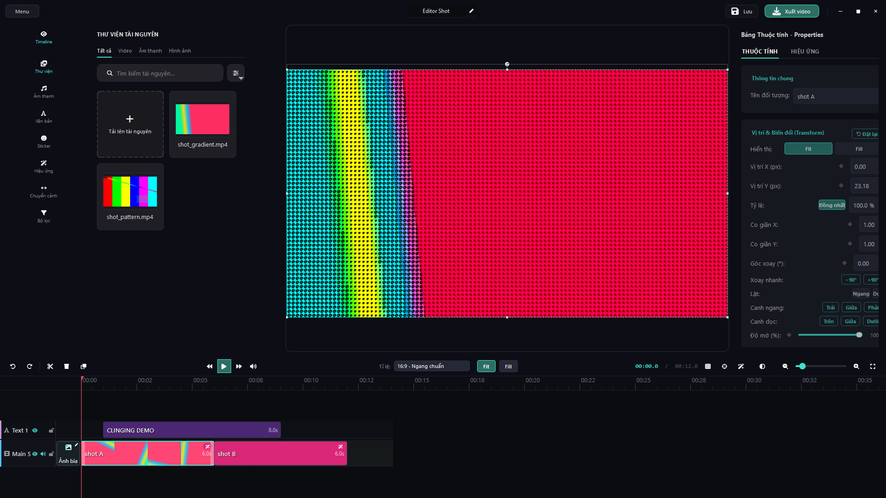
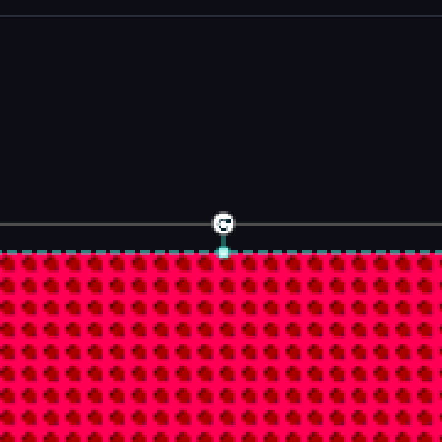

# Clinging 1.0.7

Bản cài đặt cho Windows 10/11 64-bit, chạy per-user (không cần quyền Admin, không
ghi vào `Program Files`). Ứng dụng dựng bằng PyInstaller onedir; toàn bộ runtime
gồm PySide6, OpenCV và ffmpeg nằm bên trong bundle.

## File tải về

| File | Kích thước | SHA-256 |
| --- | --- | --- |
| `ClingingSetup-1.0.7.exe` | 144.656.273 B | `4dcbb815c8e1799215f00ccf23e3603e5d99fbfb3f05580f3c0d26f3db0b9a1c` |
| `ClingingSetup-1.0.7.msi` | 164.241.901 B | `1d8d3158ddd4f81abd40fae017dddc6009d37433bf917758beacfd52f72f82de` |

Kiểm tra sau khi tải:

```bat
certutil -hashfile ClingingSetup-1.0.7.exe SHA256
```

Hai file là **hai cách đóng gói của cùng một ứng dụng**. Chọn một:

- `.exe` (Inno Setup) — có wizard, ghi mục Add/Remove Programs, tự xoá `_internal`
  cũ khi nâng cấp. Cài vào `%LOCALAPPDATA%\Programs\Clinging`.
- `.msi` (WiX 3.11) — triển khai hàng loạt bằng `msiexec /i ... /qn`. MSI per-user
  nên **không** tạo mục Add/Remove Programs; gỡ bằng `msiexec /x {ProductCode}`.
  `INSTALLFOLDER` mặc định của package **trùng thư mục của bản Inno**, nên muốn hai
  bản cùng tồn tại thì phải gọi rõ:
  `msiexec /i ClingingSetup-1.0.7.msi INSTALLFOLDER="%LOCALAPPDATA%\Programs\ClingingMSI" /qn`.

## Thay đổi so với 1.0.6

Hai thay đổi sản phẩm và một lần đo lại. Không thêm tính năng mới, không đổi model,
không đổi format `.clinq`. Selftest vẫn **44 dòng** — số dòng không đổi vì cổng mới
đi vào chi tiết của hai dòng đã tồn tại.

### 1. Sửa lỗi đóng cửa sổ treo vô hạn (hành vi)

Trước bản này, khi đóng cửa sổ editor, `ClipItem.shutdown_extraction()` gọi

```python
if not thread.wait(5000):
    thread.wait()          # <- lan THU HAI khong co tran
```

`thread.wait()` không trần chỉ về khi luồng giải mã kết thúc. Một lần
`cv2.VideoCapture.read()` kẹt trên HDD quay chậm khiến luồng đó không bao giờ kết
thúc, và cửa sổ **không bao giờ đóng được** — app treo đúng ở thao tác tắt, không
một dòng thông báo.

Bản này đặt trần **theo từng clip** (`EXTRACTION_SHUTDOWN_MS = 8000`) và nếu luồng
vẫn không hợp tác thì **detach** nó: giữ quyền sở hữu bằng tham chiếu để Qt không
hủy một `QThread` đang chạy, rồi để worker tự kết thúc sau khung hình đang giải mã.

Hai lựa chọn bị loại vì đã đo:

- `QThread.terminate()` — cắt một luồng đang chạy bytecode Python để lại GIL và
  `cv2.VideoCapture` ở trạng thái không xác định.
- Một hạn chung cho **cả lượt** dừng luồng — sẽ cắt ngang hàng loạt clip còn đang
  giải mã đúng lúc thoát, tức là mở lại cái abort `0xC0000409` mà 1.0.6 vừa khắc phục
  (đo 4/4 lần trên `--project-report`).

Chi phí thật của phép dựng, đo trên một dải hình 4K 12 s tự sinh (fixture do probe
tạo bằng `tools\ffmpeg\ffmpeg.exe`, `ffprobe` kiểm là **1 keyframe / 360 khung hình**
để phép thử không xanh vì input quá nhẹ): lượt `--project-report` byte nguyên
**19,6 s, rc=0**, so với **11,5–16,2 s** khi cố tình cắt đường detach — lúc đó tiến
trình chết bằng `rc=3221226505`. Worker nghỉ ngay sau khung hình đang giải mã, không
phải sau cả dải, nên phần thêm là vài giây lúc đóng cửa sổ.

Không một video nào của người dùng được dùng làm vật thử; probe chốt bằng byte-hash
các `.clinq` trong `%USERPROFILE%\Clinging_Projects` và `recent_projects.json`
(`du_lieu_nguoi_dung_khong_doi PASS 0 file lech byte`).

### 2. Tay nắm xoay trên canvas vẽ bằng icon xoay (chỉ thay hình)

Tay nắm xoay tự do ở cạnh trên của khung hình giờ là glyph `fa6s.arrow-rotate-right`
trong đĩa `ROTATE_HANDLE_R = 9,5`, thay cho dấu chấm nhỏ. **Không đổi model, không
đổi persistence, không thêm hàng nút** — hình dạng duy nhất thay đổi.

Cổng đo bằng pixel: cửa "đếm pixel tối trong đĩa" của `--transform-report`
(`diagnostics.rotate_glyph_pixel_count`, ngưỡng ≥ 40) đo **3119 px** trên khung hình
thật — chống lại lớp lỗi "glyph rỗng vẫn xanh" mà `isNull()` không bắt được.

Ảnh chứng minh (chụp THẬT toàn màn hình 1920×1080 của cửa sổ editor đang chạy, do
`scratch/rotate_knob_evidence.py` sinh ra từ code path sản xuất):




### 3. Cửa sổ console đen chớp tắt: đã đo lại, không có gì để sửa

`scratch/console_window_probe.py` đếm cửa sổ bằng `EnumWindows` +
`GetClassNameW == "ConsoleWindowClass"` (không khớp theo tiêu đề), ghi tập cửa sổ
console TRƯỚC và SAU nên chỉ đếm cái do app sinh ra: **22 cửa, rc=0, 0 cửa console
mới trên 7 lần sinh tiến trình con thật**, và `ffprobe.exe` có mặt trong danh sách
(gate chống "vòng lặp rỗng"). Chế độ `--frozen` chạy **exe đã cài** cũng trả
`consoles=[]`. Phản chứng `--phan-chung` (8 cửa, file JSON riêng): bỏ patch của
`main` rồi spawn `ffmpeg -version` thì **mở ra một cửa `ConsoleWindowClass` mới**.

Kết luận: bản phát hành `Clinging.exe` (dựng với `console=False`) không tự mở console.
Cửa sổ đen còn thấy là **console của interpreter** khi chạy `python main.py`.

## Cách kiểm chứng

Bốn bước như mọi thay đổi khác trong repo (xem `docs/verification-gates.md`):

| Cổng | Kết quả |
| --- | --- |
| `python main.py --selftest` trên tree nguồn | **44 dòng, `failed=[]`, `only=null`, rc=0**; dòng `dong cua so` đo bốn điều, chi tiết `thread khong hop tac bi cat o 8006 ms (tran 8000 ms) va van con song` |
| `python main.py --selftest --only="dong cua so"` | xanh đơn dòng, 18,8–19,2 s |
| `python main.py --project-report` (fixture 4K tự sinh) | `rc=0` trong **19,6 s**, `mo_duoc=True`, `o_editor=True` |
| `python main.py --transform-report` | **17 cửa, rc=0**, gồm cửa pixel của glyph tay nắm |
| `python scratch/teardown_workers_counterfactual.py` | **ALL PASS 23/23, rc=0**, 5 vet trên 3 oracle, 7,1 phút |
| `python scratch/transform_counterfactual.py` | 19 vet, hai oracle (selftest + report) |
| `pythonw scratch/console_window_probe.py` (+ `--phan-chung`) | 22 cửa / 8 cửa, rc=0, hai file JSON riêng |
| `python scratch/needle_canary.py` | **ALL CLEAN 17/19** — mọi byte mẫu của probe phản chứng còn nguyên |

Cổng trên **exe đóng gói** `dist\Clinging\Clinging.exe` (PE `1.0.7.0`,
7.164.518 B, sha256[:16] `dde9fcbe5eb9b39b`) — đọc mã thoát bằng `subprocess.run`,
không qua đường ống:

| Lệnh trên bundle | rc | thời gian | Số đo trong payload |
| --- | --- | --- | --- |
| `--selftest` | 0 | 69,2 s — **44 dòng**, `failed=[]`, `only=null`; dòng `dong cua so` ghi `thread khong hop tac bi cat o 8003 ms (tran 8000 ms)`, dòng `bien doi` ghi `glyph tay nam xoay 3119 px toi` |
| `--project-report` | 0 | 10,3 s — `mo_duoc=True`, `o_editor=True`, `khoi_dong_tu_home=True`, `clip = 3/3 khop`, đóng cửa sạch |
| `--split-report` | 0 | 9,0 s — `frozen=True`, `menu_actions` ba hành động, 3 đoạn `failed=[]` |
| `--transform-report` | 0 | 3,1 s — 17 cửa, `failed=[]` |
| `--sfx-report` | 0 | 10,5 s — 23 cửa, `failed=[]` |
| `--canvas-layout-report` | 0 | 15,2 s — 36 cửa, `failed=[]` |
| `--library-report` | 0 | 10,1 s — 13 cửa, `failed=[]` |
| `--style-report` | 0 | 19,3 s — `ok=True`, 14 cửa |
| `--startup-report` | 0 | 3,1 s — `ok=True`, **11/11 cửa**, cửa sổ hiện lúc **0,4913 s**, **69.152 KiB** |
| `--audio-report` | 0 | 4,7 s — `card_visible=True`, 4 slider, 2 export token |
| `python scratch/frozen_bundle_probe.py` | 0 | **ALL PASS (0 fail)**, 32 cửa; bên trong là `--selftest` **44 checks rc=0** và cửa "bundle co dong selftest dung luong giai ma" |

Hai chuỗi mới **có mặt trong binary người dùng thật chạy**, không chỉ trong tree
nguồn: `frozen_bundle_probe.py` còn chứng minh exe đọc PYZ (ẩn `core/` rồi ẩn `ui/`
của tree nguồn — exe vẫn `exit 0` và chi tiết các dòng **giống hệt baseline từng
byte**).

Metadata và payload của hai file cài:

- `scratch/release_meta.py` đọc từ chính hai file (rc=0): sáu nguồn trong tree đều
  **1.0.7** → `KHOP: tat ca = 1.0.7`; MSI `ProductVersion 1.0.7`,
  `ProductCode {6CED171F-5CD4-4547-A585-0D53BDF3801B}` (mới), `UpgradeCode
  {322A4294-D740-42B3-9414-555BA07FDB88}` giữ nguyên như mọi bản trước; setup.exe
  `FixedFileInfo 1.0.7.0`, `FileVersion 1.0.7`, `ProductVersion 1.0.7`.
- `scratch/msi_payload_check.py`: **ALL PASS, 0 fail** — bảng `File` của MSI đúng
  bằng **385 file / 517.405.660 B** của `dist\Clinging` (1.0.6 là 383 file /
  516.682.602 B; hai file mới chính là hai ảnh `assets/uiux/editor-rotate-knob*`).
  Trong payload có `Clinging.exe`, `ffmpeg.exe`, `ffprobe.exe`, bộ glyph
  fontawesome6 và **không còn** qtawesome.
- **Số phát hành chỉ ba thành phần** (`1.0.7`, không phải `1.0.7.0`): Windows
  Installer không coi số bốn thành phần là bản mới hơn, và
  `release_meta.source_versions()` chặn ngay từ nguồn.

Phản chứng của cổng đóng cửa sổ đỏ vì **đúng** lý do, từng vet một:

| Lỗi cố tình cắm vào | Cổng báo |
| --- | --- |
| Bỏ trần, trở lại `wait()` vô hạn | child treo quá 90 s, bị cắt — không kịp in báo cáo |
| Xóa `detach_running_thread(thread, worker)` | đỏ `co tran: detach khong luu thread (0 -> 0)`; vet này được SPOT trên **bảng tron**: `rc=1 rows=44 failed=['dong cua so: ...']` |
| Xóa luôn lệnh `wait` | đỏ `co tran: shutdown quay ve sau 0 ms, tran la 8000 ms` — tức "về ngay" không được tính là an toàn |
| Xóa `closeEvent` / để vòng lặp không dừng ai | `rc=3221226505` ở **cả hai lượt** trên `--project-report` |

### Bản cài trên máy, và một cổng vẫn đỏ không xác định

Cây Inno `%LOCALAPPDATA%\Programs\Clinging` giờ là **1.0.7**: `Clinging.exe`
7.164.518 B, sha256[:16] `dde9fcbe5eb9b39b` **trùng từng byte** với
`dist\Clinging\Clinging.exe`; set-diff lá-file so với `dist` là **387 = 385 +
`unins000.*`**, 0 thiếu và 0 lá lạ.

`scratch/installed_app_probe.py` trên bản cài này: **171 PASS / 1 FAIL**. Cổng đỏ
là `project THAT exit 0` khi mở dự án THẬT hai clip 4K (~110 s/clip) bằng
`Clinging.exe --project-report` — `returncode=3221226505` tức `0xC0000409`, **sau
khi** payload đã ghi xong. Hai cổng đo lại:

- `scratch/installed_abort_repeat.py` (ba lượt, cùng lệnh, cùng dự án):
  **1 abort / 2 `rc=0`**, 130,7–166,9 s; cả ba lượt `mo_duoc=True`,
  `o_editor=True`, `clip=2` và file `.clinq` **+ `recent_projects.json` trả về
  nguyên byte (0 mục bị chạm)**.
- `scratch/teardown_detach_heavy_probe.py` loại giả thuyết "cứ thread bị detach là
  nổ": trần `EXTRACTION_SHUTDOWN_MS = 1` (mọi worker đều bị detach ngay tức khắc)
  trên project nhẹ vẫn **`rc=0`** (13,1 s so với 12,4 s ở trần 8000 ms), và project 4K
  **hai clip tự sinh** vẫn `rc=0` ở cả tree nguồn lẫn exe đã cài (21,2–28,2 s).

Nói cách khác: bản sửa 1.0.7 **hết treo cửa sổ** (không còn `wait()` vô hạn) và
**không phải lỗi tất định** nữa (1.0.5 là 3/3), nhưng trên máy này, với dự án 4K
nặng của người dùng, đóng cửa sổ vẫn còn **1/4 lượt** để lại process chết ở
`0xC0000409` ở bước finalize. Không có dòng `QThread: Destroyed while thread is
still running` trong stderr của exe. Sản phẩm (dự án mở ra, clip, thư viện, ảnh
bằng chứng) đúng trong cả bốn lượt đo; dữ liệu người dùng không bị chạm.

## Ghi chú nâng cấp

- Cài đè trực tiếp từ 1.0.4/1.0.5/1.0.6. Inno xoá `_internal` cũ trước khi giải nén;
  MSI dùng cùng `UpgradeCode` nên lần cài mới gỡ bản cũ trước khi ghi.
- **Định dạng dự án không đổi**: 1.0.7 không thêm khoá nào, nên `.clinq` tạo bởi
  1.0.6 mở và lưu lại được ở 1.0.7 mà không mất dữ liệu.
- Máy cấu hình thấp: bản này không thêm binary, không thêm module nào trên đường
  boot; chi phí duy nhất đo được là vài giây lúc **đóng** cửa sổ khi dự án đang có
  clip 4K dở giải mã (số ở mục 1).
- **Đóng cửa sổ trên dự án 4K rất nặng**: 1.0.7 bỏ hẳn đoạn chờ vô hạn nên cửa sổ
  luôn đóng được, nhưng trên máy phát hành vẫn còn **1/4 lượt** process kết thúc ở
  `0xC0000409` ngay bước dọn dẹp cuối (`installed_abort_repeat.py`, số đo ở mục
  "Bản cài trên máy"). Nó xảy ra **sau khi** dự án đã lưu và đã ghi báo cáo, nên
  bài dựng, `.clinq` và ảnh xuất không bị ảnh hưởng; nếu thấy thông báo của Windows
  khi vừa đóng app, cứ mở lại bình thường.
- Build từ mã nguồn cần tự đặt `tools\ffmpeg\ffmpeg.exe` + `ffprobe.exe` (~205 MB,
  vượt giới hạn 100 MB/file của GitHub). **Bản cài đặt đã kèm sẵn cặp này.**
- Tài liệu quy trình kiểm chứng: `docs/verification-gates.md`, `docs/glyph-icons.md`.
