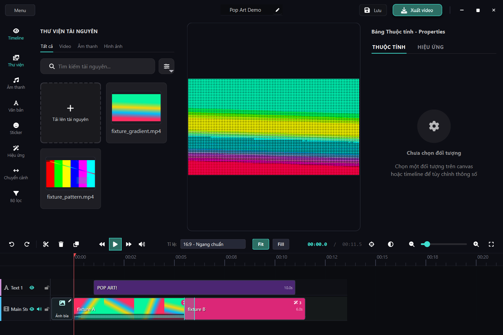
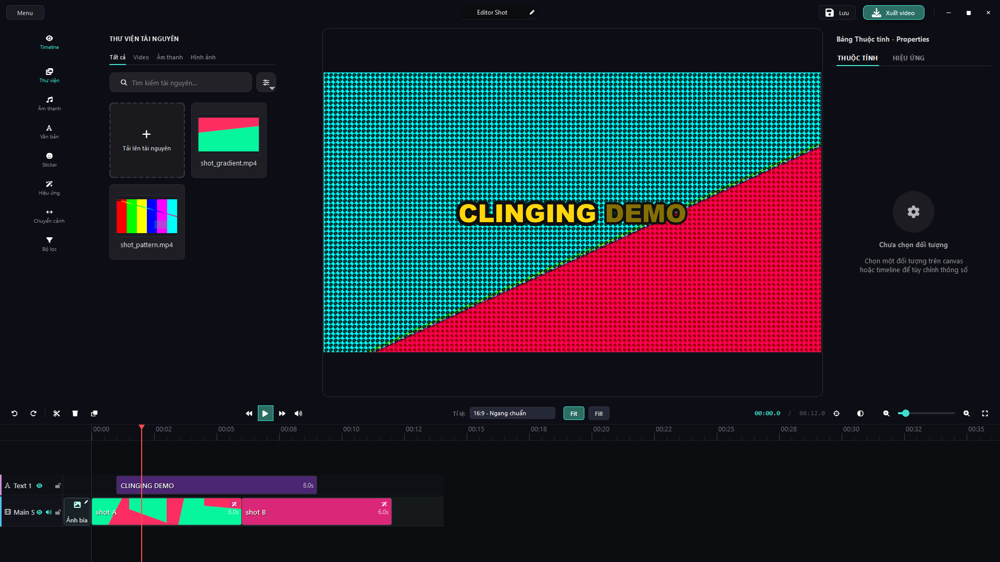
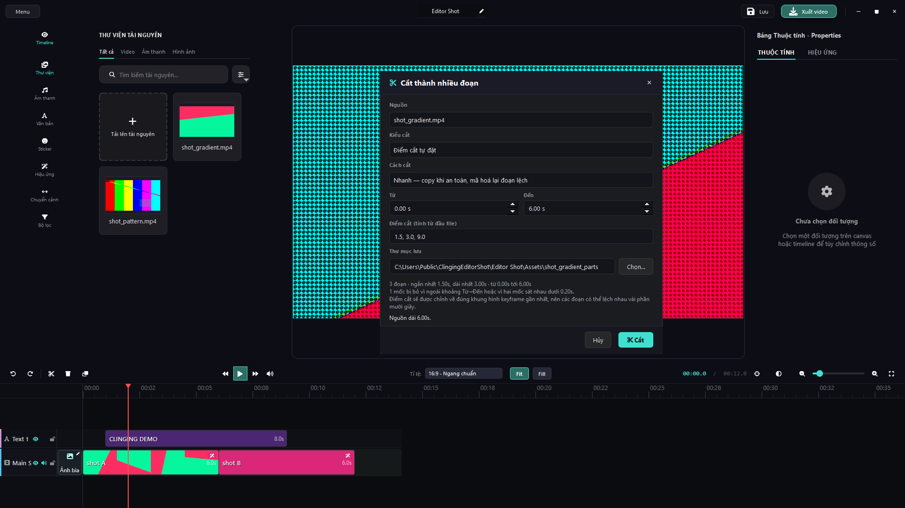
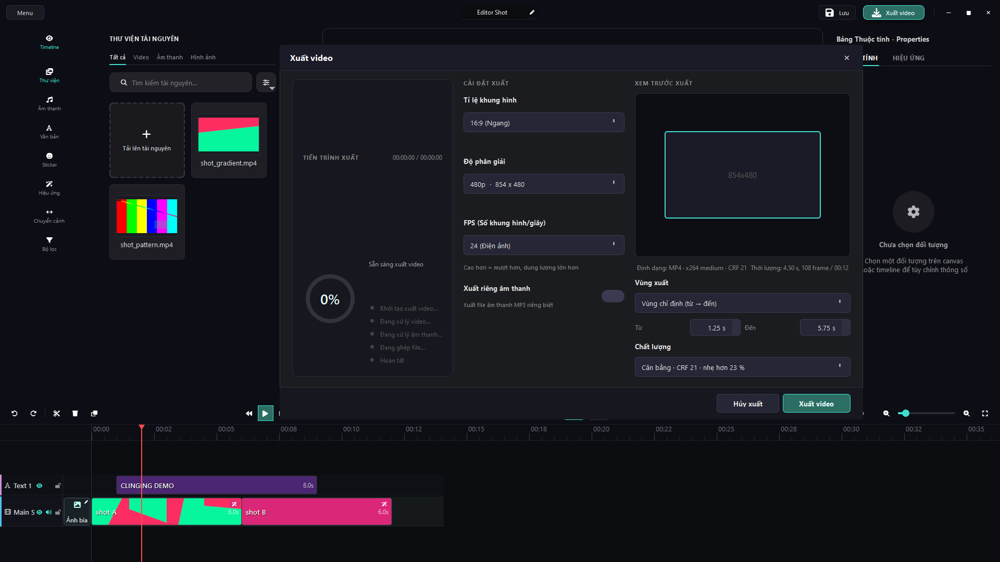
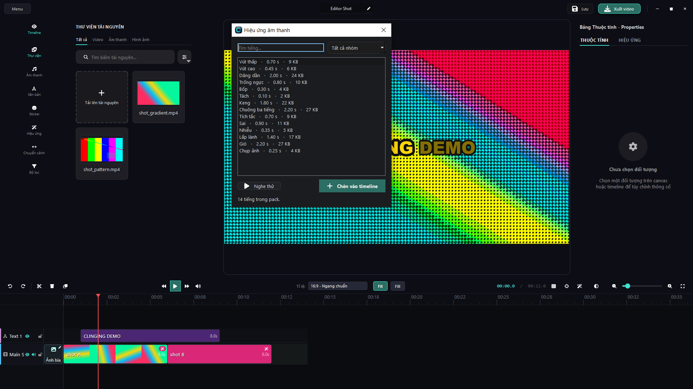
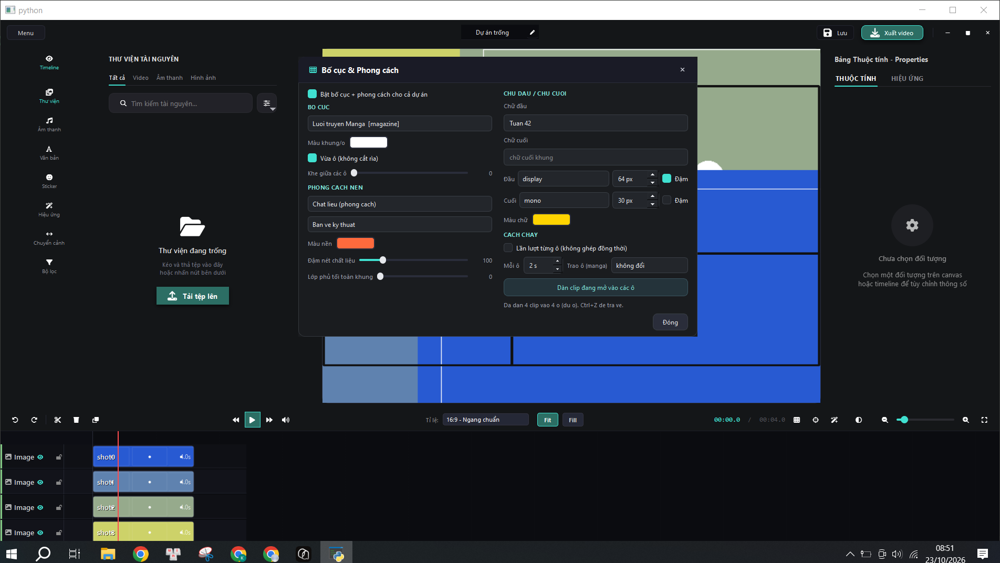

# Quy trình kiểm chứng của repo này

Tài liệu này định nghĩa thế nào là "xong" cho một thay đổi ở Clinging. Nó không
phải phong cách, mà là điều kiện: một sửa đổi không qua bốn bước dưới đây thì
chưa được tính là đã làm, kể khi code chạy đúng trên máy người viết.

Lý do: mọi gate trong repo này đều đã có ít nhất một lần xanh vì lý do sai
(ví dụ thật ở mục "Thất bại đã ghi").

---

## Bốn yêu cầu

### 1. Gate chạy trên ĐÚNG đường production

Gate phải gọi chính lệnh mà người dùng / installer gọi, không phải một bản mô
phỏng. Một test tự dựng đầu vào theo cách riêng của nó thì chỉ chứng minh test
đó chạy được.

- `python main.py --selftest` → `diagnostics.run_selftest()` dùng đúng
  `QApplication` mà exe tạo ra; báo cáo JSON ghi `exe`, `frozen`, `python` và
  `failed: [...]`.
- `python main.py --startup-report`, `--layout-report`, `--alignment-report`,
  `--graph-report`, `--project-report`, `--style-report`, `--import-report`,
  `--thumbnail-report`, `--split-report`, `--audio-report`, `--chrome-report`
  đều là cờ của `main.py` (xem `main.py:156-224`), tức cùng một code path với
  app thật.
- Bundle đã dựng thì đo bằng `dist\Clinging\Clinging.exe --selftest`; máy đã cài
  thì đo bằng `installed_app_probe.py` trỏ vào `%LOCALAPPDATA%\Programs\Clinging`.

**Bộ lọc dòng `--only=` (chỉ cho người phát triển).** `python main.py --selftest
<json> --only=<chuoi>` chạy đúng `run_selftest()` đó nhưng chỉ gọi những hàm có
tên chứa chuỗi lọc (lặp qua `sys.modules`, không đổi code path). Số đã đo trên
máy này 22/10/2026:

| Lệnh | Thời gian |
| --- | --- |
| `main.py --selftest` (đủ 39 dòng) | 48,8 s (38 dòng: ~31,1 s) |
| `main.py --selftest --only="chinh mau"` (1 dòng) | ~5,0 s (~6,2× nhanh hơn) |
| `main.py --selftest --only="vung xuat"` (1 dòng) | 11,4 s |

Quy tắc: **một lần chạy lọc không bao giờ được báo cáo là "39 dòng xanh"**. Báo
cáo JSON có sẵn bằng chứng — khóa `"only"` là `null` khi chạy đủ bảng, là danh
sách token khi chạy lọc — nên mọi consumer phải kiểm `payload["only"] is None`
trước khi tuyên bố cả bảng. Bản thân bộ lọc có gate riêng
(`scratch/selftest_filter_counterfactual.py`, 10 cửa, trong đó cửa
`loc_khong_trach_gi_do` đòi dòng đỏ `bo loc --only khong trach duong nao` chứ
không im lặng trả bảng rỗng — đúng cái bẫy "xanh vì đầu vào rỗng"). Cờ này là
dụng cụ phát triển: không có `--only` thì `run_selftest()` chạy đúng như trước,
nên hành vi app và kết quả `--selftest` trên bản đóng gói không đổi.

### 2. Phản chứng (counterfactual): gate phải ĐỎ vì ĐÚNG lý do

Mỗi gate phải có một phép thử cho thấy nó còn khả năng chết. Xanh vì đầu vào
rỗng là xanh giả.

Nam dang phan chung dang dung trong `scratch/`:

| Dạng | Cách làm | Ví dụ đã chạy |
| --- | --- | --- |
| Đổi một hằng số đầu vào | Chép script, `str.replace` đúng một dòng, chạy bản chép như chạy bản thật | `scratch/gate_discrimination_probe.py` phần 1: thêm gốc `"theme"` (là FILE, không phải thư mục) vào `DIR_ROOTS` → audit phải rc=1 và nói "khong co file .py nao" |
| Cắm một file nguồn THẬT | Viết `ui/_gate_probe_bad_icon.py` chứa tên glyph không tồn tại, đòi chính audit gốc báo đỏ, rồi xóa và đòi xanh lại | `gate_discrimination_probe.py:94-107` — kiểm luôn rằng gate không để lại rác |
| Xóa vật lý một file | `shutil.copytree` rồi `os.remove` một lá, đo bằng hàm đếm thật | `msi_install_probe.count_files()` trên cây 5 file cắt còn 4 |
| Chèn lại dòng đã xóa | exec một module bản "trước sửa", so đầu ra với bản hiện tại | SHA-256 trên byte RGBA của 1402 glyph × 16/24/32 px phải bằng nhau khi xóa một dòng `import` thừa |

Số ngưỡng không được tự tay nhập: `check("cay MSI giai DUNG SO file cua bundle
trong dist", n == dist_n, ...)` so cây đã cài với `dist\Clinging` đang có, chứ
không so với một con số nhớ từ lần build trước. Ngưỡng dưới (`dist_n >= 300`)
chặn trường hợp "xanh rỗng" `0 == 0`.

**Dạng thứ năm — đổi byte một chỗ trong file nguồn THẬT** (mười probe trong
`scratch/*_counterfactual.py`). Khuôn đã chốt sau khi có `--only`:

1. Baseline chạy **đủ bảng** và phải xanh; `nfull = len(checks)` lấy từ chính lần
   đó, không nhập tay 38.
2. Từng phép đổi byte chạy **lọc** (`--only=<dong do>`), đòi hai điều: payload
   phải thực sự là lần chạy lọc (`only == [dong]`, `len(checks) == 1`) và `detail`
   của dòng đó chứa **đúng lý do của phép đó**. Probe nào bỏ qua điều đầu tiên sẽ
   tố cáo một bộ lọc nói dối thay vì một cổng đỏ.
3. Phép ĐẦU TIÊN chạy lại trên **đủ bảng** (SPOT, một lần thay vì N lần): đòi
   `failed == [dong do]` — giữ lại tính chất "đỏ một mình, không kéo theo dòng
   khác" mà N lần chạy lọc không thể nói.
4. Khôi phục byte, chạy đủ bảng lần cuối, phải xanh với `len(checks) == nfull`
   và `only is None`; byte nguồn phải bằng nguyên ban (so `sha256[:16]` trước/sau).

**Canary đầu mối que (`scratch/needle_canary.py`).** Probe phản chứng không chạy
được là probe **im lặng**: nó import `MUTATIONS`, đếm số lần mỗi mẫu byte xuất
hiện trong file nguồn thật, và báo `LECH` khi con số khác chính con số probe đòi.
Chạy nó TRƯỚC khi phán một cổng "xanh" — nó không đổi byte nào, 0,6 s cho 12 probe.
Hai nguyên nhân lệch đã gặp: tính năng mới chèn dòng vào giữa mẫu cũ, và **file
nguồn bị đổi sang CRLF** (mẫu nối bằng LF thành 0 lần khớp) — `git checkout -- <file>`
với `core.autocrlf=true` gây ra nguyên nhân thứ hai này mà `git status` không báo gì; chữa bằng
`data.replace(b'\r\n', b'\n')` rồi đòi byte bằng `git show HEAD:<file>`.

### 3. Render thì cần ẢNH, và ảnh phải được mở ra xem

Log và dòng PASS không chứng minh một pixel nào. Bộ dựng ảnh phải đi từ đúng code
path sản xuất (`QPixmap.grab()` của widget thật, frame xuất bằng pipeline export
thật), lưu vào `scratch/*.png`, và người kiểm phải đọc lại ảnh đó — kể cả khi nó
do chính script vừa in ra.

Ảnh đang có: `scratch/icon_parity.png` (ta vs qtawesome), `scratch/fonticon_*.png`
(9 bản UI), `scratch/desktop_icon_probe.png`, `scratch/aura_evidence_sheet.png`,
`scratch/karaoke_ui_evidence.png`, `scratch/transition_ui_evidence.png`,
`scratch/save_atomic_evidence.png`, `scratch/media_locator_evidence.png`.

**Nhưng `scratch/*` bị `.gitignore` (giữ lại mỗi `*.py`), nên ảnh nằm ở đó chỉ
người dùng máy này xem được.** Ảnh nào tài liệu cần dẫn cho người đọc repo /
Release thì phải copy sang `assets/uiux/` — bằng chứng đã commit:
`assets/uiux/pop-art-project.png` (cửa sổ app đã cài mở dự án Pop Art),
`assets/uiux/editor-project-window.png`, `assets/uiux/editor-split-dialog.png`,
`assets/uiux/editor-export-dialog.png` (ba bức sau là ảnh chụp THẬT toàn màn
hình 1920×1080 của cửa sổ editor đang chạy, do `scratch/editor_screen_shots.py`
sinh ra ngày 22/10/2026). Bảng chứng minh nhiều panel do probe ghép (nền tối,
panel A/B/C/G...) KHÔNG commit: người đọc repo cần thấy sản phẩm, không cần thấy
bảng số của người dựng — số đó vẫn nằm trong text và trong `scratch/`. Đường
`scratch/...` vẫn được ghi cạnh để biết ảnh do script nào sinh ra.

Bẫy đã trả giá (xem `~/.qoder/memory`): ảnh DPR > 1 phải blit vào QRect theo device
size, không `drawPixmap(x, y, pm)` trên QImage DPR-1 (co còn 80%, ăn cả dấu trừ);
không grab sau `hide()+show()`; `QT_QPA_PLATFORM=offscreen` trên máy này không có
font nào, chữ luôn là tofu — chỉ được phán bố cục, không phán chữ.

### 4. Đọc rc CỦA CHÍNH công cụ

`rc` qua đường ống, `rc` của bash, và `rc` của wrapper đều có thể nói dối.

- Python thoát bằng fastfail (`0xC0000409` = Qt callback mang exception qua Bien
  C++, hoặc teardown để window sống) thì Git Bash báo **127** trong khi mọi gate
  trong stdout đã in `ALL PASS`.
- Đọc mã thật: `python scratch/…` rồi in `subprocess.run(...).returncode`, hoặc
  dùng `python .qoder/skills/gate-counterfactual-evidence/scripts/true_rc.py <lenh>`
  (in cả thập phân lẫn hex).
- `ISCC` và wrapper build nền trả rc=0 cả khi không ghi ra file nào; phải đọc lại
  đích (`exe_version.py`, set-diff đường dẫn tương đối so với `dist`, sha256[:16]
  của `<App>.exe`).
- **Không tự gõ lại tên dòng.** `python main.py --selftest | grep "chinh mau"`
  chỉ chạy được `grep` — pipe nuốt rc của app. Muốn đọc từng dòng thì import
  `diagnostics`, lấy đúng tuple `(tên, hàm)` từ `run_selftest`, rồi spawn
  `--selftest <json> --only=<tên lấy từ bảng>` (script một lần đã dùng cách này
  để đo 31,1 s và 5,0 s ở mục 1; đừng biến nó thành gate thường trực).

---

## Chạy toàn bộ cổng, theo thứ tự

```bash
# 0) Snapshot dữ liệu người dùng TRƯỚC khi động vào app
python scratch/user_data_snapshot.py capture scratch/_snap_before.json

# 1) Audit tên icon + tham số color= trên toàn bộ nguồn
python scratch/icon_name_audit.py

# 2) Selftest 44 dòng trên tree nguồn (bundle 1.0.6 cung 44; bundle 1.0.5 dong o 39 dong)
python main.py --selftest

# 2b) Cùng gate nhưng chỉ một dòng (dev tool, ~5-12 s thay vi ~49 s). KHONG bao gio
#     duoc báo cáo là "44 dòng xanh"; payload trả về có khóa "only" để kiểm chứng.
python main.py --selftest t.json --only="chinh mau"

# 3) Đo khởi động (bao gồm control cùng lần, xem mục dưới đây)
python main.py --startup-report

# 4) Phản chứng của các cổng đã sửa gần đây (34 check)
python scratch/gate_discrimination_probe.py

# 4b) Phản chứng riêng cho ba check "cái gì KHÔNG được nạp lúc boot"
#     (trang dung phim / psutil / hop thoai nen — xem nhom I duoi day)
python scratch/boot_laziness_counterfactual.py

# 4c) Độ trễ NGƯỜI DUNG thấy (Popen -> cửa sổ hiện) + tham do UI thread
python scratch/wall_to_window_probe.py --runs 3
python scratch/wall_to_window_probe.py --selfcheck   # do luong phan biet duoc UI bi chan

# 4d) Phản chứng + ảnh cho năm cổng "luu du an", "media lac cho", "undo chu + hinh hoc",
#     "clipboard Ctrl+C/V", "style chu" (vien/bong/hop nen/can le)
#     (moi probe do byte trong nguon that, chay --selftest lai sau moi phien ban
#     CU, va KHOI PHUC byte trong finally -> lan cuoi phai ra ALL PASS rc=0)
python scratch/save_atomic_counterfactual.py
python scratch/media_locator_counterfactual.py
python scratch/undo_text_transform_counterfactual.py
python scratch/clipboard_counterfactual.py
python scratch/text_styling_counterfactual.py   # -> 6/6 do dung ly do, 120,3 s (khuon loc + SPOT)
python scratch/save_atomic_evidence.py       # -> scratch/save_atomic_evidence.png
python scratch/media_locator_evidence.py     # -> scratch/media_locator_evidence.png
python scratch/undo_text_transform_evidence.py  # -> %TEMP%\clinging_undo_evidence.png
python scratch/clipboard_evidence.py            # -> %TEMP%\clinging_clipboard_evidence.png
python scratch/text_styling_evidence.py         # -> %TEMP%\clinging_text_styling_evidence.png

# 4e) Bộ chỉnh màu (hue / lift-gamma-gain / LUT .cube): 8 cua tren MainWindow that,
#     13 phep phan chung, va anh render tu FrameComposer
python scratch/color_grading_ui_probe.py        # -> ALL PASS 8 cua, khong de lai media
python scratch/color_grading_counterfactual.py  # -> 13/13 do dung ly do, byte ve nguyen ban
                                                # -> 133,6 s (khuon loc + 1 SPOT du bang)
python scratch/color_grading_evidence.py        # -> scratch/color_grading_evidence.png
                                                # -> scratch/color_grading_card_evidence.png

# 4f) Du an Pop Art: gate do TREN FILE mp4 da xuat + 6 phep phan chung (moi phep
#     chay CA HAI gate: --selftest 36 dong va gate file)
python scratch/popart_project_build.py              # -> ALL PASS, ~5 ban render 720p
CLINGING_POPART_REUSE=1 python scratch/popart_project_build.py  # do lai khong xuat lai
python scratch/popart_project_counterfactual.py     # -> 6/6 do dung ly do, byte ve nguyen ban
                                                    # -> scratch/popart_project_counterfactual.png

# 4g) Anh chung minh cua so THAT (ban da cai mo du an Pop Art): PrintWindow ->
#     assets/uiux/pop-art-project.png, 6 cua + 3 phep phan chung tren anh
python scratch/popart_window_shot.py                # -> ALL PASS, mo anh ra XEM
python scratch/popart_window_shot.py --selfcheck    # duong dan exe sai -> rc=1
python scratch/popart_window_shot.py --pixels       # khung den DO, anh that XANH,
                                                    # boi preview DO vi mat noi dung

# 4h) Chroma key (duc nen theo goc hue + despill + matte ha do phan giai):
#     19 phep doi byte tren 4 file nguon, moi phep do DUNG mot dong cua no
python scratch/chroma_key_counterfactual.py       # -> 19/19 do, byte ve nguyen ban
                                                  # -> 147,9 s (khuon loc + 1 SPOT du bang)
python scratch/chroma_key_evidence.py             # -> 54 OK / 0 FAIL
                                                  # -> scratch/chroma_key_evidence.png
                                                  # -> scratch/chroma_key_card_evidence.png
python scratch/chroma_cost_probe.py               # -> 16 OK / 0 FAIL: chi phi/frame
                                                  # qua composer that, do xen ke 1 vong

# 4i) Tach am thanh (clip video -> clip audio cung nguon, cung noi dung, tat tieng
#     video): 10 phep doi byte tren 4 file nguon + anh TimelineScene that + wav do RMS
python scratch/detach_audio_counterfactual.py     # -> 10/10 do dung ly do, byte ve nguyen ban
                                                  # -> 87,5 s (khuon loc + 1 SPOT du bang)
python scratch/detach_audio_evidence.py           # -> 14/14 phep do PASS
                                                  # -> scratch/detach_audio_evidence.png
                                                  # -> scratch/detach_audio_evidence.json

# 4j) The Cat in/out (bang thuoc tinh ben phai): hinh hoc giao hoan toan cho
#     resize_clip, mot spin = mot buoc undo, do ca preview lan export
python scratch/trim_counterfactual.py             # -> 12/12 do dung ly do, byte ve nguyen ban
                                                  # -> 136,6 s (khuon loc + 1 SPOT du bang)
python scratch/trim_evidence.py                   # -> 23/23 phep do PASS
                                                  # -> scratch/trim_evidence.png
                                                  # -> scratch/trim_evidence.json

# 4k) Nen / toi uu tep video (cong thuc port tu compressO, chi dung ffmpeg cua
#     bundle): remux that su day moov len dau, codec khop container o CA HAI chieu
python scratch/compress_counterfactual.py         # -> 17/17 do dung ly do, byte ve nguyen ban
                                                  # -> 183,7 s (truoc khi co --only: 377,2 s)
python scratch/compress_evidence.py               # -> menu video/audio phan biet, 3 grab day pixel
                                                  # -> scratch/_compress_ev_evidence.png
python scratch/compress_cost_probe.py             # -> bang chi phi preset/codec do xen ke 1 vong

# 4l) Kieu cat moc thu cong + doi dai co dinh (nhom J, 2026-10-22): so hoc
#     nam het trong core/media_splitter.py, gate do tren FILE cat ra dia
python scratch/split_plan_counterfactual.py       # -> 14/14 do dung ly do, ~2,2 phut
                                                  #    (khuon loc --only + 1 SPOT du 38 dong)
python scratch/media_split_probe.py               # -> 167 cua PASS, 78,6 s; anh 3 kieu
                                                  #    cat + hop thoai moc KHONG phai cuon
python scratch/split_gate_counterfactual.py       # -> 26/26, 0,5 s (thang do --split-report)

# 4m) Vung xuat in/out + preset chat luong (nhom K, 2026-10-22): mot seam
#     core/export_range.py cho ca nhan lan lenh ffmpeg, va -shortest bi nhac ra
python scratch/export_range_counterfactual.py     # -> 18/18 do dung ly do, 178,0 s
                                                  #    (khuon loc --only + 1 SPOT du 39 dong)
python scratch/export_range_evidence.py           # -> 16 cua PASS, 14,7 s; anh 1560x1380
                                                  #    2 che do hop thoai + 24/12 khung hue
python scratch/export_quality_cost_probe.py       # -> 8 cau hinh preset/CRF do xen ke 2 vong

# 4n) Ban dong goi (dist/Clinging/Clinging.exe): gate chay TRONG exe, hai phan
#     chung (lat _internal/styles, an core/ cua tree nguon) + do boot
python scratch/frozen_bundle_probe.py             # -> ALL PASS (0 fail), rc=0
dist/Clinging/Clinging.exe --startup-report scratch/dist_startup.json

# 4o) Chinh bo cai loc --only va dau que cua cac probe phan chung
python scratch/selftest_filter_counterfactual.py  # -> 10/10 cua, 218,8 s; loi "xanh vi
                                                  #     dau vao rong" phai do bang dong tu
python scratch/needle_canary.py                   # -> "ALL CLEAN: n/m probe con nguyen
                                                  #     ven mau", 0,6 s, KHONG doi byte nao

# 4p) Thu vien tai nguyen (nhom L, 2026-10-22): 6 toi uu tren duong nap the,
#     thang do la cua DEM (cua ms bi loi contention cua may lam do)
python main.py --library-report scratch/_lib_report.json   # -> 13 cua, 11,8-13,4 s, rc=0
python scratch/library_counterfactual.py                   # -> 45/45 ALL PASS, 131,3 s
                                                           #    (19 vet theo so do ban chua toi uu + 5 vet byte)

# 4q) The "Bien doi" (nhom N, 2026-10-23): xoay tu do tren canvas, lat ngang/doc,
#     sau nut canh le, mot o "Tỷ lệ %" co khoa "Đồng nhất"
python main.py --transform-report scratch/_tf_report.json  # -> 17 cua do tu pixel xuat, 4,0-4,4 s, rc=0
python scratch/transform_counterfactual.py                 # -> 19/19 do dung ly do, 194 s, rc=0
                                                           #    (hai oracle: dong selftest + --transform-report)

# 4r) "Bố cục & Phong cách" cap du an (nhom O, 2026-10-23): 12 kieu bo cuc,
#     10 chat lieu nen, hai vung chu, chay tuan tu, dan clip vao o
python main.py --canvas-layout-report scratch/_cl_report.json  # -> 36 cua, rc=0
python scratch/canvas_layout_counterfactual.py  # -> 50/50 ALL PASS, rc=0 (~3 phut,
                                                #     4 vet SONG doi byte + 1 lan phuc)
python scratch/canvas_layout_evidence.py        # -> sheet 3 bang + anh CHUP THAT cua so, rc=0
python scratch/boot_laziness_counterfactual.py  # -> 5 cua RED vi dung ly do (them bocuc)

# 4s) Icon xoay tren tay nam frame view + cua so console an (2026-10-23)
python main.py --selftest scratch/_st_transform.json --only="bien doi"
                                                # -> rc=0, 2,4 s, dong nay bao "glyph tay nam xoay 3119 px toi"
python scratch/rotate_knob_evidence.py          # -> anh CHUP THAT toan man hinh 1920x1080 + crop 4x
                                                #    ra assets/uiux/editor-rotate-knob{,-detail}.png, rc=0
python scratch/rotate_knob_evidence.py --pixels # -> 6 vet tren anh da luu (xoa region / anh bo chon / lech tam), rc=0
pythonw scratch/console_window_probe.py         # -> 22 cua dem: 0 cua so console moi tren duong sinh
                                                #    tien trinh that + lan mo exe da cai, rc=0, 21,7 s, 7 lan spawn
                                                #    -> scratch/console_window_probe.json
pythonw scratch/console_window_probe.py --phan-chung
                                                # -> 8 cua, 19,3 s, 3 lan spawn, rc=0: mot spawn thieu
                                                #    CREATE_NO_WINDOW mo cua ConsoleWindowClass that
                                                #    -> scratch/console_window_probe_cf.json (file RIENG)

# 5) Chụp lại rồi diff: phải ra 0 THEM / 0 MAT / 0 DOI
python scratch/user_data_snapshot.py capture scratch/_snap_after.json
python scratch/user_data_snapshot.py diff scratch/_snap_before.json scratch/_snap_after.json

# 6) Chỉ khi phát hành: metadata PE/MSI đọc từ chính file tải về, và payload
#    MSI đối chiếu từng tên file với dist (KHONG can cai dat)
python scratch/release_meta.py build/installer/ClingingSetup-<ver>.msi \
                               build/installer/ClingingSetup-<ver>.exe
python scratch/msi_payload_check.py
```

Nguồn không được sandbox `APPDATA`: `site-packages` của user trên máy này nằm ở
`%APPDATA%\Python\Python311\site-packages`, nên trỏ `APPDATA` vào thư mục tạm làm
`import cv2` chết lặng — selftest đỏ 4 dòng vì `ModuleNotFoundError`, không phải
vì lỗi sản phẩm. An toàn dữ liệu đo bằng snapshot nội dung (mtime + size + sha256[:16]) quanh bước
đo, không phải bằng cách giấu `APPDATA`. Ngược lại, exe đã cài thì PHẢI
chạy với `APPDATA` chỉ vào bản copy dùng một lần, vì `ui/home_page.py`
`_load_recent_projects()` ghi đè `recent_projects.json` ngay lúc mở app.

Bảng so sánh chi phí khởi động chỉ có giá trị khi control nằm TRONG cùng một lần
chạy (`--startup-report` in `nhe_s` / `nang_s`, trong đó `nang_s` là qtawesome bị
kéo qua đúng seam đó). Wall clock giữa hai lần chạy trên HDD máy này sai do cache,
do import bị hoist, và do layout shift khi icon rỗng.

### Làn boot của trang Home

`--startup-report` có hai check về **thứ không được xuất hiện** lúc cửa sổ hiện:
`boot_khong_keo_trang_dung` (`ui.main_window`) và `boot_khong_psutil`. Lý do đo
bằng module chứ không bằng giây: số giây dao động, còn "module nào thường trú lúc
mở app" thì không.

| Bằng chứng (2026-10-20, tree nguồn) | Số |
| --- | --- |
| `python -X importtime -c "import ui.main_controller"` | `ui.main_window` cumulative **155 ms**, `core` 66 ms, `PySide6.QtMultimedia` 36 ms, `QtNetwork` 16 ms |
| `python scratch/boot_phase_profile.py` (cProfile trên `main._boot`) | `system_stats.psutil_or_none` **102 ms** cum, nằm trong `HomePage()` |
| `--startup-report` 3 lần, median `boot_to_window_s` | **1,645 → 1,204 s** sau khi lazify |
| RAM lúc cửa sổ hiện | **78,4 → 68,4 MB** (−10,0 MB) |
| `boot_laziness_counterfactual.py` | SACH rc=0 / DOC rc=1, hai check lật đúng chiều, `boot_khong_cv2` vẫn True |

Đo lại **2026-10-21** trên tree nguồn, máy không có render nào chạy cạnh tranh
(vì cả hai công cụ đều đọc wall-clock): `scratch/boot_low_spec_probe.py` rc=0, 5
vòng sau 3 lần warmup — baseline **0,658 s** median (min 0,548), working set
**70.780 KiB**, private **40.164 KiB**, 119 widget, **10/10** icon có điểm ảnh,
`qtawesome`/`qtpy`/`QtOpenGL` đều `False`. Chiều tiết kiệm xác định bằng cặp từng
vòng: `force_qtawesome` **1,090 s**, chậm hơn baseline **+0,542 s** median
`[1,013 / 1,132 / 0,384 / 0,388 / 0,542]`, private **+30.540 KiB**. Đồng hồ đặt
NGAY TRONG lần boot nói cùng một chuyện: `import qtawesome` một mình 0,414 s, cả
seam 0,564 s, còn bộ vẽ glyph cục bộ **0,028 s** (nạp font 0,008 + vẽ 0,019 cho 13
lần gọi) → không còn gì để cắt. Chế độ `stub_renderer` (seam trả icon rỗng) vẽ
**0/10** icon và làm bố cục lệch (`geo` khác) — được ghi lại để cấm dùng nó làm
gate, vì tiết kiệm của nó là tiết kiệm giả. `python main.py --startup-report` rc=0,
`ok=True`, 8/8 check: `boot_to_window` **1,038 s**, RAM lúc cửa sổ hiện **68.664
KiB**, lúc nghỉ 1,5 s sau đó **83.420 KiB**, `cv2_da_nap_luc_boot=False`, control
nặng 0,263 s (chứng minh đồng hồ phân biệt được).

Cùng lúc đó `wall_to_window_probe.py` đo từ **bên ngoài** app: trên exe 1.0.2 đã
cài, `Popen() → cửa sổ hiện` là **1,34–1,39 s** (lần đầu tiên sau reinstall 2,26 s)
trong khi đồng hồ trong app chỉ báo 0,84 s — ~0,5 s chênh là bootloader
PyInstaller + LoadLibrary, nằm ngoài mọi `--startup-report`. Probe cũng ghi
`mapped_files`/`cold_read_mb` (46 file, **67,6 MB** DLL-PYD mà một lần mở Home phải
giải phóng) vì hai lý do đã trả giá:

* **Đuổi cache bằng cách đọc file lớn KHÔNG được**: đọc 1.531,9 MB từ chính file
  installer chỉ hết 1,3 s — nó nằm trong RAM, nên phép "proxy cold boot" đó vô
  hiệu; `GetProcessIoCounters` của process cũng trả `ReadTransferCount = 0` cho
  image mapping.
* **`SendMessageTimeout(WM_NULL, SMTO_ABORTIFHUNG)` là đồng hồ trung thực**: cắm
  `time.sleep(3)` vào một slot của cửa sổ thật thì probe đọc ra 2.973 ms một lần
  mẫu duy nhất >1 s — tham số phải chứng minh nó phân biệt được rồi mới được tin.

---

## Cổng "đừng làm mất việc của người dùng" (nhóm A, 2026-10-20)

Bốn dòng selftest mới giữ các lỗi từng làm mất trắng công sức của người dùng,
cộng thêm cổng cho tính năng clipboard clip (Ctrl+C / Ctrl+V).

| Dòng | Hợp đồng | Phản chứng |
| --- | --- | --- |
| `luu du an: ghi hong khong pha ban cu` | `save_project_to_file` serialize ra byte TRƯỚC khi chạm file thật, ghi `.tmp` + `fsync` + `os.replace`, và quay bản cũ vào `~/.clinqing/recovery` (giữ `RECOVERY_KEEP = 5`) | `save_atomic_counterfactual.py`: 4 phép đổi byte (`open(path,"w")` cũ, bỏ rotation, handler lỗi có dấu, bỏ `or "."`) — mỗi phép phải làm ĐỎ đúng một dòng |
| `media lac cho: preview va export cung duong dan` | Một chiều duy nhất `core/media_locator.py`: chỉ đi bộ trong thư mục của chính file + thư mục chứa `.clinq`, chặn `MAX_DEPTH = 4` / `MAX_ENTRIES = 2000`, không bao giờ đụng thư mục hiện hành; định vị MỘT lần lúc mở dự án nên preview và export nhìn cùng một `source_path` | `media_locator_counterfactual.py`: 6 phép đổi byte trên 3 file (`MAX_DEPTH = 9`, `roots = [os.getcwd()]`, resolver rỗng, bỏ resolve ở `restore_model`, cắm lại `os.walk(".")` vào `TimelinePanel._get_media_duration`, bỏ báo `missing`) |
| `undo cho chu + hinh hoc clip` | Mười handler chữ của panel không còn ghi thẳng `clip_model`: mọi sửa chữ đi qua `SetClipTextCommand`, mọi sửa hình học (panel + neo Canvas) đi qua `SetClipTransformCommand` (kéo trên Canvas phải nhận `before=` từ lúc bấm chuột vì item đã ghi model trước). Gõ từng ký tự / kéo từng nấc spin gộp MỘT bước (`merges_with` + `absorb`, cửa sổ `MERGE_WINDOW_S = 0.75`), thao tác khác clip/khác khóa vẫn là một Ctrl+Z riêng. `clipUpdated` được nghe lại để Canvas vẽ lại RIÊNG item (không dựng lại scene, giữ con trỏ gõ chữ) | `undo_text_transform_counterfactual.py`: 2 phép đổi byte — tắt `push` trong `_push_text` (cửa ĐỎ vì "0 buoc, phai la 1"), nới guard khác khóa trong `merges_with` (cửa ĐỎ vì "bold khong thanh mot buoc undo rieng"); mỗi phép xong đều khôi phục byte và chạy xanh lại |
| `clipboard clip Ctrl+C/V` | `ClipClipboard.copy_from` snapshot đúng các clip đang chọn (deepcopy, giữ `offset` tương đối để dán nguyên nhóm không vỡ bố cục); `PasteClipsCommand` clone ra id MỚI, đặt qua `TimelineModel.place_clip` — CÙNG quy tắc va chạm/nhảy-layer và compaction Main Storyline như `duplicate_clip` — tại playhead, và là MỘT bước undo. Nối `Ctrl+C`/`Ctrl+V` qua `_install_editor_shortcuts` (bọc `_invoke_unless_editing`) | `clipboard_counterfactual.py`: 4 phép đổi byte — `PasteClipsCommand.execute` gọi `get_clip` thay `place_clip` (ĐỎ "seam clipboard thieu"), `copy_from` gán `self._entries = []` (ĐỎ "clipboard bao trong"), ép `offset = 0.0` (ĐỎ "le bo cuc tuong doi"), `undo` thành `pass` (ĐỎ "undo hai lan paste khong tra ve"); mỗi phép khôi phục byte rồi chạy xanh lại |

Số đo thật của lần kiểm (tree nguồn, 2026-10-20):

* 7 lần save đè liên tiếp trên cùng một file → recovery giữ đúng 5 bản gần nhất,
  đánh dấu `[m3..m7]`, 0 file `.tmp` sót; lần ghi hỏng (payload `QColor`) để file
  cũ còn nguyên từng byte.
* Ảnh chứng minh `scratch/save_atomic_evidence.png`: ba ô (file đang dùng / bản
  recovery / hiệu đổi ×8) — hai ô đầu bằng nhau khi nội dung không đổi.
* `scratch/media_locator_evidence.png`: ô 1 (file đúng chỗ) và ô 2 (file bị dời
  hai cấp, mở lại `.clinq`) cho payload xuất ra **giống nhau từng byte** (0/230.400
  byte lệch, 320×180 RGBA); ô 3 là mồi cùng tên đặt ngoài thư mục dự án (lệch
  118.992 byte, chứng hai bên phân biệt được thật); ô 4 là file vắng mặt thật —
  không vẽ gì và vẫn giữ đường dẫn cũ.
* Năm chỗ `os.walk(".")` trong `ui/` + `core/` đã bị xoá vật lý; `get_media_dimensions`
  trên đường dẫn đã định vị trả `(8.0, 8.0)` trên ảnh 8×8.
* Ảnh chứng minh `scratch/undo_text_transform_evidence.png` (5 ô dựng bằng
  `FrameComposer`, đúng đường preview + export): ô A chữ nhỏ giữa khung → ô B
  to lên sau `SetClipTextCommand` (7.955 byte RGBA lệch) → ô C sau Ctrl+Z **bằng
  hệt A** (0 byte lệch) → ô D lệch đi sau `SetClipTransformCommand` dời + phóng
  (3.680 byte lệch) → ô E sau Ctrl+Z **bằng hệt A** (0 byte lệch). Hoàn tác không
  chỉ đổi model mà trả lại từng pixel.
* Ảnh chứng minh `scratch/clipboard_evidence.png` (4 ô `FrameComposer`, có một
  clip nền "BG" sống 0..20s để giữ duration, khỏi bị `active_visual_clips_at`
  clamp về cuối): ô A "Clinging" gốc tại t=1s → ô B tại t=10s **chưa** paste (chỉ
  còn nền, mốc trắng) → ô C tại t=10s **sau** Ctrl+V, chữ "Clinging" hiện ra và
  **giống hệt A** (0/230.400 byte lệch — bản dán giữ nguyên font/hình học) → ô D
  tại t=10s sau Ctrl+Z **trở lại đúng ô B** (0 byte so với mốc, 5.025 byte lệch so
  với ô C — undo đã gạch sạch bản dán, không để lại bóng ma).
* Ảnh chứng minh `scratch/text_styling_evidence.png` (8 ô `FrameComposer`, đúng
  đường preview + export, nền đen nên phải tint bóng màu mới thấy): ô 1 chữ trắng
  thường → ô 2 viền đỏ 6px (3.006 byte lệch) → ô 3 bóng xanh lệch 12px (2.544) →
  ô 4 bóng mờ cyan blur 8 (2.208) → ô 5 hộp nền xanh lá 60% (11.033) → ô 6 căn TRÁI
  và ô 7 căn PHẢI **dịch thật** (trai↔phai 1.506 byte lệch) → ô 8 kết hợp viền vàng
  + hộp tím + bóng (6.411). Phản chứng `text_styling_counterfactual.py`: 6 phép đổi
  byte, mỗi phép làm cổng "style chu" đỏ ĐÚNG lý do — tắt composite → "vien ve giong
  chu thuong", export mất styling → "export bo qua style chu hop nen", preview mất
  seam → "seam style chu thieu", đổi khoá lưu → "style chu mat khi quay qua file",
  mất cast float → "text_style_of khong chuan hoa so ve float", ép lề center →
  "can le khong dich vi tri chu"; sau khi khôi phục byte, bảng xanh lại 33/33 rc=0.

Mọi vòng đều khép lại bằng `user_data_snapshot.py diff` ra
`THEM: 0 / MAT: 0 / DOI: 0` trên 1612 file — gate không được quyền chạm dữ liệu thật.

---

## Cổng "chỉnh màu" (nhóm D, 2026-10-21)

| Dòng | Hợp đồng | Phản chứng |
| --- | --- | --- |
| `chinh mau: hue/lift-gamma-gain/LUT .cube` | MỘT `EffectData("Chinh mau")` mỗi clip, năm khoá `{hue_shift, lift, gamma, gain, lut_path}`; `core/clip_effects.apply_color_effects` là seam màu DUY NHẤT mà cả `FrameComposer._draw_media` (export) lẫn `CanvasClipItem.paint → _apply_effects` (preview) gọi, nên hai bên bằng nhau theo cấu trúc chứ không theo lời hứa. Quay hue là xoay quanh trục xám `(1,1,1)` (xám bất biến; `hue_shift = 0` trả về ĐÚNG object cũ để máy cấu hình thấp không phải trả giá cho một phép ma trận vô ích). Lift/gamma/gain đo được TỪNG cái một: lift chỉ nhấc bóng, gamma chỉ bưng midtone, gain nhân tuyến tính từng kenh. `.cube` đọc theo trục nhanh-nhất-là-xanh (reshape `[r,g,b,ch]`), nội suy tam tuyến tính nên một bảng identity phải tái tạo đầu vào trong sai số làm tròn; LUT 1D áp theo từng kenh; cache khoá `(abspath, st_mtime_ns, st_size)`; `load_lut` không bao giờ raise. `GRADING_KEYS` cố ý rời khỏi `PIXEL_KEYS`; `SetGradingCommand` gộp thao tác trong `MERGE_WINDOW_S = 0.75` và tỉa thẻ về `GRADING_IDENTITY` thì xoá hẳn EffectData | `color_grading_counterfactual.py`: 13 phép đổi byte trên 4 file nguồn (`core/clip_effects.py`, `core/lut.py`, `core/commands.py`, `ui/properties_panel.py`) — mỗi phép phải làm ĐỎ đúng một dòng, với lý do riêng |

Số đo thật của lần kiểm (tree nguồn, 2026-10-21):

* `--selftest`: **34 dòng, `failed = []`, rc=0, 21,5 s**. Chi tiết dòng chỉnh màu:
  `xoay truc xam 0.00->26.3 do-luc, lift +61.2 toi/1.2 sang, gamma mid 37.8,
  gain 150.0, LUT identity 0.00 swap 0.00 1D 187.0, 4 nac = 3 buoc undo,
  6 seam nguyen`.
* 13 phép phản chứng đều đỏ ĐÚNG lý do, ví dụ: bỏ `hue_shift` khỏi chuỗi lọc →
  `chuoi loc bo qua hue_shift (do-luc 170.0 -> 170.0)`; đảo ngược mũ gamma →
  `gamma 1.6 khong bentre midtone (-43.4 o do 128)`; biến lift thành brightness
  toàn ảnh → `lift 0.25 cham ca vung sang (+5.0 o do 250)`; cho hue 0 vẫn chạy ma
  trận → `hue 0 do van chay ma tran (ton may cau hinh thap)`; trộn `GRADING_KEYS`
  vào `PIXEL_KEYS` → `GRADING_KEYS trung PIXEL_KEYS: cua the ma mat nghia che do`;
  hoán vị trục bảng LUT → `LUT identity lech 175.3/255`; để LUT 1D được gọi mà
  không áp → `LUT 1D khong duoc ap (do 128 ra 128.0)`; khoá cache chỉ theo đường dẫn
  → `LUT bi thay noi dung van dung ban cu trong cache (con 200.0/255, size khong
  doi = 19697 byte)`; panel ghi thẳng vào clip → `seam chinh mau:
  ClipPropertiesWidget._push_grading thieu SetGradingCommand`; tắt gom nút →
  `keo 4 nac gamma thanh 4 buoc undo (MERGE_WINDOW_S bi vo)`; gom mọi khoá →
  `num khac khoa bi gom chung vao mot buoc undo`; tắt tỉa thẻ → `tha het ve trung
  tinh ma the chinh mau van con (1 the)`. Sau 13 phép: `phuc hoi: dong chinh mau
  XANH lai`, `byte nguon da tra ve nguyen ban (4 file)`, rc=0, 340,3 s.
* **Hai lỗi sản phẩm thật bị gate này bắt được và đã sửa trong `core/lut.py`**:
  `_interp_1d` nhân `(3,1) * (3,1,1)` → `(3,3,1)` nên LUT 1D `.cube` chưa bao giờ
  áp được cho bất kỳ kích thước nào; cache LUT khoá theo `st_mtime` (độ phân giải
  giây) trong khi file `.cube` viết `%.6f` có kích thước không đổi, nên sửa file
  tại chỗ không bao giờ được nạp lại.
* Ảnh `scratch/color_grading_evidence.png` (9 ô `FrameComposer` 320×180, đúng
  đường xuất, mọi bo số đẩy qua `SetGradingCommand`): ô 7 LUT identity lệch ô 1
  **0,16/255** trung bình; ô 8 hoán vị R-B khớp kênh đối phương **0,2** và khác
  kênh cũ **43,4** trên từng pixel; ô 2 và ô 3 (hue ±90°) cách nhau **48,6** và
  mỗi bên cách gốc 38,6; ô 4 lift 0,30 nâng bóng tối **2,33 lần** trong khi vùng
  sáng chỉ **1,06 lần**; ô 5 gamma 1,60 bưng giữa **1,28 lần**, sáng **1,05 lần**;
  ô 6 gain 0,60 hạ cả ba band đúng **0,59/0,60/0,60**; ô 9 tổ hợp khác hue thuần
  **26,8**. Ảnh `scratch/color_grading_card_evidence.png`: thẻ "Chỉnh màu" grab từ
  `ClipPropertiesWidget` thật (400×268, 24.628 điểm alpha), nhãn đọc lại đúng bo số
  của clip (`+45°`, `1.30`) và tên `identity.cube`.
* `scratch/color_grading_ui_probe.py`: **8 cổng trên `MainWindow` thật** (kéo
  slider thật, bấm nút "Chọn .cube…" thật với `QFileDialog` giả trả file tạm,
  Ctrl+Z thật, lưu/mở `.clinq`, so preview `scene.render` với export
  `FrameComposer` trên cùng khung hình) — rc=0, 42,3 s, lệch preview/export
  **1,0/255**.
* Chi phí khởi động (ràng buộc "máy cấu hình thấp"): `core/lut.py` chỉ được import
  bên trong nhánh `lut_path` của `apply_color_effects`, nên cây boot không thêm
  module nào; hai check `boot_khong_keo_trang_dung` / `boot_khong_psutil` vẫn xanh
  trong chính lần chạy 34 dòng này.
* Vòng này khép bằng snapshot **1691 file** → `THEM: 0 / MAT: 0 / DOI: 0`.

**Khâu phát hành 1.0.3 (cùng ngày).** Bundle `dist\Clinging` 362 file, `Clinging.exe`
6.890.990 B khai `ProductVersion 1.0.3`; `release_meta.py` xác nhận cả `.exe` (Inno)
lẫn `.msi` đều 1.0.3 → `GATE: metadata khop`; `msi_payload_check.py` 10/10 PASS nên
payload MSI đúng là cây `dist` (không còn qtawesome, có ffmpeg/ffprobe + cặp font
FA6). Bản đã cài chạy `scratch/installed_app_probe.py`: **216 dòng đo, 0 FAIL, rc=0** —
trong đó `--selftest` 34 dòng chạy trong bundle, `--style-report`, `--graph-report`,
`--project-report` (cả fixture lẫn dự án thật của người dùng, so byte với bản chụp
TRƯỚC khi probe mở), `.clinq` association và shortcut Desktop. Boot của exe đã cài đo
bằng `--startup-report` của chính nó: **1,02 s** tới cửa sổ, working set **68,5 MB**
lúc cửa sổ hiện, `cv2_da_nap_luc_boot=False`. Snapshot sau toàn bộ khâu cài + do:
`MAT: 0 / DOI: 0`, `THEM: 41` và CẢ 41 đều nằm dưới `cache\image\` (bộ nhớ đệm thumbnail
ra đĩa, sinh ra vì app vừa mở dự án), không có file dữ liệu nào khác thay đổi.

---

## Cổng "dự án Pop Art" (nhóm E, 2026-10-21)

Sản phẩm giao: `C:\Users\doxuanhop\Clinging_Projects\Pop Art Demo\Exports\pop_art_demo.mp4`
— 11,50 s, h264 1280×720@24 + AAC stereo 48 kHz, 8.962.919 B, ffprobe đọc trực tiếp
trên file. Dự án `Pop Art Demo.clinq` (9.728 B) và hai fixture `Assets\fixture_gradient.mp4`
/ `fixture_pattern.mp4` do chính `scratch/popart_project_build.py` sinh: không có
video, bài hát hay dự án nào của người dùng làm nguyên liệu (`Dự án 2` untouched).

| Dòng | Hợp đồng | Phản chứng |
| --- | --- | --- |
| `du an pop art: lap bang lenh cua app` | Model dựng bằng đúng sáu lệnh người dùng gọi — `AddClipCommand`, `ApplyEffectCommand`, `SetGradingCommand`, `SetClipAudioCommand`, `SetClipTextCommand`, `SetTransitionCommand` — trên `UndoStack`, không có bản vẽ phái sinh; lưu bằng `project_storage.save_project_to_file`, mở lại bằng `restore_model_from_clinq(media_roots=[...])`; round-trip phải giữ thời lượng, bộ thẻ hiệu ứng, 12 khoá mỗi clip (volume/speed/fade_in/fade_out + 8 khoá chữ/font), chuyển tiếp, đúng HAI thẻ "Chinh mau" (5 khoá), và `clip_id` không đổi | `popart_project_counterfactual.py`: 6 phép đổi byte trên `core/clip_effects.py`, `core/commands.py`, `core/project_storage.py`, mỗi phép chạy CẢ HAI gate (selftest 34 dòng + gate file) |
| `san pham mp4 do tren FILE` | Render bằng đúng `ui.export_dialog.RenderWorker` mà người dùng bấm, mọi ngưỡng tính trên mp4 đã giải mã (ffprobe + ffmpeg xuất frame + PCM), không tính trên frame trong bộ nhớ | 7 cua build PHAI xanh o ca 6 phep thu: thoi luong dung, RMS, 2 kenh, am thanh khong ngan hon file, khong loi xuat, phoi `finished_ok` |
| `the Pop Art doi anh sau khi encode` | So `chuan` với `khong_popart` (ĐÃ có chữ + hoạt ảnh + chuyển tiếp + chỉnh màu, chỉ thiếu thẻ Pop Art) — so với `goc` thì lệch trọn cả ba lớp và vẫn xanh khi thẻ Pop Art bị gỡ | 35,39 / 20,88 / 26,94 ở ba mốc (ngưỡng 10,0) |
| `luoi 6 px` | Nâng luma trung bình trên ô 6 px ĐO Ở NGOÀI dải chữ, lấy max over 36 pha ô: Ben-Day chấm MUC/GIAY (`rgb*0.30+8` / `rgb*1.06+26`) chỉ hiện ra ở đây | 44,01 (ngưỡng 25,0): ban Pop Art 131,1/48,9/71,7 vs ban bo the 0,5/4,9/5,6 |
| `bo chinh mau (gain 1.10) lam sang file` | Median độ chênh luma ba mốc của `chuan` so với `khong_grade`, đo SAU encode | 2,479 (ngưỡng 1,0) |
| `chu ve ra file` | % điểm ảnh trong dải chữ đổi >30 giữa `chuan` và `khong_chu` — không dùng tổng ink vì con chữ in đậm làm pixel tối đi, tổng ink TĂNG khi bỏ chữ | 8,61 / 15,45 / 15,68 % (ngưỡng 3,0) |
| `chi phi xuat` | Ngưỡng lấy TỪ SỐ ĐO chứ không phải đoán: trần 1,20 s/frame chỉ bật ở chế độ đầy đủ (ban ngan 0,626 s/frame vì bộ giải mã + pipe ffmpeg chưa kip amortize) | 0,285 s/frame, peak working set 217.356 KiB (< 400 MiB) |

Số đo thật của lần kiểm (2026-10-21):

* `python scratch/popart_project_build.py` (đủ dự án, 5 bản render): **ALL PASS,
  rc=0**. `python scratch/popart_project_counterfactual.py`: baseline `rc=(0,0)`
  (cả hai gate xanh trước), **6/6 phép đổi byte đỏ ĐÚNG cửa, 0 cửa đỏ oan**, sau
  khi khôi phục byte hai gate xanh lại, `rc=0`.
* F1 `halftone` trả thẳng ảnh (không vẽ chấm) → đỏ `selftest: phong cach pop art`,
  `the Pop Art doi anh`, `luoi 6 px`, `bo chinh mau (gain 1.10)`. Cửa cuối là phát
  hiện thật: bỏ lưới chấm thì posterize 4 bậc nuốt luôn mức sáng +10 % của gain
  (luma đo được tụt 2,479 → 0,33), tức hai lớp màu ĐÀ nhau trên file.
* F2 `x**1/g * gain` → `* 1.0` → đỏ `selftest: chinh mau: ...` + `bo chinh mau`.
* F3 `ApplyEffectCommand` lấy `params=dict(preset)` → `params={}` → đỏ HAI cửa build
  (`the Pop Art doi anh` và `luoi 6 px` cùng nhận **0,0**), selftest 34 dòng **vẫn
  xanh**: dòng `phong cach pop art` kiểm tên khoá của preset và gọi hàm trực tiếp, nó
  không đọc đường preset → command. Ghi lại để lần sau không tưởng selftest đã chạm
  giá trị preset.
* F4 serialiser bỏ `text_style` → đỏ `selftest: 8 kieu karaoke` + `mo lai:
  POP ART!.text_style`; dòng `style chu: vien/bong/hop nen/can le` vẫn xanh vì nó
  đo trường khác.
* F5 `serialize_effects` lọc bỏ thẻ "Chinh mau" → đỏ 6 cửa: 1 selftest
  (`chinh mau: hue/lift-gamma-gain/LUT .cube`) + 5 round-trip (`mo lai: dung HAI the
  Chinh mau`, `bo chinh mau con nguyen 5 khoa`, `gain van la 1.1`,
  `fixture A/B dung hieu ung`).
* F6 `posterize lv = 255` (không nén bậc) → đỏ DUY NHẤT `selftest: phong cach pop
  art`, cả gate file xanh. Đây là phép thử NGUOC co y: ảnh `.png` chưa encode phân
  biệt được số bậc, nhưng sau h264 + lưới Ben-Day + bộ resampler của `FrameComposer`
  thì không. Posterize/halftone/outline/contrast vì vậy do unit gate giữ
  (`diagnostics.py:_popart_ok`: đúng số bậc 2/4/8, vùng tối >0,30 và lệch vùng sáng
  >0,25, viền trên vùng phẳng, spread >1,05), gate file giữ đường phối hợp + persistence.
* Snapshot dữ liệu người dùng quanh vòng này (`_snap_before_pop.json` 09:32 →
  `_snap_after_pop.json` 11:20, 1.744 → 1.758 file): `THEM: 24 / MAT: 10 / DOI: 1`.
  Giải trình hết 35 dòng: 4 file là dự án thật vừa tạo (`Pop Art Demo.clinq`, hai
  fixture trong `Assets\`, `Exports\pop_art_demo.mp4`), 1 là `recent_projects.json`
  (đăng ký MRU chủ đích), 1 là thumbnail cache ra đĩa, và 19 mới + 10 cũ bị xoá đều
  nằm trong `~\.clinqing\recovery\` của bốn stem: `Pop Art Demo` (4 mới),
  `Pop Art CF` (5 mới, bản của probe SHORT), `Kiem karaoke` (5 mới/5 cũ),
  `Kiem recap` (5 mới/5 cũ). Hai stem cuối KHÔNG phải dự án của người dùng — đó là
  fixture mà `--selftest` tự dựng trong `%TEMP%\clinging_*_report\`. Cơ chế đúng là
  cơ chế đã gate ở nhóm A2: `core/project_storage.py:207 _rotate_recovery_copy` copy
  bản đang có vào `recovery/` TRƯỚC khi ghi đè lên một `.clinq` đã tồn tại, rồi
  `_prune_recovery` giữ 5 bản — nên mỗi lần app mở rồi lưu lại fixture tạm là hàng
  cũ của chính fixture đó bị đẩy ra. Nội dung bị đẩy là bản chụp fixture tạm, không
  phải công sức người dùng: `Clinging_Projects\Dự án 2` không có dòng nào trong diff.
* Defect THẬT mà cổng này bắt được (mới ghi, chưa sửa vì RULE "chi thay giao dien,
  giu logic"): buoc ghep trong `ui/export_dialog.py:877` dung `-shortest`, nên khi
  clip chữ chạy sau clip audio cuối, mp4 bị **cắt đuôi im lặng** — model báo
  `duration` 1,9 s mà file ra 1,6 s, `--selftest` không biết. Probe buộc fixture
  kết chữ trong phạm vi audio; sản phẩm thật (11,5 s) không bị ảnh hưởng.

* Ảnh: `scratch/popart_project_evidence.png` (1316×638, 5 cột `goc` / `bo the Pop
  Art` / `bo chinh mau` / `bo clip chu` / `SAN PHAM` × 3 mốc thời gian, footer ghi
  đủ số đo) và `scratch/popart_project_counterfactual.png` (624×1608, 8 hàng: frame
  `chuan` của vòng baseline cạnh frame của vòng đã đổi byte). Hàng `baseline` lệch
  **0,0**/màu vì hai ô là cùng một ảnh; các hàng F1–F6 lệch 6,3–45,8 và F1/F3 mất
  hẳn lưới chấm Ben-Day nhìn thấy được. Hàng `final` (byte đã khôi phục, render
  lại từ đầu) vẫn lệch baseline **7,5**/màu: hai lần xuất CÙNG một model không cho
  hai file bằng nhau trên máy này, nên mọi ngưỡng file ở trên đều so hai bản render
  trong CÙNG một vòng, không so xuyên vòng.

### Ảnh cửa sổ thật của bản đã cài (`scratch/popart_window_shot.py`)

Bức `assets/uiux/pop-art-project.png` (1500×1000) là cửa sổ của **bản Inno đã cài**
mở đúng dự án Pop Art (`Clinging.exe <duong dan .clinq>`), không phải ảnh
`grabWidget()` hay frame tự dựng. Sáu cửa: tìm thấy cửa sổ của **đúng pid vừa
khởi động**; ảnh không đen (luma > 8); vùng preview 320×180 có > 400 màu; hai lần
chup lệch ≤ 1 %; cửa sổ nằm trọn trong màn hình; PNG ghi xong mở lại đúng kích
thước.

* Số đo lần chạy 21/10/2026: `man hinh: 1920x1080`, `bat anh: PrintWindow
  (rc=1 getdibits=1000)`, `kich thuoc 1500x1000 luma 34.7 preview 571 mau lech hai
  lan 0.00%`, **ALL PASS rc=0** (12,3 s).
* Chụp lại ngày 22/10/2026 trên đúng cây Inno đã nâng cấp **1.0.5** (exe
  sha256[:16] `33cbadb850d55464`): `cua so: pid=11008 title='Clinging - Video
  Editor'`, `bat anh: PrintWindow (rc=1 getdibits=1000)`, `bbox 0,0-1500,1000
  tron_man_hinh=True`, `kich thuoc 1500x1000 luma 34.7 preview 571 mau lech hai
  lan 0.00%`, **ALL PASS rc=0**. Ảnh mới **trùng từng byte** với bản đã commit
  (sha256[:16] `4529d55b4ada5a6d`, 299.382 B): cửa sổ 1.0.5 vẽ ra đúng số pixel
  như lần chụp 21/10 — không có gì để sửa trong `assets/uiux/`, và đó là cách phát
  hiện sớm nhất nếu một thẻ màu mới làm đổi frame nền.
* Bài học về thứ tự: lần đầu gọi `PrintWindow` ngay sau 2,5 s chờ trả về **toàn
  đen** (`luma 0.0`, 1 màu) dù `rc=1`. Probe vì vậy chỉ nhận ảnh khi đã sáng, poll
  mỗi 1,5 s trong 25 s — ảnh chụp "lúc app còn đang boot" không phải bằng chứng.
* `--selfcheck` (đường dẫn exe bịa) → `rc=1`, đỏ vì "exe khong ton tai".
  `--pixels` ba phép lật trên CHÍNH hàm cổng ảnh: khung đen 1500×1000 đỏ 2 cửa
  (`khung den`, `preview khong co noi dung`), ảnh đã lưu xanh 0 cửa, ảnh bị bôi đen
  đúng vùng preview đỏ ĐÚNG cửa preview (571 → 1 màu).
* Snapshot dữ liệu người dùng quanh phép chụp: 1.758 → 1.774 file,
  **THEM 16 / MAT 0 / DOI 0**. Cả 16 dòng là `cache\image\` (14) và `cache\wave\`
  (2) — thumbnail + waveform của hai fixture Pop Art vừa được tính lại. Không có
  dòng nào ở `recent_projects.json`, `.clinq`, hay `~\.clinqing\recovery\`: đóng
  app mà model không bẩn thì không có gì được lưu.
* Vòng chụp 22/10 (1.0.5): 1.968 → 1.969 file, `THEM: 1 / MAT: 0 / DOI: 1` — và
  CẢ HAI dòng không phải do probe. Ba bằng chứng: (1) phép chụp kết thúc lúc
  15:54, còn `last_modified` của `.clinq` và timestamp bản recovery vừa sinh ra
  đều là **15:57:47** — ba phút SAU khi tiến trình probe (pid 11008) đã thoát;
  (2) nội dung diff là **hai clip mới** ở `timeline_in` 11,5 s và 17,5 s
  (11,5 → 23,5 s) — một phép lặp/paste của người dùng, probe chụp ảnh không thêm
  clip nào; (3) suốt vòng đo vẫn còn ĐÚNG MỘT phiên app của người dùng sống
  (pid 7000, `Clinging - Video Editor`) — mà chỉ cần một phiên mở/đóng `.clinq`
  là `_auto_save()` ghi đè và re-key `asset-…` (đã ghi ở nhóm A2). Bản recovery
  15:57:47 vẫn mang `last_modified 2026-10-21T10:12:32`, tức trạng thái ngay
  trước cú lưu đó trùng trạng thái mà probe đã thấy và chụp lại.
  Kết luận cho vòng sau: muốn diff của một phép chụp ra `0/0/0` thì phải đóng hết
  `Clinging.exe` của người dùng trước.

---

## Cổng "dục nền chroma key" (nhóm F, 2026-10-21)

| Dòng | Hợp đồng | Phản chứng |
| --- | --- | --- |
| `duc nen chroma key: goc hue + alpha qua chuoi loc` | Một `EffectData("Chroma key")` mỗi clip, bốn khoá `{key_color, tolerance, feather, spill}` nằm NGOÀI `PIXEL_KEYS`/`GRADING_KEYS` nên cổng "thẻ ma" không đổi. Matte đo bằng **GÓC hue trên mặt phẳng Cb/Cr (BT.601)**, tuyệt đối không dùng khoảng cách: trắng cách nền `#00B140` tới 83,7 đơn vị bão hoà nên bản "distance" khoét chủ thể trước khi khoét nền. Ngưỡng bão hoà `CHROMA_MAG_FLOOR = 20,0` **cố định** (sàn không được phình theo núm, nếu không núm rộng lại ăn màu nhạt). `tolerance = 0` → `apply_color_effects` trả về ĐÚNG object QImage. Matte tính **MỘT lần trước** vòng lọc màu nên thứ tự thẻ không đổi được kết quả; despill chỉ động kênh nóng nhất của màu khoá và không được chạm alpha. `SetChromaCommand` gom trong `MERGE_WINDOW_S = 0.75`, khác khoá thì không gom, về `CHROMA_IDENTITY` thì tỉa hẳn thẻ | `chroma_key_counterfactual.py`: 19 phép đổi byte trên `core/clip_effects.py`, `core/commands.py`, `ui/properties_panel.py`, `core/timeline_model.py` |
| (cùng dòng) `matte 256 px` | `CHROMA_MATTE_MAX = 256`: mặt phẳng matte tính trên plate thu nhỏ (`cv2.INTER_AREA` xuống, `INTER_LINEAR` lên) rồi nhân vào alpha; despill vẫn chấm RGB ở độ phân giải làm việc. Phải đo được CẢ HAI chiều: cạnh thu nhỏ **thật sự chạy** ở 640×360 (không thì cổng xanh vì nhánh bị vô hiệu hoá), và **không đổi quyết định** trong vùng đồng nhất — chỉ được làm lệch đường biên | hai phép cuối của `chroma_key_counterfactual.py`: `if long_side <= CHROMA_MATTE_MAX:` → `if True:` (tắt cạnh) phải đỏ vì `branch thu nho matte khong chay`, và `size = (round(w*scale), round(h*scale))` → `(w//64, h//64)` (plate quá ran) phải đỏ vì `thu nho matte an chu the` |

Số đo thật của lần kiểm (tree nguồn, 2026-10-21):

* `--selftest`: **35 dòng, `failed = []`, rc=0, 19,2 s**. Chi tiết dòng chroma:
  `nen 0.000 moi dung sai, la-cay 19.8 do alpha 1.000->0.303->0.000 theo num
  0.05/0.15/0.30, lan 40.8 do cat tu 0.50, 4 mau trung tinh con 1.000 o tolerance
  1.0 (ke ca 0.0 do mag 16.7), bien mong la-cay tai tolerance 0.02, feather 0->1
  lam mong 1.000->0.030, spill 177->61 khong doi matte, matte 256 px (lech 0.0000
  so voi do day du tai 640x360), 4 nac = 1 buoc undo, 6 seam, round-trip 1 the`.
* 19 phép phản chứng đều đỏ ĐÚNG lý do, rc=0, **437,3 s**, ví dụ: sàn bão hoà về 0
  → `tolerance 1.0 duc ca mau trung tinh (trang alpha nan)`; span núm dung sai về 0
  → `tolerance 0.15 khong mo vong toi la cay (alpha 1.000)`; span viền mềm về 0 →
  `vien mem khong lam mong bien`; đảo dấu span → `mau cua chinh bo khoa van con
  o alpha 0.998`; despill tắt → `spill 0.8 khong keo kenh xanh cua nen (177 -> 177)`;
  despill cả ba kênh → `spill dong luon kenh khac cua nen`; pre-pass tắt →
  `nen con alpha 255 trong QImage`; matte đảo → `trang bi duc o QImage that (alpha 0)`;
  thẻ trung tính vẫn mở numpy → `the chroma trung tinh van chay chuoi loc`; màu đọc
  không được → `mau doc khong duoc ('') khong tra ve nen mac dinh`; khoá lẫn
  `PIXEL_KEYS` → `CHROMA_KEYS trung khoa khac`; hai luật gom undo →
  `keo 4 nac dung sai thanh 4 buoc undo` / `num khac khoa bi gom chung`; tắt tỉa thẻ
  → `tha het ve trung tinh ma the chroma van con (1 the)`; hai seam panel →
  `update_values thieu _sync_chroma_card` / `_push_chroma thieu SetChromaCommand`;
  presetBo loc dùng khoá chroma → `Bo loc se duc nen luong bat`.
* Ảnh `scratch/chroma_key_evidence.png` (8 ô `FrameComposer` 640×360, đúng đường
  xuất, mọi bo số đẩy qua `SetChromaCommand`/`SetGradingCommand` trên `UndoStack`
  thật): ô 0 nguyên nền xanh; ô 1-2 cắt hết caro, giữ 8 ô màu; ô 3-4 viền mềm làm
  mong biên; ô 5 chống ám kéo kênh xanh của ô nhiễm ám 127 → 99 mà không đụng
  đỏ/lục (lệch 0,0); ô 6 khoá màu ĐỎ cắt đúng đỏ-da-cam và để nguyên nền xanh;
  ô 7 chroma + chỉnh màu hue +90 vẫn cắt nền (239,239,60) và xoay đỏ đi 163.
  Ảnh `scratch/chroma_key_card_evidence.png`: thẻ "Dục nền (Chroma key)" grab từ
  `ClipPropertiesWidget` thật (400×235, 22.138 điểm alpha), nhãn đọc lại đúng
  `0.30 / 0.25 / 0.00` và hex `#00B140 (0,177,64)`. Probe: **54 OK / 0 FAIL, rc=0,
  4,3 s**, hai ảnh được `PIL.Image.open` mở lại và đếm màu (7.747 và 210 màu).
* `scratch/chroma_cost_probe.py` (ràng buộc "máy cấu hình thấp") — **16 OK / 0 FAIL,
  rc=0, 41,5 s**:
  * Đường tắt: không thẻ và thẻ `tolerance 0` trả về **đúng object QImage**
    (`0,015 ms/frame`), nên clip không dục nền không phải trả giá numpy.
  * Thuê qua `FrameComposer` (20 frame median): 720p — không thẻ 30,1 ms, chroma
    98,4, `grading hue 45` 76,0, Pop Art 195,0; 1080p — 31,7 / 87,7 / 62,2 / 190,6.
    **Phần cứng nói dối nếu đo hai vòng riêng**: cùng một cấu hình, hai vòng liền
    lệch 8-12 ms vì drift đọc đĩa, nên cặp núm dung sai/viền mềm phải đo **xen kẽ
    trong cùng một vòng** — kết quả 117,5 vs 120,0 ms (720p) và 102,6 vs 103,6 ms
    (1080p), tức núm không nhân chi phí vì matte chỉ tính một lần.
  * RIêng hàm `chroma_key_rgb` tại 640×360: **13,4 ms** khi matte rút về 256 px,
    20,2 ms kèm despill, so với **54,0 ms** khi tính đầy đủ — `atan2` một mình hết
    11,8 ms/230k phần tử trên CPU chỉ có X86_V2. Despill viết lại theo lerp một
    kênh: 8,8 → 6,4 ms, kết quả bằng nhau tới 0,0/255.
  * RAM: 20 frame 1080p làm working set 72,6 → 73,4 MB (**+0,8 MB**), không thêm
    module nặng nào vào import đầu (numpy/cv2 đã nạp sẵn cho các thẻ khác).
* Snapshot dữ liệu người dùng quanh `--selftest`: **1774 → 1774 file,
  `THEM: 6 / MAT: 6 / DOI: 0`**. Sáu dòng thêm và sáu dòng mất cùng nằm trong
  `~\.clinqing\recovery\` và trùng đúng hai stem fixture của selftest
  (`Kiem karaoke` 5, `Kiem recap` 1) — vòng quay keep-5 của ảnh phục hồi, không
  phải mất dữ liệu: `DOI: 0` và tổng số file không đổi.

**Xác minh bản đóng gói (bundle `dist\Clinging`, dựng lại từ đúng tree chroma).**
`Clinging.exe` 6.911.780 B (bản 1.0.3 là 6.890.990 B), dựng bằng
`python -m PyInstaller ClingingQt.spec --noconfirm`, log `scratch/pyinstaller_chroma.log`,
`Build complete` sau 204 s.

* `scratch/frozen_bundle_probe.py`: **ALL PASS, 0 fail, rc=0, 40,2 s** — trong đó
  selftest chạy **bên trong exe đóng gói** là 35 dòng, `failed = []`, `frozen = True`,
  `_MEIPASS` trỏ vào `dist\Clinging\_internal` (85 entry), và dòng chroma OK với
  `matte 256 px (lech 0.0000 so voi do day du tai 640x360)` — tức cv2 5.0.0 có mặt
  trong PYZ và cạnh thu nhỏ matte chạy thật trong bundle, không chỉ ở tree nguồn.
* Hai phản chứng của bundle: (1) lật `_internal\styles` → selftest `rc=1` và đúng
  mục fail `styles/*.qss + theme`; (2) **đổi tên `core/` của tree nguồn** trong lúc
  exe chạy → selftest vẫn `rc=0`, `failed = []`, dòng chroma vẫn OK và **chi tiết
  giống baseline từng byte**. Đó là bằng chứng code đến từ PYZ chứ không vay từ
  `D:\Programming\clinging\core`; thư mục được trả lại trong `finally` và
  `git status` sạch sau phép thử.
* Boot của bundle (hai lần, `--startup-report`): **0,58 s** và **0,55 s** tới lúc
  cửa sổ lộ, working set 61,8–62,0 MB lúc `MainController()` xong, 68,8 MB lúc cửa
  sổ hiện, 82,3–82,6 MB lúc ngắm; tám check của báo cáo đều `true`
  (`cua_so_lo`, `tem_ram_con_song`, `dong_ho_phan_biet`, `boot_khong_cv2`,
  `boot_khong_keo_trang_dung`, `boot_khong_psutil`, `bia_duoc_ve`, `anh_chung_minh`).
  Không so được với `scratch/dist_startup_final.json` (1,42 s / 102 MB) vì baseline
  đó dựng trước khi bỏ qtawesome — chỉ kết luận được là chroma không thêm gì vào
  đường boot: không import mới, và `control.cv2_da_nap_luc_boot = false`.
  Ảnh `scratch/dist_startup_chroma2.png` đã mở ra xem: Home đủ chữ, icon Font
  Awesome không tofu, hai bìa dự án gần đây được vẽ, monitor CPU/RAM/GPU sống.
* Snapshot quanh ba lần selftest trong bundle + hai lần boot: **1774 → 1774 file,
  `THEM: 10 / MAT: 10 / DOI: 0`** — mười thêm và mười mất đều là ảnh phục hồi
  keep-5 của đúng hai fixture selftest (`Kiem karaoke`, `Kiem recap`).
* **Chưa** dựng lại installer, **chưa** cài đè, **chưa** đụng Release: chroma key
  mới tồn tại ở tree nguồn + bundle local, chờ duyệt phát hành.

---

## Cổng "tách âm thanh" (nhóm G, 2026-10-21)

| Dòng | Hợp đồng | Phản chứng |
| --- | --- | --- |
| `tach tieng video thanh clip audio rieng` | `TimelineModel.detach_audio` clone clip video thành clip AUDIO **cùng** `source_path`/`in_point`/`out_point`/`duration`/`speed_factor`/`volume_level`/`fade_in`/`fade_out` và **cùng** `start_time`, rồi đặt `audio_muted = True` lên clip nguồn. Exporter không phải sửa một dòng: `collect_audio_clips` chỉ còn thấy clip audio, `build_filter_complex` tự sinh `atrim` + `adelay=<start*1000>`. Preview cũng không: `_preview_audio_owner` đổi chủ theo `clip_volume` nên video đã tắt tiếng tự nhường. **Đúng MỘT** clip được thêm — video còn tiếng thì cùng một nguồn bị đọc hai lần trong bản trộn. Từ chối khi: không phải video, `source_path` rỗng, hàng đang khóa, tiếng đã tắt (chẳng còn gì để tách). Hàng đích ưu tiên hàng audio không khóa và **còn phát được tiếng**; đổ xuống hàng `is_muted` là tiếng tách ra câm luôn mà người dùng không có manh mối. `remove_clip` tự xóa hàng trống nên `undo()` phải dựng lại hàng audio trống của người dùng **cùng id, tên, mute/lock và vị trí trong danh sách** — không thì một cú Ctrl+Z ăn mất hàng họ tạo. Hai nửa nằm trong MỘT `DetachAudioCommand` vì undo rời rạc để lại hàng tiếng câm. Persistence dùng nguyên `ClipModel.to_dict/from_dict`, không khoá mới. Cửa ngõ UI gate bằng **hành vi thật** (`ClipItem._detachable_audio_clip` gọi qua `SimpleNamespace(clip_model=...)` cho 4 trạng thái) chứ không bằng tên hàm | `detach_audio_counterfactual.py`: 10 phép đổi byte trên `core/timeline_model.py`, `core/commands.py`, `ui/graphics/clip_item.py`, `ui/timeline_panel.py` |

Số đo thật của lần kiểm (tree nguồn, 2026-10-21):

* `--selftest`: **36 dòng, `failed = []`**. Chi tiết dòng tách tiếng:
  `1 clip audio trung nguon/trung noi dung, export thay [0:a] adelay=1500,
  Ctrl+Z tra lai ca hai nua + giu hang audio trong`. Fixture là file lavfi
  `testsrc2` + `sine=440` 4 s dựng trong `%TEMP%`, không dùng video của người dùng.
* 10 phép phản chứng — mỗi phép chạy lại `python main.py --selftest <json>` THẬT,
  **rc đọc từ chính probe = 0 (`0x00000000`), 244,8 s** cho 11 lần selftest —
  tất cả đỏ ĐÚNG lý do và **không kéo theo dòng nào khác**:
  `place_clip(..., clip.start_time + 0.5)` → `lech start_time: 2.0000 vs 1.5000`;
  bỏ `clip.audio_muted = True` → `hai nua cua thao tac khong doi trang thai`;
  `if clip.audio_muted and False` → `tach duoc tieng cua clip dang tat tieng`;
  `audio.media_type = "video"` → `khong co dung 1 clip audio sau khi tach: []`
  (chính `place_clip`/`track_accepts_media` từ chối, tức loại media là khóa thật
  chứ không phải nhãn trang trí); `audio.source_path = ""` →
  `clip tach sai loai hoac sai nguon`; `_detachable_audio_clip` trả `True` mòn →
  `menu hien khi da tach va tat tieng, menu hien khi la clip audio, ...`;
  `undo` không ghi lại mute → `Ctrl+Z chi tra lai mot nua thao tac`;
  `_restore_track` thành `state = None` → `Ctrl+Z lam mat hang audio trong cua
  nguoi dung`; panel gọi thẳng `model.detach_audio` →
  `panel khong push DetachAudioCommand`; xóa khóa `"detach_audio"` khỏi bảng phân
  phối menu → `menu clip khong goi audio_detach_requested`. Khôi phục byte xong:
  `khoi_phuc_xanh PASS rc=0 rows=36 failed=[]`, `ALL PASS`. Probe copy bản gốc
  sang `<file>.cfbak` TRƯỚC khi chèn và ở lần chạy sau tự khôi phục mọi `.cfbak`
  còn sót: một lần chạy nền bị cắt giữa chừng đã để lại đúng một dòng `# CU`
  trong `ui/timeline_panel.py` trong khi wrapper báo `exit 0`.
* Ảnh `scratch/detach_audio_evidence.png` (1282×578, bốn ô `TimelineScene` dựng
  từ model thật qua đúng tín hiệu model — `TimePixelMapper().set_zoom(90.0)`,
  `SnapEngine` thật, mỗi ô grab sau 4,0 s settle để worker thumbnail/waveform kịp
  việc): ô 1 clip gốc 0..4 s; ô 2 block audio teal 0..4 s **và sóng trên clip video
  biến mất** (`ClipItem._audio_silent()` đọc thẳng model, nên nút loa trên hàng và
  cây sóng không thể bất đồng); ô 3 kéo block sang 1..5 s; ô 4 lane audio trống +
  sóng video trở lại sau Ctrl+Z. wav do `core.audio_mix.render_audio` sản xuất
  (PCM s16le/48k/stereo), giải bằng `wave`+`struct` của stdlib, định vị điểm đổi
  tone 440→880 Hz bằng mật độ cắt-zero trong cửa trượt 25 ms:
  **trước 2,00 s | sau tách 2,00 s | dịch +1,0 s 3,00 s | Ctrl+Z 2,00 s**, RMS cả
  file `0,0628 / 0,0628 / 0,0562 / 0,0628` — tách không làm đổi tiếng, con số
  thứ ba thấp hơn đúng bằng phần đầu bị cắt. Probe: **14/14 phép đo PASS**,
  `failed = []`.
* Máy cấu hình thấp: không module mới, không import mới trên đường boot, không
  hộp thoại — `detach_audio` chỉ chạy khi người dùng bấm menu, nên giá boot là
  0 s / 0 MB; việc mới duy nhất nằm trong row selftest.
* Snapshot dữ liệu người dùng quanh vòng gate (`_snap_before.json` 18:09 →
  `_snap_after.json` 18:15, **1790 → 1790 file**): `THEM: 6 / MAT: 6 / DOI: 0`.
  Sáu thêm và sáu mất nằm trọn trong `~\.clinqing\recovery\` và trùng đúng hai
  stem fixture của `--selftest` (`Kiem karaoke` 5, `Kiem recap` 1) — vòng quay
  keep-5 đã giải trình ở các nhóm trước. Không có dòng nào ở `recent_projects.json`,
  `.clinq`, hay `Clinging_Projects\`; `DOI: 0`.
* Hai probe cũ đụng tới menu clip phải chạy lại sau khi thêm mục "Tách âm thanh":
  `scratch/font_icon_probe.py` **rc=0, ALL PASS (0 fail)** và
  `scratch/keyframe_graph_probe.py` **rc=0, ALL PASS**. Lần chạy đầu của
  `font_icon_probe.py` ĐỎ vì ba khiếm khuyết có sẵn từ trước, không phải do
  nhóm này: (a) `clip.effects` trong fixture là `dict` trong khi
  `ClipPropertiesWidget._grading_params` đọc `effect.name` — model không bao giờ
  chứa dict (`deserialize_effects` luôn trả `EffectData`), nên fixture được sửa
  đi đúng đường sản xuất; (b) bảng cho-phép emoji danh theo **số dòng** (468) mà
  dòng đó đã trôi tới 488, nên cổng "không còn emoji trong UI" báo đỏ giả — niu
  nay danh theo nội dung dòng, và chứng minh nó không rỗng: tắt bảng cho-phép
  thì đúng một hit `ui/graphics_canvas_item.py:488` quay lại; (c) probe in danh
  sách emoji ra console cp1252 nên chết giữa bảng bằng `UnicodeEncodeError` —
  nay `sys.stdout.reconfigure(encoding="utf-8", errors="replace")` như các probe
  khác.
* **Chưa** dựng lại bundle cho nhóm này: `dist\Clinging` hiện tại dựng từ tree
  chroma nên vẫn chạy 35 dòng — tách tiếng mới tồn tại ở tree nguồn, chờ duyệt
  phát hành.

---

## Cổng "thẻ Cắt in/out" (nhóm H, 2026-10-21)

| Dòng | Hợp đồng | Phản chứng |
| --- | --- | --- |
| `the Cat in/out trong bang thuoc tinh` | Bảng thuộc tính có thẻ **Cắt**: spin `In (s)`, spin `Out (s)`, nhãn thời lượng và hai nút cắt theo playhead ở đầu/cuối clip. **Toàn bộ hình học giao cho `TimelineModel.resize_clip`** — chính hàm mà cú kéo mép clip trên timeline gọi — nên thẻ và timeline không thể sản ra hai số khác nhau, và pipeline render không đổi một dòng nào. Đơn vị là hợp đồng: In/Out là **giây của nguồn** (`in_point`/`out_point`), thời lượng là **giây timeline**, nối nhau qua `consumed_source() = duration * speed_factor`; vì vậy mọi khoảng cách trong `_trim_bounds` phải qua `* speed` (mép trái tối đa `in_point - start_time*speed` — clip bị chắn ở giây 0 của **nguồn** thì kéo hết cỡ vẫn còn `In = 2,0` chứ không về 0). Kéo một spin = **MỘT** bước `TrimClipCommand`: `_applied` chỉ đặt khi hình học THỰC đổi (`> 0,0001`), nên một cú nudge 0,01 s trên clip 4x hay một cú cắt trên hàng khóa không tạo bước undo giả — Ctrl+Z của người dùng không được xóa nhầm bước bên cạnh. Cắt đầu phải **giữ mép phải** (`start_time` và `in_point` cùng dịch, có nhân speed). Playhead ngoài đoạn clip thì từ chối. Clip chữ/hình không có cửa sổ nguồn thì thẻ ẩn. Export không có code mới: gate assert `atrim=start=2.000000:duration=1.000000` và `adelay=2500:all=1` trong filter graph thật, và `update_values()` phải đọc lại thẻ (undo KHÔNG tự làm mới panel) | `trim_counterfactual.py`: 12 phép đổi byte trên `ui/properties_panel.py` + `core/commands.py` |

Số đo thật của lần kiểm (tree nguồn, 2026-10-21):

* `--selftest`: **37 dòng, `failed = []`**. Chi tiết dòng thẻ Cắt:
  `cat tren clip 2x: in=2.0 dur=0.5@2.5s, export thay atrim=start=2.0 duration=1.0
  + adelay=2500, ripple keo clip sau ve 2.0, Ctrl+Z 4/4`. Fixture là mp4 lavfi
  `testsrc2=160x120:rate=25:duration=6` + `sine=440:duration=6` dựng trong
  `%TEMP%`, không dùng video của người dùng.
* `scratch/trim_evidence.png` (900×1318, `scratch/trim_evidence.json`): nguồn 6 s
  ghép từ sáu block rắn 1 s **đỏ / lục / lam / vàng / cyan / magenta** + tone
  440 Hz 0..3 s và 880 Hz 3..6 s, nên "đang phát giây nguồn nào" đọc bằng MÀU,
  không phải bằng pixel-diff. Bốn trạng thái, mỗi trạng thái một ô `TimelineScene`
  grab từ model thật (`TimePixelMapper().set_zoom(120.0)`), bốn khung ra do
  `FrameComposer(320x180).render_frame()` tại t = 0,5 / 1,5 / 2,5 / 3,5 s (mẫu
  pixel giữa 160,90) và tiếng do `core.audio_mix.render_audio` sản xuất
  (PCM s16le/48k/stereo) rồi đo bằng `wave`+`struct` stdlib:

  | Trạng thái | `start, dur, in, out` | spin In/Out | filmstrip (do-luc-lam-vang) | `first_loud` | đổi tone | RMS 0,3–1,7 s / 2,3–3,7 s |
  | --- | --- | --- | --- | --- | --- | --- |
  | A gốc | 0,0 4,0 0,0 4,0 | 0,0 / 4,0 | do luc lam vang | 0,00 s | 3,00 s | 0,0625 / 0,06245 |
  | B cắt đầu 2 s | 2,0 2,0 2,0 4,0 | 2,0 / 4,0 | **den den** lam vang | **2,00 s** | 3,00 s | **0,0** / 0,06245 |
  | C cắt cuối 2 s | 0,0 2,0 0,0 2,0 | 0,0 / 2,0 | do luc **den den** | 0,00 s | **không có** | 0,0625 / **0,0** |
  | D Ctrl+Z từ B | 0,0 4,0 0,0 4,0 | 0,0 / 4,0 | do luc lam vang | 0,00 s | 3,00 s | 0,0625 / 0,06245 |

  `first_loud` dịch đúng 2,00 s khi cắt đầu nhưng **không đổi** khi cắt cuối — tức
  `start_time` được giữ, chỉ `out_point` bị chặn. Hai ô đen ở đầu filmstrip B là
  khung hình timeline trống (clip đã dời sang 2,0 s), còn `source_time()` tại
  2,5 / 3,5 s vẫn 2,5 / 3,5 vì mép phải bất động. `switch = None` ở C là bằng
  chứng đoạn 880 Hz đã ra khỏi cửa sổ nguồn.
  Kết quả probe: **23/23 phép đo PASS**, `failed = []`, `TRUE_RC = 0`.
* Bẫy phải ghi lại: `active_visual_clips_at` (core/timeline_model.py:1452) clamp
  mọi truy vấn tại/sau đuôi dự án về `duration - 1e-6` để **giữ khung cuối**, và
  `resize_clip` gọi `recalculate_project_duration` khi cắt cuối nên `model.duration`
  co còn 2,1 s — nếu không chốt dự án ở một độ dài cố định thì 4 ô đo ở 2,5 s và
  3,5 s vẫn "có hình" và trạng thái C trông như không cắt gì. `measure()` vì vậy
  đặt `model.duration = PROJECT_SPAN` (6,0 s) trước khi dựng `FrameComposer`.
* Bẫy thứ hai: undo KHÔNG đọc lại bảng thuộc tính, nên sau `stack.undo()` spin vẫn
  mang range của trạng thái cũ (`out_min = in_point + MIN_TRIM*speed = 2,1`) và
  `setValue(2,0)` bị clamp thành 2,1. Probe phải gọi đúng đường sản xuất
  `editor.update_values(clip)` (qua `PropertiesPanel.show_clip_properties`) sau
  mỗi cú Ctrl+Z — đó cũng là lý do `update_values` nằm trong nhóm gate.
* 12 phép phản chứng, **tất cả chạy lại `python main.py --selftest <json>` THẬT**
  trên tree nguồn và mỗi phép chỉ làm đỏ ĐÚNG một dòng `the Cat in/out trong bang
  thuoc tinh` (không dòng nào khác đỏ). Probe kết thúc `ALL PASS`, **rc đọc từ
  chính probe = 0 (`0x00000000`)**, lần chạy cuối `khoi_phuc_xanh PASS rc=0
  rows=37 failed=[]`:

  | Phép đổi byte | Lý do gate đỏ (nguyên văn từ selftest) |
  | --- | --- |
  | `in_min_khong_nhan_speed` — bỏ `* speed` ở mép trái | `meg trai toi da tinh sai vi chia toc do: (2.5, 4.8, 3.2, 6.0)` |
  | `cat_dau_khong_chia_speed` — cắt đầu không dịch theo speed | `cat dau khong giu meg phai: (2.9, 0.1, 2.8, 3.0) (buoc 2)` |
  | `cat_cuoi_khong_chia_speed` — chặn nguồn theo timeline thay vì nguồn | `cat cuoi sai tren clip 2x: (2.0, 2.0, 1.0, 5.0) (buoc 0)` |
  | `min_trim_bang_0` — `MIN_TRIM = 0.0` | `spin cho phep clip rong 0 giay` |
  | `push_trim_bo_undo_stack` — ghi hình học thẳng, không qua `UndoStack` | `cat cuoi sai tren clip 2x: (2.0, 1.0, 1.0, 3.0) (buoc 0)` |
  | `khong_chan_lenh_rong` — bỏ guard `abs(...) < 0.005` | `mot nac 0,01s tren clip 4x tao buoc undo gia` |
  | `khong_kiem_playhead` — bỏ guard playhead ngoài clip | `playhead ngoai clip ma van cat` |
  | `cho_phep_clip_chu` — `_has_source_window` trả `True` mòn | `the Cat hien cho clip chu khong co nguon` |
  | `the_bi_an_voi_clip_co_nguon` — thẻ ẩn với clip có nguồn | `the Cat an khi clip co nguon that` |
  | `applied_vo_dieu_kien` — `_applied = True` vô điều kiện | `lenh cat tren track khoa bi tinh la da ap` |
  | `undo_khong_ripple` — undo không gọi `recalculate_main_storyline` | `Ctrl+Z khong tra lai ripple tren truc chinh` |
  | `update_values_khong_doc_the` — bỏ `_sync_trim_card()` khỏi `update_values` | `diem vao the cat bi thieu: update_values khong doc lai the Cat` |

  Phép thứ nhất ban đầu **không đỏ**: fixture duy nhất có `in_point` nhỏ hơn
  `start_time*speed`, nên `in_min` bị `max(0.0, ...)` clamp TRƯỚC khi số hạng bị
  đổi kịp ảnh hưởng tới kết quả — gate xanh vì đầu vào bị cắt cụt cũng là gate giả.
  Thêm fixture mà số hạng đó quyết định kết quả (`start 0,5 / in 3,0 / speed 2,0`:
  mép trái tối đa là 2,0 chứ không phải 0,0) thì phép thử phân biệt được ngay.
* Máy cấu hình thấp: thẻ Cắt sống trong `ui/properties_panel.py` — file nằm NGOÀI
  chuỗi boot của trang Home (đã lazify từ 1.0.3), `TrimClipCommand` đi nhờ
  `core.commands` đang được nạp sẵn. Không module mới, không import mới trên đường
  boot, không hộp thoại, nên giá là 0 s / 0 MB. Đo lại `--startup-report` trên
  chính tree nguồn có thẻ Cắt: cửa sổ hiện lúc **1,064 s**, RAM **67,2 MB** lúc
  cửa sổ / 81,6 MB lúc ngấm, `cv2_da_nap_luc_boot = false`, control cùng lần chạy
  `nhe_s = 0,0` / `nang_s = 0,237`. Toàn bộ việc mới nằm trong row selftest
  (28,0 s cho 37 dòng, `rc=0`).
* Snapshot dữ liệu người dùng quanh vòng gate cuối (`_snap_trim_a.json` →
  `_snap_trim_b.json`, **1833 → 1833 file**): `THEM: 6 / MAT: 6 / DOI: 0`. Sáu thêm
  và sáu mất nằm trọn trong `~\.clinqing\recovery\`, trùng đúng hai stem fixture của
  `--selftest` (`Kiem karaoke` 5, `Kiem recap` 1) — vòng quay keep-5 đã giải trình
  ở nhóm G. Không có dòng nào ở `recent_projects.json`, `.clinq`, hay
  `Clinging_Projects\`; `DOI: 0`.
* **Chưa** dựng lại bundle cho nhóm này: `dist\Clinging` vẫn dựng từ tree chroma nên
  chạy 35 dòng — thẻ Cắt (cũng như tách tiếng và chroma key) mới tồn tại ở tree
  nguồn, chờ duyệt phát hành.

## Cổng "nén / tối ưu tệp" (nhóm I, 2026-10-21)

Nguồn ý tưởng: `github.com/codeforreal1/compressO` (repo người dùng đưa ra,
`doxuanhop/compressO` không tồn tại). **Không** lấy code và **không** lấy binary
của nó: chỉ port công thức ffmpeg vào `core/media_compress.py`, chạy bằng đúng
`tools\ffmpeg\ffmpeg.exe` mà app đã có. Không thêm file thực thi nào, không thêm
MB nào vào bundle.

| Dòng | Hợp đồng | Phản chứng |
| --- | --- | --- |
| `nen toi uu tep video: moov + codec-hop-container` | Bốn kiểu (`remux`, `x264`, `x265`, `vp9`) và mọi lời chặn phải là **số đo được**, không phải lời hứa. `remux` `-c copy -movflags +faststart`: bằng chứng duy nhất là tự đi đọc lại 8-byte header của file ra và so **thứ tự atom** (`top_level_atoms` / `is_faststart`) — nếu không có hai hàm đó thì `-movflags` là một dòng chữ vô nghĩa. `encoder_present()` hỏi **chính ffmpeg của bundle** (`-encoders`), không hard-code: bundle này không có AV1/VP8 nên hai codec đó không được hiện trong menu. `pair_error()` chặn **CẢ HAI chiều**: kiểu nén không ghi được vào container không chứa nó, và `remux` một nguồn `h264` ra `.webm` cũng bị chặn (nguồn không tự đổi codec). `.webm` buộc `libopus` (aac trong webm là file hỏng), `.mp4` + hevc buộc `-tag:v hvc1` (không thì QuickTime/Apple không đọc), vp9 buộc `-cpu-used` + `-b:v 0` và **cấm** `-preset` (libvpx không nhận). `estimate_seconds(remux) == 0.0` vì copy stream không mã hoá lại. `compress_file()` phải **xóa file dở** khi lỗi hoặc khi người dùng bấm Huy — ffmpeg đã kịp tạo file thì một nửa file vẫn nằm trên đĩa người dùng. Ba cách đọc tiến độ (`out_time_ms`, `out_time_us`, `out_time=HH:MM:SS`) vì ffmpeg đổi cách viết giữa các bản | `compress_counterfactual.py`: 17 phép đổi byte trên `core/media_compress.py`, mỗi phép chỉ làm đỏ đúng dòng 38 |

Số đo thật của lần kiểm (tree nguồn, 2026-10-21):

* `--selftest`: **38 dòng, `failed = []`**, `rc=0 (0x00000000)`, 32,3 s cho cả
  38 dòng (chạy trên đúng tree commit). Chi tiết dòng 38:
  `nguon 51122 B moov-cuoi -> remux 51122 B moov-dau (ftyp>moov>free>mdat), x264
  76982 B; 5 loi hop-le + nguon rac/lenh Huy khong de lai file do; vp9
  -cpu-used/-b:v 0/libopus; 3 cach doc tien do`. Fixture 51.122 B là mp4 cố ý
  **không** faststart (canary `ftyp>free>mdat>moov`), dựng bằng ffmpeg của bundle
  trong `%TEMP%`, không đụng video người dùng.
* 17 phép phản chứng, **mỗi phép chạy lại `python main.py --selftest <json>`
  THẬT**; kết quả `17/17 PHAN BIET` + `khoi_phuc_xanh PASS rc=0 rows=38
  failed=[]`, `ALL PASS`, **rc đọc từ chính probe = 0**, `elapsed=377,2 s` (lần
  chạy trước cùng probe đó là 551,5 s — hai con số chỉ khác nhau vì đọc đĩa,
  không phải vì code). `sha256[:16]` của `core/media_compress.py`
  (`6ae2023120eb0167`) giống hệt trước, giữa và sau hai vòng: probe phục hồi
  byte thật, không để lại vệt.

  | Phép đổi byte | Lý do gate đỏ (nguyên văn từ selftest) |
  | --- | --- |
  | `remux_khong_movflags` — bỏ `-movflags +faststart` | `remux xong ma moov van nam cuoi file` |
  | `encoder_present_luon_false` — hàm trả `False` mòn | `ffmpeg cua bundle nay khong co libx264 (x264)` |
  | `video_codec_khong_luu_vao_facts` — `source_facts` không ghi `video_codec` | `fixture khong phai h264: ''` |
  | `remux_khong_chan_container` — `remux` không xét codec của nguồn | `remux video h264 ra webm khong bi chan` |
  | `is_faststart_dao_nguoc` — hàm đảo kết quả | `fixture da faststart san — dong nay khong phan biet duoc gi` |
  | `vp9_di_nhanh_preset` — vp9 dùng `-preset` như x264 | `vp9 nhan -preset: ffmpeg bao 'Invalid preset'` |
  | `vp9_thieu_bv0` — bỏ `-cpu-used`/`-b:v 0` | `vp9 thieu -cpu-used hoac -b:v 0: <lenh>` |
  | `webm_van_aac` — `.webm` vẫn gắn `aac` | `webm ma mang aac: <lenh>` |
  | `suggest_giu_duoi_nguon` — gợi ý tên file giữ đuôi nguồn | `goi y file cho vp9 khong doi duoi .webm` |
  | `container_choices_tu_bang` — `container_choices` trả mọi đuôi | `bang container cua vp9 bi lech: ['.m4v', '.mkv', '.mov', '.mp4', '.webm']` |
  | `build_command_khong_raise` — dựng lệnh mà không chặn cặp hợp lệ | `build_command khong chan x264 trong webm` |
  | `crf_khong_chan` — bỏ clamp CRF | `CRF 99 khong bi chan ve CRF_MAX` |
  | `hevc_khong_tag_hvc1` — bỏ `-tag:v hvc1` | `hevc trong mp4 thieu tag hvc1/faststart` |
  | `progress_bo_out_time_ms` — chỉ đọc cách viết mới | `khong doc duoc out_time_ms (ban cu)` |
  | `progress_bo_dinh_dang_hms` — chỉ đọc số nguyên µs | `khong doc duoc out_time=HH:MM:SS` |
  | `khoi_xoa_file_do` — bỏ `_drop()` file dở | `dung giua chung van con file do <duong dan>` |
  | `remux_bao_ton_gio_ma_hoa` — `estimate_seconds(remux)` tính như mã hoá | `remux duoc bao la ton thoi gian ma hoa` |

* `scratch/compress_evidence.py` → `scratch/_compress_ev_evidence.png`
  (1560×1290, 266,7 KB): **34/34 chân PASS**, `rc=0`, 50,8 s. Ảnh có năm bảng và
  đã được mở ra xem: (A) ba `CompressDialog` **thật** grab từ cửa sổ thật —
  remux mặc định, vp9 (thang tốc độ đổi nhãn thành `cpu-used 5`, gợi ý file
  `.webm`), và cặp bị chặn in nguyên văn lời chặn; (B) stat + ffprobe trước/sau
  của ba lần chạy thiệt; (C) năm lệnh do `build_command` sinh nguyên văn; (D) menu
  chuột của **card video có hành "Nén / tối ưu tệp…", card audio thì không**;
  (E) ba grab đều 487.500 pixel có nội dung. Bảng B:

  | Lần chạy thật | Kích thước | Δ | atom / faststart | wall |
  | --- | --- | --- | --- | --- |
  | nguồn (x264 CRF 23) | 1,9 MB | — | `ftyp>free>mdat>moov`, faststart=False | — |
  | `remux` copy | 1,9 MB | **+0,0 %** | `ftyp>moov>free>mdat`, faststart=**True** | 0,74 s |
  | `x264` CRF 28 veryfast | 879,6 KB | **−53,8 %** | faststart=True, 6,000→6,000 s | 4,16 s |
  | `vp9` CRF 33 cpu-used 5 | 1,9 MB | **+2,4 %** | `n/a (webm khong co moov)` | 31,80 s |

  `remux` copy từng bit nên byte không đổi; **chỉ khác thứ tự atom** — đó là toàn
  bộ lợi ích của nó, và cũng là lý do cột cuối là wall clock đo trên máy này
  trong vòng chạy, không lấy từ bảng chi phí.
* Bảng chi phí (`scratch/compress_cost_probe.py` → `_compress_cost.json`, fixture
  6 s 1280×720 `testsrc2` = 1.951.137 B, 8 CPU logich, **đo xen kẽ một vòng**):
  x264 CRF 28: `ultrafast` 1,45 s / **3.115.218 B (+59,7 %)** · `veryfast` 2,59 s /
  819.239 B · `fast` 4,67 s / 926.532 B · `medium` 4,66 s / 895.248 B · `slow`
  7,02 s / 905.301 B. x265 CRF 30: `veryfast` 12,29 s / 914.070 B · `fast` 12,64 s /
  934.980 B. vp9 CRF 33: `cpu-used 8` 29,68 s / 1.861.055 B · `cpu-used 5` 26,45 s /
  **cùng 1.861.055 B** · mặc định ("good") 51,15 s / 1.804.780 B.
  Ba kết luận rút ra từ số, không từ lời khen: (1) **`ultrafast` không phải để
  tiết kiệm** — nó ra file NẶNG HƠN nguồn 59,7 %; (2) `-preset slow` mà compressO
  gọi là "ironclad" tốn thêm 4,43 s chỉ để đổi 86 KB so với `veryfast` → máy cấu
  hình thấp không có quyền trả, ship `veryfast` (trùng preset `media_splitter` đã
  bán); (3) **`-cpu-used 8` vừa chậm hơn vừa ra đúng số byte như `5`** — libvpx
  kẹp tham số tốc độ, nên mặc định là `5` và hộp thoại không được gợi ý `8`.
* Kết quả **âm, phải nói thẳng**: trên fixture 6 s này `vp9 CRF 33` ra file
  **+2,4 % so với nguồn** (và 31,8 s), trong khi `x264 CRF 28` ra **−53,8 %**
  (4,16 s). VP9 không phải thắng về dung lượng cho clip ngắn; fixture lại là
  `testsrc2` tổng hợp — nhiễu nhân tạo là thứ VP9 ăn tốt nhất, nên số thật trên
  video quay còn tệ hơn. Hộp thoại vẫn để vp9 vì nó bán được thứ x264 không có:
  WebM mở và không bằng sáng chế.
* Lệch có chủ ý so với compressO: giữ dải CRF của repo (16–35) thay vì thang
  36→24 của nó — thang đó không với tới các CRF 20/22 app đã dùng ở đường xuất;
  không lấy slider "quality" một chiều vì bốn kiểu có bốn thang khác nhau; không
  lấy AV1/VP8 vì ffmpeg của bundle không có encoder (`encoder_present` trả
  `False`, và dòng đó được chặn hiện trong menu).
* Máy cấu hình thấp — **có gate mới**: `--startup-report` thêm
  `boot_khong_keo_nen` (đo `ui.compress_dialog` + `core.media_compress` có nằm
  trong `sys.modules` đúng lúc cửa sổ hiện). Lý do thêm dòng: `ui.library_panel`
  (nơi menu "Nén" sống) chỉ được nạp qua `ui/main_window.py:20` nên tưởng là
  `boot_khong_keo_trang_dung` đã bao phong, nhưng phép thử cho thấy **không**:
  kéo tay `import ui.compress_dialog` lên đầu một module đường boot thì
  `ui.main_window` vẫn vắng, hai dòng cũ vẫn xanh, mà boot chậm thêm
  **0,428 s** và RAM lúc cửa sổ thêm **1 MiB** — tức 40 % của 1,083 s mà bản
  1.0.3 đang chạy. Sau khi thêm dòng, `boot_laziness_counterfactual.py` chạy
  SACH/DOC NHIEM trên ba module: `SACH rc=0 {trang_dung: True, psutil: True,
  nen: True} boot=1,249 ram=68648` / `DOC rc=1 {False, False, False} boot=1,661
  ram=80552` → `chen lai ban cu: boot +0,412 s, RAM +11904 KiB`, `PASS ba cua do
  RED vi dung ly do`. Cây sạch hiện tại: `boot_khong_keo_nen = True`,
  `boot_khong_cv2 = True`, `ok = True`, cửa sổ hiện lúc 1,083–1,741 s / 66–67 MiB
  (lệch giữa hai lần chạy chỉ vì đọc đĩa). Giá thật của tính năng khi mở hộp
  thoại: một import lazy, 0 s boot, 0 MB thường trú.
* Snapshot dữ liệu người dùng quanh toàn bộ vòng gate
  (`_snap_before.json` → `_snap_after.json`, **1835 → 1835 file**):
  `THEM: 7 / MAT: 7 / DOI: 0`. Bảy thêm và bảy mất nằm trọn trong
  `~\.clinqing\recovery\` và chỉ mang hai stem fixture của `--selftest`
  (`Kiem karaoke` 5, `Kiem recap` 2) — vòng quay keep-5 đã giải trình ở nhóm G
  và H. `recent_projects.json`, các `.clinq` thật và `Clinging_Projects\`:
  **`DOI: 0`**, không có thêm/mất nào khác.
* Ảnh chứng minh **có thật** và đã mở ra xem hai lần: lần xem đầu bắt ra ba lỗi
  hiển thị (`.webm` bị đọc header MP4 in ra tên atom rác → đổi thành
  `n/a (webm khong co moov)`; một câu trộn hai dấu phân cách `1,9 MB · 6.0s` →
  `_fmt_seconds` đổi sang dấu phẩy; chân vp9 dùng con số đã đo tệ hơn → chuyển về
  mặc định `5`). Ảnh hiện tại là lần chạy SAU ba sửa đổi đó.
* **Lỗ hổng chỉ thấy khi bước sang đường đóng gói** (2026-10-22, trước khi dựng
  bundle 1.0.4): `ui.compress_dialog` chỉ được nạp bằng một lệnh `import` bên
  trong `MainWindow._open_media_compress`, và không cổng nào đọc tên module đó từ
  PYZ của exe. Nếu bản dựng thiếu nó thì menu "Nen / toi uu tep" crash ngay lúc
  người dùng bấm, trong khi `--selftest` chạy từ source tree vẫn 38 dòng xanh —
  đúng bài học `--selftest` cũ của `ui.split_dialog`, module mà row của nó
  `import` thẳng để bundle phải tự chứng minh. Đã sửa hai chỗ: `ClingingQt.spec`
  thêm cặp `core.media_compress` + `ui.compress_dialog` vào `hiddenimports` (cùng
  kiểu ba cặp thumbnail/split/keyframe đã có), và `diagnostics._media_compress_ok`
  thêm `from ui.compress_dialog import CompressDialog`.
* **Phản chứng cho điều vừa thêm** — đổi tên vật lý một file, không đổi hằng số:
  `mv ui/compress_dialog.py ui/_compress_dialog_hidden.py` rồi chạy
  `python main.py --selftest scratch/selftest_cf_dialog.json` →
  `TRUE_RC 1`, `failed = ['nen toi uu tep video: moov + codec-hop-container']`,
  chi tiết dòng đỏ là nguyên văn `ModuleNotFoundError: No module named
  'ui.compress_dialog'`; **đúng một dòng** trong 38 đổi màu. Đổi tên lại →
  sha256[:16] `43d279f85ac417df` khớp từng byte, `--selftest` chạy lại
  `TRUE_RC 0`, 38 dòng, `failed = []`.
* Vòng gate nguồn của bản 1.0.4 (`scratch/selftest_104.json`): 38 dòng,
  `failed = []`, rc = 0. Snapshot dữ liệu người dùng quanh hai lần chạy đó:
  **1835 → 1835 file**, `THEM: 7 / MAT: 7 / DOI: 0`, và 7+7 nằm trọn trong
  `~\.clinqing\recovery\` với hai stem fixture (`Kiem karaoke` 5, `Kiem recap` 2).

## Cổng "kiểu cắt" (nhóm J, 2026-10-22)

Nguồn ý tưởng: ảnh chụp bảng "Cắt video" mà người dùng đưa
(`6546454694.PNG`) — trong đó có **Mốc thủ công** và **Độ dài cố định**. Chuỗi
đó thuộc layout `legacy_tk` đã đóng băng, nên bản PORT nhắm đường Qt đang chạy:
`core/media_splitter.py` (toán) + `ui/split_dialog.py` (ba cột chọn kiểu).
Không thêm preset mã hoá lại, không overlap, không nạp kết quả vào timeline —
người dùng chỉ chọn một nhóm.

| Dòng | Hợp đồng | Phản chứng |
| --- | --- | --- |
| `cat file thanh N doan ra dia` | Một dòng selftest bây giờ cắt **BA** kế hoạch ra đĩa thật: `đều` (`count=2`), `độ dài` (`length=2,95` trên nguồn 6 s), `mốc` (chuỗi NGƯỜI NHẬP `"0:01.5, 0:01.6, 0:03.25, 0:04.4, 1:02, 5.95, 99, abc"`). Với mỗi kế hoạch, gate không đọc lời khai của hàm lập mốc mà đọc **file**: `span` từng đoạn, `ffprobe` mở lại từng file, tổng `span` khớp thời lượng nguồn (±0,05 s), và mỗi mei nối khít (`start[i] == start[i-1] + span[i-1]`, ±1e-6) nên không đoạn nào rơi hoặc chồng. Kèm hai điều kiện về bộ lọc mốc: `abc` phải bị **báo** (`bad_tokens`), `1:02:03` phải đọc ra `3723.0` chứ không phải `102.03`. | `split_plan_counterfactual.py`: 14 phép đổi byte trên `core/media_splitter.py`, mỗi phép chạy lại `--only="cat file"` THẬT |

Vì sao ba con số fixture lại là những con số đó (`2,95` và `0:01.5` sát
`0:01.6`): chúng chặn đúng hai chỗ dễ hỏng nhất của kiểu mới — **doan du** và
**moc sat nhau**. `length=2,95` trên nguồn 6 s để lại 0,10 s thừa; nếu code
cắt tiếp thì người dùng nhận một file 0,1 s không ai xem, nếu code bỏ luôn thì
mất nội dung. `MIN_SEGMENT_SECONDS = 0,2` ghép cả hai trường hợp, và phép thử
"độ dài" đòi **2** đoạn chứ không 3.

Số đo thật của lần kiểm (tree nguồn, 2026-10-22):

* `--selftest`: 38 dòng, `failed = []`, rc=0. Chi tiết dòng cắt: `3 kieu cat
  (deu/doi dai/moc) ra 8 doan that, tong span = nguon, ffprobe doc lai duoc` —
  8 = 2 (`đều`) + 2 (`độ dài`, phần dư đã ghép) + 4 (`mốc`: 8 token nhập vào
  còn 4 mốc hợp lệ).
* `scratch/split_plan_counterfactual.py`: `14/14 PHAN BIET`, `ALL PASS`,
  **rc đọc từ chính probe = 0**, ~2,2 phút (khuôn `--only`: 14 lần chạy 1 dòng
  ≈ 5,4 s + MỘT lần SPOT đủ 38 dòng để chứng minh red đúng một dòng, rồi
  `khoi_phuc_xanh`). SPOT: `rc=1 rows=38 failed=['cat file thanh N doan ra
  dia']`; khôi phục: `rc=0 rows=38 failed=[]`.
* `scratch/media_split_probe.py`: `ALL PASS (0 fail)`, **167 cửa**, rc=0,
  **78,6 s** (đọc bằng `subprocess.run`) — gồm các cửa mới
  `hop thoai moc tu dat khong phai cuon moi thay het chu (got=[0, True])`,
  `kieu moc: cua PHAI rong ra so voi kieu deu (got=82 want> 40)`,
  `anh nho fixture ghi THAT (qua redirect, khong phai do rong) (got=2)` và
  `probe khong de lai file trong cache anh cua nguoi dung (got=1896)`.
* `scratch/split_gate_counterfactual.py` (thang đo `--split-report`, không đổi
  trong nhóm này): `ALL PASS 26/26`. `--split-report` trên tree nguồn vẫn rc=1
  vì đúng một cửa `frozen` — cửa đó chỉ xanh trên bundle.
* Snapshot dữ liệu người dùng quanh lần chạy cuối: **1926 → 1926 file,
  `THEM: 0 / MAT: 0 / DOI: 0`**, rc của lệnh diff = 0. Lần chạy ĐẦU tiên (trước
  khi redirect cache) ra `1925 → 1926, THEM: 1` ở
  `Roaming\Clinging\cache\image\7c67e845…` — xem bảng "Thất bại đã ghi".
* Ảnh: `scratch/media_split_evidence.png` (panel G — ba kiểu cắt, mỗi kiểu hàng
  đoạn + file trên đĩa) và `scratch/media_split_dialog_points.png` (600×602,
  hộp thoại "Mốc tự đặt" với CẢ BA dòng giải thích, kể dòng
  `1 mốc bị bỏ vì ngoài khoảng Từ→Đến hoặc vì hai mốc sát nhau dưới 0.20s.`).
  Đã mở cả hai ảnh ra xem; bản trước của ảnh thứ hai thiếu dòng đó vì nó nằm
  dưới fold. Ảnh commit để người đọc repo xem được là ảnh chụp THẬT của đúng hộp
  thoại đó trong cửa sổ editor: `assets/uiux/editor-split-dialog.png` (mục "Ảnh
  chứng minh đã commit của 1.0.5" cuối file); hai bảng trên vẫn ở `scratch/`.

Hộp thoại: ba cột `col_count` / `col_length` / `col_points` đổi theo `combo_style`,
`_plan_args()` trả đúng một từ khoá cho kiểu đang chọn, và `_on_run()` từ chối
chạy khi kiểu mốc không còn mốc hợp lệ nào (thay vì âm thầm cắt đều). Logic cắt
giữ nguyên như cam kết "chỉ thay giao diện" — mọi con số mới nằm trong
`build_boundaries()` và được dòng selftest đo lại trên file.

## Cổng "xuất theo vùng in/out + preset" (nhóm K, 2026-10-22)

Nguồn ý tưởng: người dùng xuất cả bài rồi cắt lại bằng tay, và hộp thoại Xuất
chỉ có một chất lượng cố định (CRF 18 `medium`). Nhóm này thêm **hai** thứ vào
cùng một đường: cửa sổ `Từ → Đến` (kèm chế độ toàn bộ) và bốn preset
`Cao / Cân bằng / Nhẹ / Nhanh`. Nó cũng **nhổ `-shortest`** khỏi lệnh xuất —
lỗi đã parked từ nhóm I: `-shortest` ở mux cắt file MP4 xuống đúng độ dài
tiếng, nên một clip chữ nằm sau clip tiếng cuối cùng biến mất im lặng
(model 1,9 s → file 1,6 s).

Toán quyết định nằm ở MỘT chỗ duy nhất: `core/export_range.py`
(`resolve_window`, `frame_time`, `audio_input_args`, `output_args`,
`QUALITY_PRESETS`). `ui/export_dialog.py` gọi nó ở cả hai đầu — hộp thoại để
in nhãn, `RenderWorker` để dựng lệnh ffmpeg — nên không thể có chuyện "nhãn
nói một đằng, lệnh làm một nẻo" (bài học của commit `9ed6125` ở thẻ Cắt).

| Dòng | Hợp đồng | Phản chứng |
| --- | --- | --- |
| `vung xuat in/out + preset chat luong` (dòng 39) | Bảy khúc, trong đó chỉ có khúc 1–4 chạm `export_range` trên giấy: (1) toàn bộ cửa số — `MIN_WINDOW_FRAMES = 2`, `span` sinh từ `frames / fps` chứ không từ hiệu hai số nhập tay, **hai đầu đều bị kẹp** (`-5 → 0` và `1,0 → 999 → 1,4 s`); (2) `RenderWorker` phải đi qua seam (`co_names`); (3) fixture hai nửa khác nhau và chỉ một nửa có tiếng; (4) hộp thoại và worker phải trả về CÙNG một cửa sổ, nhãn `lbl_duration` phải đọc ra **con số**, và bấm nút THAT với vùng sai thì hộp thoại lưu không được mở; (5) **năm lần xuat THAT** qua `RenderWorker`, đo lại bằng `ffprobe -count_frames` + `os.path.getsize`; (6) vùng phải là **cắt** của toàn bộ: giải mã cả file theo chỉ số khung hình và so hue từng khung (mọi `cat` ≤ 15°, mọi `dau` > 20°); (7) preset đổi thật số byte trên cùng nội dung (CRF 24 nhỏ hơn CRF 18 ít nhất 15%). | `scratch/export_range_counterfactual.py`: 18 phép đổi byte trên BA file nguồn thật (`core/export_range.py`, `ui/export_dialog.py`, `diagnostics.py`), mỗi phép chạy lại `--only` của đúng dòng này |

Vì sao các con số fixture lại là những con số đó:

* `FPS = 10`, nguồn `TOTAL = 2,4 s` → 24 khung, vùng `1,2 → 2,4` = 12 khung.
  Tròn cả hai đầu để `frames` không phải số do làm tròn sinh ra.
* Khúc 5 có thêm **hai cửa sổ nằm trong đoạn có tiếng** (`tieng` = 0→0,6 s
  và `vung_cat` = 0,6→1,2 s) trên một fixture có ramp âm lượng
  (`sine 440 Hz`, gain 1,0 đến 0,6 s rồi 0,02). Lý do: `vung` ở trên nằm trọn
  trong đoạn câm nên nó **không đo được đường audio** — vết `worker_bo_audio_seek`
  đã xanh một cách giả ở đó (đo 22/10/2026). Đây là phép thu duy nhất chứng
  minh `-ss` của `export_range` đi vào lệnh xuất video: `co_names` nhìn thấy
  `audio_input_args` qua đường mp3 sidecar nên cấu trúc không phân biệt được.
* Khúc 4 **ghim `combo_fps` xuống 30**: ở 24 fps (mặc định của combo) thì
  1,25 s tròn ven 30 khung hình, nên `span` tính bằng hiệu hai số nhập tay
  trùng khớp `frames / fps` và vết `hop_thoai_tu_tinh_span` xanh như không.
  37,5 frame thì không phép nguyên hoá nào sinh ra được.
* Bốn preset lấy từ số đo, không lấy từ cảm tính:
  `scratch/export_quality_cost_probe.py` → `scratch/export_quality_cost.json`
  (1280×720@30, 2,0 s, 2 vòng, 8 cấu hình). Trên máy này: CRF18 `medium`
  1,938 s / 1.151.616 B; CRF21 `medium` 1,865 s / 0,777× byte; CRF24 `medium`
  2,134 s / 0,563×; CRF23 `veryfast` 1,049 s (0,541× thời gian) / 0,558× byte.
  `ultrafast` bị loại dù nhanh nhất (0,712 s) vì nó **phình** tệp lên 1,542×.

Số đo thật của lần kiểm (tree nguồn, 2026-10-22):

* `--selftest --only="vung xuat"`: 1 dòng, `failed = []`, rc=0, **11,4 s**.
  Chi tiết: `24 frame/2.40s toan bo ... vung 1.20s = 12 frame cat cua no
  (lech mau [2.5, 1.5, 6.6, ...] do <=15), tieng 6 f RMS 0.0880 vs tam 6 f
  RMS 0.0067 (13.2x), CRF24 18191 B < CRF18 30525 B cung frame`.
* `scratch/export_range_counterfactual.py`: **18/18 PHAN BIET**, `ALL PASS`,
  rc=0, **178,0 s**. SPOT: `rc=1 rows=39 failed=['vung xuat in/out + preset
  chat luong']`; khôi phục: `rc=0 rows=39 failed=[]`. Hai vết đỏ bằng lời của
  chính người dùng: `do_dai_vung_in_mm_ss` in ra
  `'Thời lượng: 00:00 / 00:02'`, `worker_bo_do_dai` in ra
  `tieng: 6 frame/1.2 s thay vi 6/0.6 s`.
* `scratch/export_range_evidence.py`: **16 cửa, ALL PASS**, rc=0, **14,7 s**.
  Ảnh `scratch/export_range_evidence.png` (1560×1380): panel A là
  `ExportDialog` THẬT ở 1120×520 đã cuộn tới hạn cho cả hai chế độ
  (`Thời lượng: 00:02 / 00:02` và `Thời lượng: 1.21 s, 29 frame / 00:02`,
  `Định dạng: MP4 · x264 medium · CRF 21`), B là 24 + 12 khung giải mã thật
  kèm hiệu số hue, C là bảng `ffprobe -count_frames` của năm tệp, D là RMS hai
  cửa sổ. Đã mở ảnh ra xem: bản đầu **dòng chú thích của A chồng lên tiêu đề B** vì panel A
  cao 372 px trong khi ảnh 700 px + hai dòng chú thích cần 401 px — đã nong
  panel A lên 420 px và dời B/C/D xuống 48 px.
  Ảnh commit cho người đọc repo là ảnh chụp THẬT của đúng hộp thoại này trong
  cửa sổ editor: `assets/uiux/editor-export-dialog.png` (mục "Ảnh chứng minh đã
  commit của 1.0.5" cuối file).
* `scratch/needle_canary.py`: `export_range_counterfactual 18 vet OK`,
  `ALL CLEAN: 12/14`.
* Snapshot dữ liệu người dùng quanh lần chạy: **1926 → 1926 file,
  `THEM: 7 / MAT: 7 / DOI: 0`**, rc lệnh diff = **1** — `user_data_snapshot.py`
  trả 1 khi có thêm/mất (`scratch/user_data_snapshot.py:98`), nên "rc=0" ở đây
  chưa bao giờ là đích; con số phải đọc là `DOI` và danh sách đường dẫn. Cả 14
  đường đều nằm trong
  `.clinqing\recovery` và đúng hai stem fixture của `--selftest`
  (`Kiem karaoke` 5, `Kiem recap` 2) — vòng quay keep-5, không phải dữ liệu
  người dùng.
* `ClingingQt.spec`: `hiddenimports` thêm `core.export_range` +
  `ui.export_dialog` **nhưng chưa dựng lại bundle** — người dùng chốt
  "code tiếp, chưa dựng lại", nên mọi số đo ở trên là tree nguồn.

Những gì KHÔNG đổi: đường xuất mặc định vẫn là `window=None` (toàn bộ, CRF 18
`medium`, không `-shortest`), nên hành vi của bản 1.0.4 giữ nguyên khi người
dùng không chọn vùng. `export_audio` vẫn chỉ gates tệp mp3 sidecar.

## Cổng "thư viện tài nguyên" (nhóm L, 2026-10-22)

Nguồn ý tưởng: người dùng báo "vẫn lag với máy cấu hình thấp" và chỉ đích danh
bảng **THƯ VIỆN TÀI NGUYÊN**. Đo trên đúng đường sản xuất
(`MainWindow.restore_library_from_project()` → `LibraryPanel.restore_resources()`
→ `add_resource()` → `ResourceCard._load_thumbnail()` → `_apply_filter()`), với
tư liệu là fixture tự sinh của chính lệnh đo — `diagnostics.LIBRARY_FIXTURE`: 66
file bằng cv2 (6 video 640×360 + 4 ảnh 1600×1200 + 56 clip nhỏ 320×240), **không
lấy media của người dùng**. 66 là bậc cao nhất của thang đo chi phí
`scratch/library_perf_probe.py` (18 → 30 → 66 thẻ, cache redirect ra khỏi `%APPDATA%`);
chọn đúng bậc đó để ngưỡng "ms/thẻ" còn so được với con số cũ. Đợt nạp của báo
cáo là **65** thẻ: một tấm ảnh để riêng ngoài batch vì đoạn đo cache cần một khóa
chưa đọc lần nào (`diagnostics.py:7110`). `restore_resources()` nhận cả `dict`
(đúng shape file `.clinq`) lẫn `list` record (`ui/library_panel.py:740`) — báo cáo
đi nhánh list, cùng nhánh mà `restore_library_from_project` tự dựng khi dự án
không có mục `assets`. Rồi mới sửa; đầu ra đo là `python main.py
--library-report [out.json]` — 13 cửa đặt tên, thang đo
`diagnostics.LIBRARY_REPORT_CHECKS`, 11,5–13,4 s.

Sáu sửa đổi, tất cả ở `ui/library_panel.py` + `core/media_cache.py`, **không đổi
hành vi bán được**: (1) `_batch_depth` — một lần xây lưới cho cả đợt nạp thay vì
một lần cho mỗi thẻ; (2) thumbnail ảnh tĩnh được giảm cỡ bằng
`QImageReader.setScaledSize` **và** cache ra đĩa; (3) `_ThumbTask.cancelled` được
kiểm tra TRƯỚC khi giải mã và TRƯỚC khi emit; (4) `request_thumbnail()` do bộ lọc
gọi — thẻ đang ẩn thì không xin giải mã; (5) `hide()/show()` bọc bằng
`isVisibleTo(grid_host)`; (6) `_grid_cell` — chỉ `removeWidget/addWidget` khi ô
THỰC SỰ đổi.

| Dòng | Hợp đồng | Phản chứng |
| --- | --- | --- |
| 13 cửa của `--library-report` | **Mười cửa đếm** (số lần, kích thước, cờ tồn tại): `cards_loaded == cards_requested`; `filter_passes_restore == 1`; `hidden_image_decodes == 0 and hidden_image_delivered == 0`; `images_delivered == images_expected > 0 and videos_delivered_p1 == videos_expected_p1 > 0`; `image_thumb_width <= 320`; `image_key_after_first and image_second_cached`; `tasks_requested == batch and decodes_for_cleared <= 8`; `emit_errors == 0`; `redirect_image_files > 0`; `not user_cache_changed`. **Hai cửa ms** (`block_ms_per_card <= 8`, `keystroke_median_ms <= 8`) và **một cửa ảnh** (`anh thu vien ve co that`: tệp tồn tại + `distinct_colors > 40`). | `scratch/library_counterfactual.py`: **45 cửa ALL PASS, rc=0, 131,3 s**. Phần A = 19 vet trét lên payload thật đang xanh (`scratch/_lib_report.json`), mỗi vet lấy ĐÚNG con số của bản chưa tối ưu (`scratch/_lib_report_head.json` — đỏ 7/13) và đòi ĐÚNG tên cửa đó núp lên, không term nào lặng cùng; cộng hai vet phủ (bo vet ket hop do tron 13 cua / moi cua co vet cua no) và một vet baseline phải xanh. Phần B = 5 phép đổi byte trên nguồn thật `ui/library_panel.py`, mỗi phép chạy **CA HAI** lệnh production (`--library-report` và `--selftest --only="thu vien tai nguyen"`), đòi đúng tập cửa ĐẾM đỏ + `rc=1` + đúng câu trong chi tiết dòng selftest, rồi khôi phục bằng byte. |
| `thu vien tai nguyen: 1 luot luoi + the an khong giai ma` (dòng 30 của bảng 40 dòng) | Năm khúc, toàn bộ là số đếm: (1) `decode_thumb_image(png, "image")` trả ảnh ≤ 320 px, **khóa cache tồn tại ngay sau lần đọc đầu** và lần đọc hai trả cùng cỡ; (2) `restore_resources` 22 thẻ gọi `_apply_filter` đúng MỘT lần; (3) hai lượt lọc không đổi thêm **0** widget và bản đồ `_grid_cell` bất động; (4) panel có tab đặt TRƯỚC khi nạp thì thẻ ảnh `_thumb_task is None`, thẻ video có task, đổi sang tab ảnh mới xếp hàng; (5) `clear_resources()` đặt `cancelled` trên mọi task còn sống. | vet 1/3/4/5 của phần B; chi tiết dòng: `1 luot luoi/dot, o luoi on dinh, the an khong giai ma, xoa la cat` |

Số đo trước / sau trên CÙNG máy, CÙNG fixture 65 thẻ (đầu ra của chính
`--library-report`; "trước" là một lần chạy của `scratch/_lib_report_head.json` —
bản nguồn chưa tối ưu, bảng đã đỏ **7/13 cửa**; "sau" là **giải đo 3 lần chạy
`--library-report`** trên tree đã hoàn tất (197,0 ms · 214,0 ms · và baseline của
lần phản chứng), vì đồng hồ ms dao động theo đĩa chứ không theo code):

| Chỉ số | Trước | Sau |
| --- | --- | --- |
| Lượt xây lưới cho một đợt nạp | 65 | 1 |
| GUI block khi `restore_resources` | 1132,8 ms | 197,0–214,0 ms |
| Block mỗi thẻ | 17,43 ms | 3,03–3,30 ms |
| Tổng thời gian trong `_apply_filter` | 944,3 ms | 103,6–107,0 ms |
| Median một phím tìm kiếm | 17,72 ms | 1,27–2,82 ms |
| Lượt giải mã ảnh của thẻ đang ẩn | 3 | 0 |
| Thumbnail ảnh tĩnh | 1600×1200 = 7,324 MiB | 320×240 = 0,293 MiB |
| Ảnh đọc lần hai (đã cache đĩa) | 28,2 ms, `image_second_cached=False` | 3,8–4,4 ms, `=True` |
| Lượt giải mã sau khi thẻ bị xóa | 20 (17 đang chạy + 3 mới) | 3–4 |
| `emit_errors` qua biên C++ | 0 | 0 |

Bốn con số đếm (`passes`, `hidden_image_decodes`, `image_thumb_*`, `emit_errors`)
giống hệt nhau ở cả ba lần chạy — đó là lý do cổng chỉ chốt bằng chúng.

Vì sao các con số fixture lại là những con số đó:

* Ngưỡng `8 ms` cho block/thẻ và keystroke lấy từ chính số đo cũ (17,43 và
  17,72): một nửa của cái-là là ngưỡng mà vết đổi byte phải vượt qua, còn
  `<= 0` thì không đo được gì (`0 < p[...]` bắt buộc có trong cả hai cửa).
* Cửa `anh nho anh tinh co cache dia` đếm **tệp khóa** chứ không đếm số file
  trong thư mục `image/`: 62 thumbnail video cũng nằm ở đó, nên đếm thư mục thì
  cửa xanh kể cả khi đường ảnh tĩnh không ghi lần nào (đã trả giá khi viết cửa này).
* Cửa `fixture ghi THAT o redirect` tồn tại để `khong ghi vao cache nguoi dung`
  không xanh vì "không ai ghi gì": redirect của `core.media_cache.cache_root`
  phải đi qua đúng đường ghi sản xuất (temp + `os.replace` + ngân sách).

Ảnh: `scratch/_lib_report.png` 450×693, `distinct_colors = 276` — ảnh chụp THAT
bảng thư viện từ đúng code path sản xuất (`panel.grab()` của `run_library_report`):
4 tab `Tất cả / Video / Âm thanh / Hình ảnh`, ô tìm kiếm, thẻ "Tải lên tài
nguyên", lưới 2 cột đầy thumbnail. Đã mở ra xem: chữ Việt đọc được (không tofu),
không ô trống. Thumbnail trong ảnh là fixture tự sinh của cổng
(`lib_clip_00..05.mp4` 640×360, `lib_photo_00..03.png/jpg` 1600×1200,
`lib_tiny_00..55.mp4` 320×240), **không** phải media của người dùng.
Ảnh này **không** copy sang `assets/uiux/`: repo chỉ nhận ảnh chụp THẬT cửa sổ
editor toàn màn hình cho người đọc (`scratch/editor_screen_shots.py`), còn đây là
ảnh cắt một panel 450 px dùng làm chứng cứ đo; số đo của nó đã nằm nguyên văn
trong `scratch/_lib_report.json` và bảng ở trên.

Vòng kiểm cuối (tree nguồn, 2026-10-22, máy đã đóng hết app — `tasklist` xác
nhận không còn `Clinging.exe`; rc đọc bằng `subprocess.run`, không qua ống):

* `python main.py --library-report scratch/_lib_report.json`: rc=0, **12,3 s**,
  `library-report: ALL PASS (13 cua, 0 do)`, `block_ms_per_card=3,29`,
  `keystroke_median_ms=2,82`, `filter_passes_restore=1`.
* `python main.py --selftest`: rc=0, **38,0 s** (lan lien truoc do 36,2 s),
  `rows 40 failed=[] only=None frozen=False`. Dòng 30 xanh với chi tiết ở bảng
  trên; chạy lẻ `--only="thu vien tai nguyen"` rc=0, **2,1 s**.
* `python scratch/library_counterfactual.py`: **ALL PASS (45/45)**, rc=0,
  **~131 s** (hai lần trong ngày: 131,3 s và một lần chốt sau khi sửa comment).
  Cửa thứ 45 là `thu muc tam cua probe bi xoa het`: hai đường dẫn vet nằm trong
  `%TEMP%\clinging_libcf_*` vì `--library-report` sinh `.png` ngay canh `.json`
  (`shot = report[:-5] + ".png"`) — để trong `scratch/` thì mỗi vet bỏ lại một
  `_lib_vet.png` rác. Canary: `library_counterfactual 5 vet OK`, `ALL CLEAN: 13/15`.
* Cặp snapshot **quanh hai lệnh cuối trên tree đã hoàn tất** (`--library-report`
  rồi `--selftest --only="thu vien tai nguyen"`): **1996 → 1996 file,
  `THEM: 0 / MAT: 0 / DOI: 0`**, rc lệnh diff = **0** — hai cổng này không ghi gì
  vào `%APPDATA%` của người dùng.
* Cặp snapshot của **vòng chốt 18:44 → 18:50** (gồm `--library-report` ×3, một lần
  `--selftest` trọn bảng và một lần phản chứng): **1996 → 1996 file,
  `THEM: 6 / MAT: 6 / DOI: 0`** — sáu đường thêm và sáu đường mất đều nằm trong
  `.clinqing\recovery`, đúng hai stem fixture của `--selftest` (`Kiem karaoke` 5,
  `Kiem recap` 1) và là vòng quay keep-N; **không có mục nào thay đổi nội dung**
  (`DOI: 0`) và không mục nào dưới `%APPDATA%\Roaming\Clinging`.
* Cặp snapshot **rộng hơn** (17:51 → 18:20, gồm hai lần `--selftest` trọn bảng và
  lần app của người dùng tự đóng): **1996 → 1996 file, `THEM: 10 / MAT: 10 /
  DOI: 1`**, rc lệnh diff = **1** — `user_data_snapshot.py` trả 1 khi có thêm/mất
  (`scratch/user_data_snapshot.py:98`), nên con số phải đọc là `DOI` kèm danh sách
  đường dẫn. Mười đường thêm/mất đều trong
  `.clinqing\recovery` và đúng ba stem fixture của `--selftest` (`Kiem karaoke` 5,
  `Kiem recap` 2, `Pop Art Demo` 3) — vòng quay keep-N, không phải dữ liệu người
  dùng. `DOI: 1` là `Clinging_Projects\Pop Art Demo\Pop Art Demo.clinq`: cùng cỡ
  16.826 B, mtime dịch đúng 1200 s và rơi vào nhịp `:47` của recovery, tức autosave
  của chính app người dùng đang chạy (lệnh `taskkill` theo yêu cầu đã để app tự
  đóng sau ~16 s flush). Không probe nào ghi vào dữ liệu người dùng.

Ba bẫy mới học được trong nhóm này, đã ghi vào `AGENTS.md`:

1. **Chạy probe song song với app của người dùng thì cửa đo thời gian nói dối.**
   Cùng một vet mất **900 s** (timeout) khi `Clinging.exe` còn mở trên HDD, và
   **13 s** khi máy nghỉ. Vet số 5 (`ban lai moi o luoi`) đỏ vì
   `keystroke_median_ms = 8,64` trên máy đang contention, dù cấu trúc vẫn đúng.
   Vì vậy `library_counterfactual.py` **loại hai cửa thời gian khỏi tập kỳ vọng**
   và chỉ đòi cửa đếm; và nó raise `PROBE DUNG: ... may dang chay don cong viec
   khac` sau 300 s thay vì chờ tiếp.
2. **Cửa "một lượt xây lưới" cũng đỏ hộ cửa khác.** Vet tắt `_batch_depth` làm đỏ
   HAI cửa (`luoi xay dung 1 lan moi luot` và `the da xoa khong giai ma them`) vì
   66 lượt `removeWidget` quét qua cả thẻ đã xóa; đó là quan hệ nhân quả thật, nên
   kỳ vọng ghi nguyên văn cả hai.
3. **`--only` của dòng mới vẫn phải chạy `cache_root` redirect**, nếu không nó ghi
   thumbnail fixture vào cache `%APPDATA%` của người dùng (bẫy cũ của
   `media_split_probe.py` lặp lại ở quy mô 22 thẻ).

Những gì KHÔNG đổi: không sửa logic chọn/tìm/xóa thẻ, không đổi kích thước thẻ
116×76, không đổi tab, không thêm dependency. Bundle 1.0.5 và exe đã cài **vẫn
chưa** có dòng 30 và cờ `--library-report` (chúng đóng gói từ trước nhóm L) — chỉ
tree nguồn được đo ở trên; dựng lại bundle là thao tác shared-state phải xin duyệt.

## Cổng "Kho SFX" (nhóm M, dựng 2026-10-22, đo lại 2026-10-23)

Nguồn ý tưởng: yêu cầu "thêm sfx test", và lựa chọn được chốt là **kho tiếng
dựng sẵn trong app** — không tải audio từ mạng, không phụ thuộc thư viện bên
thứ ba. Pack gồm **14 tiếng** do `tools/make_sfx.py` vẽ bằng `lavfi` rồi nén
bằng `ffmpeg` (181.167 B, tổng 14,15 s), nằm trong `assets/sfx/` kèm
`manifest.json` tự ghi thời lượng/RMS/peak/sha256 cho từng file.

Năm chỗ chia nhau một sự thật, và cổng phải do cả năm:

| Chỗ | Vai trò |
| --- | --- |
| `tools/make_sfx.py` → `assets/sfx/` | dựng pack + manifest; manifest là loại "tự chấm điểm" nên **không** được là chân lý duy nhất |
| `core/sfx.py` | resolver đọc manifest một lần rồi cache: `entries() / by_key() / groups() / missing_files() / pack_dir()` |
| `ui/sfx_dialog.py` | hộp thoại: ô tìm kiếm, combobox nhóm, "Nghe thử" (QMediaPlayer), "Chèn vào timeline"; ảnh chụp 575×650 của chính nó là bằng chứng |
| `ui/main_window.py` (`_open_sfx`, `_insert_sfx`) | `import ui.sfx_dialog` nằm trong **thân hàm** — một byte của `QAudioOutput` không được ngốn lúc boot; chèn clip đi qua `core.commands` để Ctrl+Z trả về timeline trống |
| `ClingingQt.spec` (`hiddenimports`) | module chỉ được import trong thân hàm thì tree nguồn luôn xanh mà bundle vẫn có thể thiếu — đúng cái bẫy đã trả giá với `ui.compress_dialog` |

| Dòng / cổng | Hợp đồng | Phản chứng |
| --- | --- | --- |
| `kho hieu ung am thanh (sfx)` (dòng selftest) | Manifest đọc được, pack đủ 14 tiếng, byte trên đĩa khớp manifest, pack dưới ngân sách byte và ngân sách thời lượng, manifest **đúng một trần** với thang đo đang ship | `scratch/sfx_counterfactual.py` lớp B: đổi byte `assets/sfx/manifest.json` và hằng số trong `diagnostics.SFX_REPORT_CHECKS` rồi chạy lại `main.py --selftest --only=sfx` |
| `--sfx-report` (23 cửa) | Từng tiếng bị **đo lại** bằng `ffprobe`/`ffmpeg` (thời lượng, RMS, peak, ZCR, sha256) chứ không tin manifest; 14 tiếng phải ra 14 hash khác nhau và ZCR trải ra; nut trên thanh thời mở được hộp thoại thật; lọc nhóm và tìm kiếm cắt **đúng số dòng** tính từ manifest; "Nghe thử" rồi dừng phải **thả khoá file**; chèn tạo clip audio trên MỘT lane, hai tiếng nối liền không chồng, playhead chạy tới cuối clip, Ctrl+Z trả timeline trống; probe không để lại vết trong cache người dùng; ảnh hộp thoại phải **có nội dung** | Cùng probe, lớp A: 33 vết đặt trên payload thật do chính lệnh chạy ra, mỗi vết phải nộp đúng tên cửa của nó |

Vì sao phải `ffprobe` đo lại thay vì tin manifest: manifest do `tools/make_sfx.py`
tự viết, nên một pack rỗng hoặc một pack toàn tiếng giống hệt nhau vẫn "đúng
manifest". Hai con số chống hai kiểu gian lận đó: `distinct_hashes = 14` (không
hai tiếng nào là một file đổi tên) và `zcr_spread = 0,7392` (14 tiếng trải đều
trên cả tiếng chuông lẫn tiếng nhiễu).

Số đo thật của lần kiểm (tree nguồn, máy nghỉ, 2026-10-23):

* `python main.py --sfx-report scratch/_rep_sfx.json` **rc=0, 23 cửa, 0 đỏ**
  (`failed = []`, `frozen = False`). Payload: `entry_count 14`,
  `pack_bytes 181.167`, `pack_seconds 14,15`, `probed_count 14`,
  `duration_worst_dev 0,0`, `rms_worst_dev 0,0`, `peak_max 0,8826`,
  `rms_max 0,1818`, `distinct_hashes 14`, `zcr_spread 0,7392`.
* Đường người dùng, cũng trong payload: `dialog_rows 14`, nhóm "Chuyển cảnh"
  lọc còn `3/3`, tìm `"Vút"` còn `2/2`, hai lần "Chèn" ra `clip_count 2` trên
  `audio_tracks 1` với `overlap 0,0`, `playhead_after 1,15`,
  `clips_after_undo 0`, `preview_source_cleared True`,
  `user_cache_changed False` (cache người dùng **2018 → 2018 file**), ảnh
  `575x650` với `distinct_colors 137`.
* `python scratch/sfx_counterfactual.py` — **33 vết** trên payload xanh (lớp A)
  và **6 phép đổi byte nguồn thật** (lớp B), ~2,5 phút, máy phải nghỉ.
* Giá boot: cửa `boot_khong_keo_sfx` trong `--startup-report` (11 cửa, rc=0).
  `scratch/boot_laziness_counterfactual.py` đo cả năm module (trang dung phim,
  psutil, nén, SFX, bố cục): kéo tay hết năm lên đường boot làm boot
  **chậm thêm 0,540 s** và RAM lúc có cửa sổ **thêm 13.116 KiB**, và đúng năm
  cửa đó đỏ trong khi `boot_khong_cv2` vẫn xanh — tức cổng đỏ vì module của
  chính nó, không vì môi trường.
* Ảnh chứng minh: `assets/uiux/editor-sfx-dialog.png` — ảnh **chụp thật toàn
  màn hình 1920×1080** của cửa sổ editor đang mở `SfxDialog` qua đúng cú nhấp
  nut trên thanh thời (xem mục "Ảnh chứng minh đã commit").

Cổng này **không có trong bundle nào phát hành tới hết 1.0.5**: `dist\Clinging`
và bản cài Inno 1.0.5 vẫn là bảng 39 dòng, không có `--sfx-report` lẫn kho
`assets/sfx`. Lần dựng 1.0.6 (23/10/2026) là lần đầu `dist\Clinging\Clinging.exe
--sfx-report` và `frozen_bundle_probe.py` phải tự trả lời — chạy từ nguồn không
chứng minh được `hiddenimports`; 1.0.6 đã public nên hai câu trên chỉ còn đúng
với cây 1.0.5 và cây MSI 1.0.4.

## Cổng "Biến đổi: xoay tự do + lật + canh lề + khóa tỷ lệ" (nhóm N, 2026-10-23)

Nguồn ý tưởng: video mẫu người dùng quay ngày 22/10 (bảng thuộc tính của một
app dựng phim khác) và câu yêu cầu "thêm tính năng xoay và các tính năng như
video". Không cài hay chạy công cụ bên thứ ba để so — chỉ đọc video, rồi dựng
cùng một bề mặt: **một o "Tỷ lệ %" co nut "Đồng nhất"**, hai nut xoay `−90°` /
`+90°`, hai nut lat `Ngang` / `Dọc`, **sáu** nut canh mep (`Trái / Giữa / Phải`
và `Trên / Giữa / Dưới`), mot nut `Đặt lại`, và một **tay nam xoay tu do** trên
canvas. Tổng 12 nut (nhãn "Giữa" dùng chung hai hàng nên 11 nhãn ≠ 12 nut —
`diagnostics.TRANSFORM_BUTTON_COUNT`).

Bốn chỗ chia nhau một sự thật, và cổng phải do cả bốn:

| Chỗ | Vai trò |
| --- | --- |
| `core/timeline_model.py` + `core/project_storage.py` | ba khoá mới `flip_h`, `flip_v`, `uniform_scale` trên `ClipTransform`; file `.clinq` cũ không có khoá nào vẫn mở được và mặc định "không lật, khóa bật" |
| `core/canvas_utils.py` | `rotated_box_size`, `align_center`, `base_display_size` — hình học thuần, **xoay trước rồi mới canh lề** |
| `ui/graphics_canvas_item.py` | preview: `QTransform` xoay/lat, `boundingRect` **hằng số** (`ROTATE_ROOM = 52.0`) và `_hit_test_rotate` cho cú kéo chuột thật |
| `core/frame_composer.py` | đường xuất: cùng phép xoay/lat, đo lại bằng pixel của file ra |

| Dòng / cổng | Hợp đồng | Phản chứng |
| --- | --- | --- |
| `bien doi: xoay tu do + lat + canh le + khoa ty le` (dòng 42) | Nam xich ma một bundle đóng gói có thể âm thầm cắt: ba CO hình học có trong model và tròn ven qua `.clinq` (kể cả file cũ không có khoá); ba CO **không** nằm trong `PROPERTY_ORDER` của đồ thị keyframe và `SetClipTransformCommand` đảo ngược được chúng; góc xoay luôn trong `(-180, 180]` (QTransform và `atan2` của `sync_to_model` chỉ cùng một tiếng trong dải đó); thẻ "Biến đổi" có ĐỦ 12 nut; xoay/lat/canh phải **đo được trên widget thật** (nhấp từng nut, đọc lại model) chứ không phải chuỗi trong nguồn; và tay nắm xoay trên canvas phải **đọc ra là nút xoay** — `rotate_glyph_pixel_count` render đúng `QGraphicsScene` của preview vào QImage RGB32 và đếm pixel tối trong đĩa đường kính 11 đơn vị, `glyph_px < 40` là đỏ (23/10: bản có glyph báo **3119 px toi** trong chi tiết dòng) | `scratch/transform_counterfactual.py`: 19 phép đổi byte trên SAU file nguồn thật, mỗi phép chạy lại đúng oracle của nó |
| `--transform-report` (17 cửa) | Toàn bộ số đo lấy từ **pixel FrameComposer vẽ ra** (960×540 cho đường xuất, `QGraphicsScene.render` 1920×1080 cho preview), không lấy từ model: fixture bốn góc bốn màu; lat ngang dọc phải đảo thật và không đổi tâm nội dung; xoay 90 đổi chiều, xoay 45 mở rộng mà vẫn trong khung, xoay 180 ≡ hai lần lat; năm phép canh lề chạm đúng mép canvas **ở góc đã xoay**; o 150% mở rộng đúng 1,5 lần **cả hai trục**; preview và xuất phải cùng một mặt sau khi lat; thẻ "Biến đổi" vẽ ra tranh (không phải khối rỗng) và vẽ **đủ chiều cao** trên sheet; không ghi vào cache người dùng | Cùng probe, 5 vet cua report (`export_bo_lat`, `preview_bo_lat`, `export_bo_xoay`, `fixture_trang_don`, `align_end_tra_0`) |

Vì sao fixture phải là **bốn góc bốn màu**: một tấm nền trắng (hoặc hai nửa giống
nhau) khiến mọi phép lật đều "đúng" — và cửa kiểm đầu tiên của chính báo cáo này
đã tự đánh lừa người viết: so kênh R của nửa trái với nửa phải cho RED+BLUE
135 ≈ GREEN+WHITE 137, tức hai nửa gần bằng nhau mà trông vẫn "khác màu".
Cửa `fixture lech mau bon goc` hiện đòi **độ sáng tối thiểu của cả bốn nửa** và
**khoảng cách nhỏ nhất giữa mọi cặp nửa > 60** (đo 23/10/2026).

Số đo thật của lần kiểm (tree nguồn, máy nghỉ, 2026-10-23):

* `python main.py --selftest` **42 dòng, `failed = []`, rc=0, 47,9 s**; lần đo
  thứ hai sau khi dọn rác (23/10, payload giữ ở `scratch/_selftest_42.json`):
  **rc=0, 40,7 s, `len(checks)=42`, `failed=[]`, `only=null`**. Bảng **44 dòng**
  hiện tại (thêm dòng glyph tay nắm xoay + dòng dừng luồng giải mã) payload
  `scratch/_selftest_44.json` và `scratch/_source_selftest_106d.json`:
  **rc=0, `failed=[]`, `only=null`, trọn bảng 63,2–71,3 s trên máy nghỉ**.
  `--only="bien doi"` một dòng rc=0, **2,4–2,6 s**, chi tiết
  `3 co trong model + .clinq + undo, goc trong (-180,180], 12 nut Bien doi, xoay/lat/canh dat do tren widget that, glyph tay nam xoay 3119 px toi`
  (payload `scratch/_only_biendoi.json`, `only=['bien doi']`, `len(checks)=1`).
* `python main.py --transform-report` **rc=0, 17 cửa, 0 đỏ, 4,0–4,4 s**, ảnh
  `scratch/_tf_report.png`. Các con số trong payload: `flip_center_dx = 0.0`,
  `rot45_inside = True`, `align_left_x0 = 0.0`, `align_right_edge = 0.0`,
  `align_center_dy = 0.5`, `pct_width_ratio = 1.501`, `card_colors = 85`,
  `sheet_colors = 87`, `card_bottom_painted = True`, `user_cache_changed = False`.
* `python scratch/transform_counterfactual.py`: **19/19 PHAN BIET**, `ALL PASS`,
  rc=0, **194 s** (bảng 44 dòng). SPOT trên trọn bảng: `rc=1 rows=44
  failed=['bien doi: xoay tu do + lat + canh le + khoa ty le']` (vet
  `canh_khong_theo_hop_xoay`); khôi phục: `selftest rc=0 rows=44 failed=[]`
  **và** `report rc=0 failed=[]`. Vết thứ 19 (`glyph_tay_nam_an_het`) thay
  `rotate_glyph_pixmap()` bằng `QPixmap()` trống và làm đỏ đúng một dòng với
  `tay nam xoay khong co glyph: 0 pixel toi trong duong kinh 11 don vi`.
  Ba vết đỏ bằng chính lời người dùng nhìn thấy, không bằng cấu trúc:
  `hit_test_rotate_gia` (keo tay nam +45 do ra goc 0.00 — `item.contains()` đi
  qua `shape()` nên một `_hit_test_rotate` giả vẫn xanh), `pct_chi_ghi_mot_truc`
  (`nhap 150% ra [1.5, 1.0]`), `thang_do_dem_sau_nut` (`the co 12 nut moi,
  thang do ghi 11`).
* `python scratch/needle_canary.py`: `transform_counterfactual 19 vet OK`,
  `ALL CLEAN: 17/19 probe con nguyen ven mau`.
* Ảnh bằng chứng đã **mở ra xem**, và hai lỗi chỉ nhìn thấy bằng cách đó:
  (1) `grab()` của thẻ "Biến đổi" (card bo tròn bằng stylesheet) trả về ảnh
  **DPR 1.25 với 87% pixel trong suốt** (169.444/195.453 pixel có `alpha < 255`,
  min 0) — ghép thẳng lên sheet nền tối là thẻ tan vào nền, nên phải composite
  qua một ảnh RGB32 thật trước khi vẽ và trước khi so; bản vá đầu
  (`card_img.height() // 2`) cắt mất 4 dòng đáy thẻ mà probe vẫn PASS vì nó
  không đo tọa độ — từ đó có cửa `the Bien doi ve du chieu cao tren sheet` so
  8 dòng cuối của thẻ trên sheet với 8 dòng cuối của chính thẻ.
  (2) `apply_auto_fit` trong phần đối chiếu preview **ghi đè `scale` của clip**
  (0,5 → 1,0 với nguồn 16:9 trên canvas 16:9), nên ô "góc" trên sheet to hơn
  hẳn các ô còn lại; phải pin lại `SCALE`/`x`/`y` ngay trước khi dựng sheet.
* Chi phí máy cấu hình thấp: không thêm module mới (mọi điều khiển nằm trong
  `ui/properties_panel.py` đã nằm trên đường mở clip), nên đo lại boot bằng
  `--startup-report`: `MainController() 0,221 s`, `show() 0,126 s`, cửa sổ hiện
  `0,0004 s` sau đó; RAM 62.760 KiB lúc `MainController()` → **69.648 KiB lúc
  cửa sổ ra** (rc=0). Không có cửa laziness mới vì không có tên module mới.

Hai cổng **cũ** đỏ vì lý do không liên quan tới tính năng, đã sửa trong cùng
ngày — cả hai đều là lỗi của *chính cái cổng*, không phải của app:

1. `--audio-report` trả **0xC0000409 (rc=3221226505)** trên cả tree nguồn lẫn
   worktree HEAD (`git worktree add` + hardlink `tools/ffmpeg` để so), dù payload
   đã ghi xong và `ok = True`: `MainWindow._audio_player` (QMediaPlayer) vẫn giữ
   file wav fixture tới lúc interpreter teardown. Sửa: `stop()` +
   `setSource(QUrl())` + pump trước `win.close()`. **Phản chứng**: đổi
   `player = getattr(win, "_audio_player", None)` thành `player = None` →
   rc=3221226505 **ba lần liên tiếp**; khôi phục → rc=0 **ba lần** (6/6 xen kẽ,
   mỗi lần vẫn `card_visible=True, distinct_colors=157`).
2. `--style-report` và `--project-report` mỗi lần chạy **thêm 7 / 6 ảnh thumbnail
   fixture vào cache thật** `%APPDATA%\Roaming\Clinging\cache\image` — snapshot
   `DOI: 0` nên không cổng nào kêu. Sửa bằng
   `_cache_guard_start/_cache_guard_finish` (redirect `media_cache.cache_root`
   vào `%TEMP%\clinging_{style,project}_report_cache`, vẫn đi qua đúng đường ghi
   temp + `os.replace` + budget, rồi xóa temp) và thêm cửa đo **danh sách đường
   dẫn** `khong_ghi_cache_nguoi_dung` / khóa `user_cache_extra` trong payload.
   **Phản chứng**: biến `media_cache.cache_root = lambda: folder` thành `pass` →
   `--style-report rc=1 (7 muc)`, `--project-report rc=1 (16 muc)`; khôi phục →
   cả hai rc=0 với `user_cache_extra = []` và **0 mục mới** trong cache người
   dùng (23 muc vet tao ra đã được xóa lại đúng bằng listing trước vet).

Những gì KHÔNG đổi: clip chưa từng chạm thẻ "Biến đổi" vẫn vẽ đúng như 1.0.5
(`rotation=0`, `flip_h=flip_v=False`, `uniform_scale=True`); không thêm dependency;
`PROPERTY_ORDER` của đồ thị keyframe không nhận thêm kênh nào. Bundle và hai
installer trên máy **vẫn là 1.0.5**: `dist\Clinging\Clinging.exe --selftest` đo
lại 23/10 trả **39 dòng, `failed = []`, rc=0, 70,4 s** và payload **không có**
dòng `bien doi` — muốn người dùng thấy thẻ này phải dựng lại bundle, tức thao
tác shared-state phải xin duyệt trước.

## Cổng "Bố cục & Phong cách" (nhóm O, 2026-10-23)

Nguồn ý tưởng: tệp dự án người dùng đưa
(`trình-chỉnh-sửa-video-9_16-canva-&-aura.zip`) — hai bảng **Bố cục** và
**Phong cách** của một app dựng phim 9:16. Phạm vi chốt bằng câu hỏi trực tiếp:
"tất cả như tệp zip" (nền + chất liệu, 12 kiểu bố cục, hai vùng chữ đầu/cuối,
chạy tuần tự, manga xoay/tự vừa) và áp dụng cho **Cả dự án** — không phải từng
clip. Nên nó là một dict cấp model, sống cạnh `recap_overlay`, tròn ven qua
`.clinq` và là MỘT bước undo.

Năm chỗ chia nhau một sự thật, và cổng phải do cả năm:

| Chỗ | Vai trò |
| --- | --- |
| `core/canvas_layout.py` | bảng sự thật: 13 khoá layout (12 kiểu + `none`), 10 chất liệu, 3 chế độ nền (`black`/`color`/`texture`), 4 họ font, 22 khoá `LAYOUT_DEFAULTS`; `normalize()`, `slots()`, `header_rect()`, `backdrop()`, `paint_background()`, `paint_foreground()` |
| `core/timeline_model.py` | `project_layout` + `set_project_layout()` + `projectLayoutChanged` — mọi đọc đều đi qua `normalize()` |
| `core/project_storage.py` | khoá `project_layout` trong `timeline`; file cũ không có khoá → mặc định (không đoán) |
| `core/commands.py` | `SetProjectLayoutCommand` (cả hộp thoại = một bước undo) và `ArrangeSlotsCommand` (dàn N clip vào N ô = một bước undo) |
| `core/frame_composer.py` | `render_frame()` = `paint_background` → clip → `paint_foreground` → recap → scale: **cùng một seam cho preview và xuất** |

Vì máy cấu hình thấp là ràng buộc thường trực: `backdrop()` cache theo
`(texture, w, h, texture_scale, background_color)` với trần 6 bản (`_BACKDROP_LIMIT`),
và `paint_background()` **return sớm** khi tắt hoặc chọn nền đen — dự án không
dùng tính năng không phải trả một pixel nào.

| Dòng / cổng | Hợp đồng | Phản chứng |
| --- | --- | --- |
| `bo cuc + phong cach cap du an (12 kieu, 10 chat lieu, luu vao file)` (dòng 19) | Đo **bằng pixel trên khung 1920×1080** của FrameComposer: nền màu phủ đúng `2.073.600` px, vạch ngăn `split-4` hiện `17.968` px, chữ đầu `16.698` px; chạy tuần tự nhả đúng vòng ô (`[0, 0, 1, 2, 0, 0]`); file `.clinq` tròn vẹn 22 khoá và file cũ không có khoá vẫn về đúng 22 mặc định. Kèm `import ui.canvas_layout_dialog` thẳng trong row — mắt xích thứ hai của quy tắc "module UI import trong thân hàm thì bundle vẫn thiếu" | `scratch/canvas_layout_counterfactual.py` |
| `--canvas-layout-report` (36 cửa) | Toàn bộ do trên **widget thật và pixel thật**, không do chuỗi trong nguồn: hai combo đủ 13/10 mục; **22/22 khoá có điều khiển ghi được model** (cửa này bắt đúng lỗi thật ngày 23/10); 108 điều khiển ở BON trang thái không cái nào dưới fold (`max_dialog_h 523 < screen_h 824`); master tắt thì `disabled_leak = []`; mở hộp thoại `0,495 s` và **RAM tăng 4.940 KiB** (trần 8 MiB) do chính process tự đo; kéo slider model đổi ngay và canvas preview đổi `272.832` px; đóng hộp thoại đúng MỘT mục undo và Ctrl+Z trả bố cục cũ; dàn clip ra `transform` đúng tâm ô, clip thừa không bị lat, `hint` báo đủ/lặp ô cuối, không có clip thì nut dàn **từ chối**; 10 chất liệu là 10 bước vẽ khác nhau; chữ đầu nằm TRONG `header_rect`; nền đen không làm đổi khung; `slot_gap` thu ô đúng; `play_sequentially` + `manga_rotate_interval` nhả đúng; tròn ven qua `.clinq`; không ghi vào cache người dùng; ảnh hộp thoại vẽ co thật (`shot_colors 313`, `shot_bytes 42.517`) | Cùng probe: 40 vet offline trên payload xanh + 4 phép đổi byte SONG trong `ui/canvas_layout_dialog.py` |

`scratch/canvas_layout_counterfactual.py` (23/10/2026): **ALL PASS 50/50, rc=0**.
Bốn phép đổi byte sống lần lượt đỏ đúng một tên —
`moi khoa co dieu khien ghi duoc model`, `khong dieu khien nao bi fold`,
`nut dan bao ro du o hay lap o cuoi`, `master tat an het dieu khien` — mỗi lần
`rc=1` với `failed=[duy nhat ten do]`, và lần phục byte trả `failed=[]`. Vet P1
chính là lỗi thật đã bắt được: `touch()` thiếu nhánh `header_bold`/`footer_bold`,
probe chết ở dòng đó và **toàn bảng đo im lặng**.

Chi phí boot (ràng buộc 3): tính năng có module UI riêng nên phải có CẢ HAI
`ui.canvas_layout_dialog` trong `hiddenimports` của `ClingingQt.spec` và một cửa
laziness mang đúng tên module — `boot_khong_keo_bocuc` trong `--startup-report`
(11 cửa, rc=0, boot `1,192 s`, RAM lúc cửa sổ `69.184 KiB`). Phản chứng
`scratch/boot_laziness_counterfactual.py`: SACH `rc=0` 5/5 cửa True
(boot `1,135 s`, `69.092 KiB`) vs cắm `import ui.canvas_layout_dialog` lên đầu
đường boot thì `rc=1`, **cả năm cửa đỏ**, `boot_khong_cv2` vẫn True, tức đỏ vì
đúng lý do: **boot +0,540 s và RAM +13.116 KiB**.

Ảnh đã mở ra xem (`scratch/canvas_layout_evidence.py`, rc=0):
* Sheet `scratch/canvas_layout_evidence.png` 548.130 B — bảng A 13 ô bố cục mỗi
  ô một ảnh (12 kiểu đều được dàn qua nut "Dàn clip…" thật, số ô khớp bảng
  kiểu: split 2, split-4 4, split-5 5, split-6 6, manga-grid 4, còn lại 1), lệch
  với ô "không bố cục" từ **1,39 %** (split) đến **99,46 %** (polaroid-retro);
  bảng B 10 chất liệu trên khung không clip, 10 digest khác nhau; bảng C 7 ô
  chữ (không chữ / 4 họ font / chữ cuối trên nền đen và nền màu), số pixel
  `#FFD400` trong `header_rect` là 1.246 / 1.260 / 1.052 / 2.911.
* Ảnh **chụp THẬT cửa sổ** `scratch/canvas_layout_window.png` 140.865 B
  (1904×1072, `frame_bounds` của MainWindow) — đã copy sang
  `assets/uiux/editor-canvas-layout-dialog.png`: preview đang vẽ `manga-grid`
  trên nền `blueprint` (đo `#123A6B` > 2.000 px trong vùng preview), hộp thoại
  "Bố cục & Phong cách" nằm đè và vùng đối lệch 54,53 % so với khung hình trước
  khi mở; hai lần chụp liên tiếp ổn định.

Ba cửa do chính mình viết ra đã phải bỏ hoặc phải sửa, và đó là bài học đáng ghi:
* Muốn có **khung hình trống** để đo chất liệu nền không thể "chơi" bằng cách dời
  playhead: `TimelineModel.playhead.setter` kẹp về `model._duration` và
  `active_visual_clips_at(4,0)` vẫn TÍNH clip đang phủ `[0, 4)` (do trực tiếp
  23/10) — phải xoá clip. Không có cửa "khung trống" thì bảng B ra 13 ô giống
  hệt nhau mà probe vẫn xanh.
* Cửa "đếm số màu khác nhau ≥ 6" cho mỗi chất liệu là **cửa giả**: carbon
  `#1F2229` nằm trong dung sai 40 của nền `#121317` và nét kẻ mảnh bị trộn khi
  hạ 1920×1080 về 640×360, nên lined-paper 4 màu, dark 3, blueprint 5. Chất
  liệu tương phản thấp không phân biệt được bằng số màu; đã thay bằng nền chiếm
  đa số pixel + digest khác nhau (và `--canvas-layout-report` đo 10 bước vẽ ở
  đúng độ phân giải khung xuất).
* `--split-report` chạy từ **tree nguồn** trả `rc=1` với `failed=[]`: bảng
  `SPLIT_REPORT_CHECKS` có cửa `("frozen", lambda p: p["frozen"])` — cổng này
  sinh ra để do **exe đóng gói**, nên đỏ khi chạy bằng `python main.py` là đúng
  thiết kế, không phải hồi quy. Đường sản xuất thật đã do lại:
  `dist/Clinging/Clinging.exe --split-report` → **rc=0**, `frozen=True`,
  `failed=[]`, `menu_actions` ba hành động.

## Tay nắm xoay "đọc ra là nút xoay" (nhóm P, 2026-10-23)

Người dùng yêu cầu "có icon xoay ở frame view như video", và khi được hỏi lại thì
chọn phạm vi hẹp nhất: **chỉ thay hình tay nắm**, không đổi logic, không thêm hàng
nút. Việc do đó nằm trọn trong `CanvasClipItem.paint()`.

**Số đo quyết định hình vẽ.** Preview co mọi thứ bằng `fitInView`: cửa sổ
1920×1080 ở chế độ maximize, viewport 959×707 cho canvas 1920×1080 nên
`view_scale = 0,497`.
Đĩa cũ có bán kính `HANDLE_SIZE / 2.0 = 4,0` đơn vị dự án, tức **3,98 px trên màn
hình** — đó là lý do nó "như một chấm trắng bất kỳ" trong video mẫu. Bán kính vẽ
mới `ROTATE_HANDLE_R = 9,5` đơn vị → **9,44 px**, và vẫn nằm trọn trong ô chạm
`ROTATE_HIT = 10,0` (đường kính 20 đơn vị = 9,9 px), nên **không một pixel nào
nhìn thấy mà bấm không tới** — bất biến này là lý do con số là 9,5 chứ không phải
to hơn. Muốn to bằng video (~45 px) thì phải vẽ theo kích thước *màn hình* (chia
ngược `view_scale`) và ô chạm phải phình theo — đó là đổi hành vi chạm, ngoài
phạm vi đã duyệt.

**Glyph.** `fa6s.arrow-rotate-right` 13 đơn vị (6,5 px màn hình), màu `#06222A`
đặt trên đĩa trắng, dựng MỘT lần rồi cache trong `_ROTATE_GLYPH_CACHE` theo khóa
`(px, màu)`. `rotate_glyph_pixmap()` bắt **mọi** `Exception` và trả `QPixmap()`
trống: `paint()` là callback C++ của Qt, một raise ở đó không unwind qua biên mà
giết cả process (đã trả giá với `QIconEngine`). Lỗi vì thế chỉ được phép là "thiếu
ảnh", không bao giờ "app chết".

**Cổng trên đường production.** Cửa (7) của `_transform_ui_ok()` đếm **bằng con
số, không mở ảnh**: `diagnostics.rotate_glyph_pixel_count()` render một ô 13×13
đơn vị chung quanh tâm tay nắm qua `scene.render()` vào `QImage RGB32` 130×130 và
đếm pixel có `max(R,G,B) < 90` trong đĩa bán kính 5,5 đơn vị — vùng đếm nằm
HOÀN TOÀN trong đĩa trắng (5,5 < 9,5) nên nét viền không bị tính. Ngưỡng **≥ 40**;
một đĩa trắng trần cho ~0, glyph thật cho **3119 px**.

* `python main.py --selftest scratch/_only_biendoi.json --only="bien doi"`
  **rc=0, 2,4 s, `only=['bien doi']`, `len(checks)=1`**, chi tiết `… xoay/lat/canh
  dat do tren widget that, glyph tay nam xoay 3119 px toi`.
* Trọn bảng **44 dòng** `failed=[]`, `only=null`, rc=0
  (`scratch/_selftest_44.json`, `scratch/_source_selftest_106d.json`); thời gian
  trọn bảng trên máy nghỉ **63,2–71,3 s**.
* `python main.py --transform-report scratch/_tf_report.json` **rc=0, 17 cửa,
  0 đỏ** — báo cáo pixel của `FrameComposer` không đổi vì tay nắm thuộc preview.
* Phản chứng `python scratch/transform_counterfactual.py`: **19/19 PHAN BIET**,
  `ALL PASS`, rc=0, **194 s**. Vết mới `glyph_tay_nam_an_het` thay
  `rotate_glyph_pixmap()` bằng `QPixmap()` trống, đỏ đúng một dòng với
  `tay nam xoay khong co glyph: 0 pixel toi trong duong kinh 11 don vi`.
  SPOT trọn bảng `rc=1 rows=44 failed=['bien doi: ...']`; khôi phục `selftest
  rc=0 rows=44 failed=[]` **và** `report rc=0 failed=[]`. Canary:
  `transform_counterfactual 19 vet OK`, `ALL CLEAN: 17/19`.
* Chi phí máy thấp: không module mới trên đường boot (`widgets.common` chỉ import
  trong thân hàm), nên không có cửa laziness mới. `python main.py
  --startup-report scratch/_startup_knob.json` **rc=0, ok=True, 11 cửa**:
  `MainController() 0,238 s` → `show() 0,151 s` → cửa sổ hiện `0,0005 s` sau đó,
  `boot_to_window_s 0,917`, RAM **69.272 KiB** lúc cửa sổ ra, `cv2` vẫn vắng cả
  lúc boot lẫn lúc ngam (`control.nang_s 0,247`).

**Ảnh (đã mở ra xem):** `assets/uiux/editor-rotate-knob.png` là **chụp THẬT toàn
màn hình 1920×1080** qua PrintWindow, handle cửa sổ thuộc `os.getpid()`, dự án fixture
do probe tự sinh ở `%TEMP%` (không video nào của người dùng);
`assets/uiux/editor-rotate-knob-detail.png` là crop 4× đúng quanh tâm tay nắm.
Đo trên ảnh (`scratch/rotate_knob_evidence.json`): tâm `[1098, 138]`, ô 11×11 px
quanh tâm lúc **đang chọn** = 39 px trắng + 23 px tối = **81/81** (không pixel nền
lọt vào), lúc **bỏ chọn** = 0 trắng / 81 tối — đĩa chỉ hiện khi chọn, đúng hành vi
trước khi sửa. Phản chứng trên ảnh `--pixels` **rc=0, 6 cửa**: baseline khớp
`[39, 23]`; xóa vùng → 0 trắng VÀ 0 tối; lấy đúng vùng đó trên ảnh bỏ chọn → 0
trắng; lệch tâm 40 px → 0 trắng.

## Cửa sổ console chớp tắt: đo lại, không có gì để sửa (2026-10-23)

Người dùng chọn "ẩn terminal" = **cửa sổ console đen chớp tắt**. Vá đã có từ lâu
và nằm ở đầu `_boot()`: `main.py:89` gọi `_suppress_child_console_windows()`, vá
`subprocess.Popen.__init__` để MỌI tiến trình con mang `CREATE_NO_WINDOW` +
`STARTF_USESHOWWINDOW`; `core/media_frame.py:204` và `ui/export_dialog.py:1008`
còn đặt cờ tường minh. Câu hỏi còn lại là **còn đường nào lọt** — nên đo, không
sửa.

`pythonw scratch/console_window_probe.py` **rc=0, 22 cửa, 21,7 s, 7 lan sinh tiến
trình con** (`scratch/console_window_probe.json`). Cách đo: `EnumWindows` +
`GetWindowThreadProcessId` (phải khai báo `restype`/`argtypes` cho ctypes, và khớp
`GetClassNameW == "ConsoleWindowClass"` chứ không khớp theo tiêu đề), ghi lại tập
cửa sổ console TRƯỚC và SAU, nên cửa "khong cua so console MOI nao" đếm cái do
app sinh ra, không đếm console của riêng người dựng. Kết quả: **0 cửa mới**, mọi
lan sinh đều mang cờ, và `ffprobe.exe` có mặt thật trong danh sách (gate chống
"vòng lặp rỗng").
* Chế độ `--frozen` chạy **exe đã cài 1.0.6**
  (`%LOCALAPPDATA%\Programs\Clinging\Clinging.exe`) mở một dự án fixture tự sinh
  rồi đóng, với `APPDATA`/`LOCALAPPDATA` của tiến trình con trỏ về thư mục tạm
  (đây là chỗ DUY NHẤT được sandbox APPDATA — tree nguồn thì cấm, vì `site-packages`
  nằm trong đó): `seconds 16,6`, `window=True`, `closed_cleanly=True`,
  `media_children=['ffmpeg.exe']`, **`consoles=[]`** (`scratch/console_frozen.json`)
  — tức bản phát hành, không chỉ tree nguồn.
* Chế độ `--boot-window`: 4 module đầu của `_boot()` sinh **0** tiến trình và **0**
  cửa sổ console, rc=0 (`scratch/console_boot_window.json`) — patch nằm trước mọi
  đường sinh.
* Phản chứng `pythonw scratch/console_window_probe.py --phan-chung` **rc=0, 8 cửa,
  19,3 s, 3 lan sinh** (`scratch/console_window_probe_cf.json`, **file riêng** vì
  hai mode từng đè lên nhau và làm mất số của mode kia): cắt hoàn toàn patch của
  `main` rồi spawn `ffmpeg -version` thì **mở ra một cửa `ConsoleWindowClass`
  mới** (lần đo 23/10: pid 1196) — nếu không có vết này thì mọi số "0 cửa sổ" ở
  chế độ đo thật đều vô nghĩa; bỏ patch thì cửa `CREATE_NO_WINDOW` đỏ LECH (đỏ vì
  đúng tên, không đỏ vì không tìm thấy spawn nào); canary `--boot-window
  --canary` mở được cửa + ghi được spawn thiếu cờ; và dự án **không clip**
  (`--frozen --empty`) đếm được `media_children=[]` mà vẫn `window=True` — gate
  không xanh vì đầu vào rỗng.

Kết luận nói với người dùng: app (kể cả bản cài) không tự mở console; cửa sổ đen
còn thấy là **console của interpreter** khi chạy `python main.py` — bản phát hành
`Clinging.exe` dựng với `console=False` nên không có.

## Thất bại đã ghi (để không lặp)

| Hiện tượng | Nguyên nhân thật | Hệ quả thành quy tắc |
| --- | --- | --- |
| `python -m` audit in "quet sach" | `os.walk()` trên một gốc không tồn tại trả 0 file mà không báo lỗi | Gate phải chết nếu đầu vào của nó rỗng (`gate_discrimination_probe.py:79-89`) |
| `msi_install_probe` xanh cho cả bản còn qtawesome | Ngưỡng `n >= 360` trong khi bản mới có 362 file | So với bundle thật, không so với hằng số |
| `dist\Clinging\Clinging.exe --split-report` (và bản đã cài 1.0.4) trả **rc=1 trên một app cắt đúng**, phát hiện ngày 22/10/2026 khi cài 1.0.4 | `run_split_report` tự chấm bằng `len(menu_actions) == 2`; commit `b88f59f` thêm hành động "Nén / tối ưu tệp…" vào card video nhưng không chạy lại `--split-report`, nên hằng số cũ bị ĐÓNG GÓI vào bundle và chỉ đỏ khi có người cài bản mới | Cổng tự chấm phải so với **bề mặt sản phẩm đang ship** (`diagnostics.VIDEO_CARD_MENU`, ba chuỗi đúng thứ tự) chứ không với một con số; mỗi điều kiện đặt tên một cửa (`SPLIT_REPORT_CHECKS`) để phản chứng chỉ ra được cửa nào đỏ vì lý do của nó (`scratch/split_gate_counterfactual.py`, 26 vet / 14 cua, rc=0 — chạy lại 22/10 trên bundle 1.0.5: `ALL PASS (26/26)`). **Đã đóng một phần**: bản dựng 1.0.5 cùng ngày đưa thang đo mới vào payload nên `dist\Clinging\Clinging.exe --split-report` trả **rc=0**, `menu_actions` ba chuỗi; `dist`, hai file cài và Release **1.0.4** vẫn mang hằng số cũ — app không sao, nhưng `--split-report` của chúng chỉ xanh sau một lần dựng lại |
| `msiexec /i ClingingSetup-1.0.3.msi /qn` báo `rc=0`, log "MainEngineThread is returning 0", nhưng `Programs\ClingingMSI` biến mất và cây Inno bị payload MSI đè | `INSTALLFOLDER` mặc định trong `packaging\clinging.wxs` trỏ `Programs\Clinging`; major upgrade gỡ product cũ trước khi ghi product mới | Cài MSI luôn kèm `INSTALLFOLDER=...ClingingMSI`, và sau khi cài phải đọc lại CẢ HAI cây + khóa HKCU Uninstall (hai entry cùng trỏ một thư mục là hỏng), không tin mỗi mã thoát |
| Process abort `0xC0000409`, mất hết stdout | `ValueError` bật lên trong `QIconEngine.pixmap()` — callback C++ | Kiểm tên ngay trong `widgets/fontawesome.py:icon()`, trước khi qua biên |
| 4 dòng selftest đỏ `cv2` | Sandbox `APPDATA` của chính người viết | Chạy nguồn với APPDATA thật + gate snapshot |
| Probe để lại `scratch/*.mp4`, `os.remove` báo `WinError 32` cả sau 2 s retry | `QMediaPlayer` (backend WMF) giữ source đang mở cho tới khi được `setSource(QUrl())`, không phải `close()` của `SequentialVideoReader` | Dọn fixture phải buông cả player: `stop()` + `setSource(QUrl())` rồi mới xoá; và việc xoá thất bại phải tính là FAIL, không được in một dòng rồi bỏ qua |
| `shutil.rmtree(WORK, ignore_errors=True)` "thành công" mà `%PUBLIC%\ClingingEditorShot` còn nguyên `shot_gradient.mp4` (phát hiện 22/10/2026 khi chụp ảnh editor) | Trong đường editor, kẻ giữ file **đầu tiên** là `MainWindow._video_readers` (`SequentialVideoReader` → `cv2.VideoCapture`, `ui/main_window.py:1293`): reader chỉ đóng khi clip biến khỏi model (`ui/main_window.py:628`), còn `close()` cửa sổ thì giữ nguyên handle. `ignore_errors=True` biến thất bại đó thành im lặng | Probe mở cửa thật phải `reader.close()` + clear `_video_readers` TRƯỚC khi xoá fixture, và `rmtree` không dùng `ignore_errors`: thử lại vài giây rồi **đo** "gốc fixture không còn tồn tại" như một cửa — cửa đó đã đỏ đúng một lần trước khi tìm ra thủ phạm |
| selftest xanh, exe crash khi mở | Probe để window sống tới lúc teardown | Probe phải đóng theo thứ tự rồi pump event |
| `--report` treo khi build `console=False` | Exception không bắt biến thành hộp thoại modal | Chế độ headless phải ghi error payload và return khác 0 |
| Phản chứng đỏ **mà source không đổi gì** | Gate assert `rc == 3221226505`, trong khi Qt-abort lần ra 0xC0000409 lần ra rc=1 (đo 6 lần: 2 abort / 1 rc=1 cho cùng một đầu vào) | Bất biến phải là nội dung log (`Error calling Python override of ...`), mã exit chỉ in ra để đọc — assert trên TẬP {1, 0xC0000409} |
| `chroma_cost_probe` FAIL `thue bo sung <= 22.0 ms/frame` dù code đã nhanh hết mức | Ngưỡng bịa từ chi phí bộ lọc thuần, quên rằng MỌI thẻ pixel phải trả round-trip QImage→numpy→QImage (65-85 ms/frame lúc 720p) trước khi phép lọc chạy | So thẻ mới với thẻ ĐÃ SHIP chạy qua cùng composer (ngưỡng tương đối) và đặt ngưỡng tuyệt đối chỉ trên hàm toán thuần |
| Hai phép phản chứng đầu tiên của chroma đỏ vì đúng lý do nhưng SAI dòng | Cạnh 640×360 mới thêm đặt TRƯỚC các assertion QImage cũ nên nó nuốt lỗi của phép thử khác | Mỗi phép đổi byte phải chỉ làm đỏ CỬA CỦA NÓ — đặt assertion mới SAU các assertion đã tồn tại trong cùng giai đoạn, rồi chạy lại 19/19 |
| `frozen_bundle_probe.py` chết giữa bảng, `UnicodeEncodeError: 'charmap' codec` ở dòng in `row["detail"]` | Probe in chi tiết selftest có dấu ("Trang chủ 5 nut/1 menu…") ra console cp1252, và bảng dừng ở dòng 12/35 — hai đoạn counterfactual phía sau KHÔNG chạy mà vẫn có người tưởng probe đã xong | Probe nào in bảng cũng phải `sys.stdout.reconfigure(encoding="utf-8", errors="replace")` ở đầu file; rc của probe phải đọc bằng `subprocess.run`, không đọc bằng mắt |
| Cửa `bundle khong kem ffmpeg/ffprobe` FAIL trên một bundle đúng | Check viết từ 1.0.1 khi app gọi ffmpeg bản PATH; `ClingingQt.spec` nay đóng cả cặp vào `_internal/tools` nên "không kèm" là sai hợp đồng | Cửa "có/không tài nguyên" phải lấy spec + `dist` làm chuẩn và so **từng file với bản trên đĩa** (102.856.192 B / 102.652.416 B), không so với hằng số hay với trí nhớ |
| `--selftest` xanh nhưng stdout in `Loi luu du an: Object of type QColor is not JSON serializable` | Đó là fixture cố ý của dòng `luu du an atomic` (`diagnostics.py:523` đưa payload không serialize được để chứng minh file thật không bị chạm; `:535` ghi JSON cắt đôi cho đường đọc) | Trước khi gọi một dòng stdout "trông như lỗi" là regression, quy nó về ĐÚNG dòng: chạy từng hàm `_ok` trong subprocess riêng rồi xem dòng nào in ra |
| Phản chứng `in_min_khong_nhan_speed` của thẻ Cắt KHÔNG đỏ dù đã bỏ `* speed` | Fixture duy nhất có `in_point < start_time*speed`, nên `max(0.0, ...)` clamp kết quả về 0,0 trước khi số hạng bị đổi kịp lộ ra — đầu vào bị cắt cụt, không phải code đúng | Một mutation chỉ được coi là đã gate khi có fixture mà số hạng đó **quyết định đầu ra**; thêm fixture `start 0,5 / in 3,0 / speed 2,0` rồi chạy lại đủ 12/12 |
| `compress_counterfactual.py` báo `SyntaxError: bytes can only contain ASCII literal characters` và **không chạy nổi một phép nào** | Needle của mutation `webm_van_aac` chép nguyên dòng có dấu tiếng Việt vào `b'...'` | Needle byte trong probe phản chứng phải ASCII-only (dòng nguồn thật có dấu thì chép phần không dấu quanh nó); một probe không chạy được là probe im lặng, không phải probe đỏ |
| `--selftest` 38 dòng xanh từ source tree, nhưng menu "Nen / toi uu tep" của bản đóng gói chỉ chờ ngày crash | `ui.compress_dialog` chỉ được `import` bên trong thân hàm `MainWindow._open_media_compress`, và không cổng nào đọc PYZ của exe theo tên module đó — `hiddenimports` của spec cũng chưa có nó | Tính năng có module UI riêng phải (a) có cặp trong `hiddenimports` của `ClingingQt.spec` và (b) được `import` thẳng trong row selftest của chính nó, rồi phản chứng bằng **đổi tên vật lý file** (đã làm với thumbnail/split/keyframe; compress bổ sung 22/10/2026: đỏ đúng một dòng với `ModuleNotFoundError`, đổi tên lại thì sha256[:16] khớp từng byte) |
| Mutation `khoi_xoa_file_do` không đỏ trên chân "nguồn rác" | Với đầu vào là một đoạn văn bản mang đuôi `.mp4`, ffmpeg fail TRƯỚC khi kịp tạo file ra, nên bỏ `_drop()` cũng chẳng còn file mà kiểm — do 21/10/2026 | Mỗi mutation phải có một đầu vào mà file dở THỰC SỰ tồn tại; ở đây là chân bấm Huy giữa chừng, và lý do gate đỏ được viết lại thành `dung giua chung van con file do` |
| Ảnh bằng chứng in ra `atom \x1a\x43\x42...` cho dòng `.webm` | `top_level_atoms` đi theo header 8 byte kiểu MP4; áp nó lên EBML thì đọc thẻ ra toàn tên rác — mà ảnh vẫn "có chữ" nên nhìn qua không thấy sai | Hàm giải mã theo container phải tự khai nó chỉ đúng với container nào (`FASTSTART_CONTAINERS`), và ảnh phải MỞ RA XEM chứ không đếm pixel không |
| Probe dựng fixture chết ở dòng `fixture video loi rc=0` dù ffmpeg đã báo lỗi từ trước | Guard viết `fmt_bytes(size).endswith("B")` — luôn đúng, vì "1.9 MB" cũng kết thúc bằng "B" | Kiểm đầu vào bằng ngưỡng số (`getsize >= 100_000`), không kiểm bằng hình thức chuỗi; một guard luôn đúng còn tệ hơn không có guard |
| Một phép phản chứng của `--library-report` chạy **900 s rồi bị timeout**, và khi chạy được thì đỏ ở cửa **không** phải cửa của nó (`keystroke_median_ms` 8,64 rồi 9,01 ms) | `Clinging.exe` của người dùng vẫn mở trên HDD 5400 rpm trong lúc probe đổi byte + nộp 65 thẻ: mọi cửa đo thời gian đều thành cửa đo contention. Cùng vet đó trên máy nghỉ: 13 s, và cửa đếm vẫn đỏ đúng | Probe có cửa ms phải chạy trên máy nghỉ (`taskkill //PID` không `/F` để app tự flush), **chỉ đòi tập cửa đếm**, và dừng bằng `SystemExit` có thông điệp sau 300 s thay vì để timeout cắt ngang (`scratch/library_counterfactual.py`, 45/45, rc=0, 131,3 s) |
| Hai cửa `boot_khong_keo_trang_dung` và `boot_khong_psutil` **xanh** trong khi hộp thoại nén bị kéo lên đường boot, boot chậm thêm 0,428 s | Hai cửa đó chỉ nhìn `ui.main_window` và `psutil`; `ui.compress_dialog` đi vào bằng một module đường boot khác thì không ai thấy | Cửa laziness chỉ chứng điều đúng tên nó nhìn: module mới phải có cửa đo `sys.modules` trên chính tên nó (`boot_khong_keo_nen`) |
| Bảng chi phí đo `cpu-used 8` rồi chân vp9 của ảnh bằng chứng cũng dùng `8` | Probe lấy con số đang thử thay vì mặc định bản ra; trên máy này `8` ra ĐÚNG số byte của `5` nhưng lâu hơn 3,2 s | Ảnh/dòng kiểm phải chạy đúng cấu hình ship ra (`preset=None` để `build_command` tự lấy `DEFAULT_PRESET`), không phải cấu hình đang dò |
| `color_grading_counterfactual.py` chết ngay dòng đầu: `AssertionError: mau byte xuat hien 0 lan o ui\properties_panel.py`, 13 phép phản chứng KHÔNG chạy một phép nào | Tính năng sau (thẻ Cắt, 9ed6125) chèn `self._sync_trim_card()` vào GIỮA hai dòng mà mẫu 2 dòng đã chép; cùng kiểu hỏng ở `commands.py` khi `SetChromaCommand` sao lại đoạn `keys = set(self._requested)` nên mẫu 4 dong khớp 2 lan trong khi probe đòi 1 | Mẫu byte phải neo vào một đoạn ĐỘC QUYỀN (thêm dòng `isinstance(other, SetGradingCommand)`), guard là `count != so_lan` (không phải `<`), và trước khi phán một cổng "xanh" thì chạy `scratch/needle_canary.py` (~0,6 s, không đổi byte) để tìm probe đã chết im lặng |
| Một loạt phản chứng chạy nhanh hơn 6 lần nhưng báo "38 dòng xanh" dù chỉ 1 dòng được gọi | `--only=` cắt bớt bảng, `failed=[]` của lần chạy lọc mang nghĩa KHÁC `failed=[]` của lần chạy đủ | Consumer phải đọc `payload["only"]` (phải là `null`) và `len(checks)` so với `nfull` đo từ baseline; bản thân bộ lọc có gate đỏ riêng khi nó không trạch dòng nào (`selftest_filter_counterfactual.py`), và giữ tính chất "đỏ một mình" bằng một lần SPOT đủ bảng |

| Sau khi chữa chạy trùng probe bằng `git checkout -- core/clip_effects.py`, canary báo `popart_project_counterfactual ... mau tim thay 0 lan` | Repo có `core.autocrlf=true` + `.gitattributes text=auto`, nên checkout ghi lại file bằng CRLF mà `git status` vẫn báo sạch; mọi mẫu nối bằng `L(*lines)` (LF) trên file đó thành 0 lần khớp — bốn file nguồn bị dính (clip_effects, frame_composer, export_dialog, `src/asr/*`) | Khôi phục bằng `data.replace(b"\r\n", b"\n")` rồi đòi `open(f,"rb").read() == git show HEAD:<file>`; mẫu nhiều dòng chỉ an toàn khi file nguồn còn LF, nên canary phải chạy sau MỌI lệnh checkout |
| Vết phản chứng đầu tiên của kiểu cắt làm ĐỎ HAI dòng selftest, trong đó có `nen toi uu tep video` không liên quan | `if points and len(points) > 1:` đổi thành `if False:  # CU` để lại một `if` rỗng → `IndentationError: expected an indented block after 'if' statement`; module không import được nên MỌI row chạm `media_splitter` cùng chết | Một phép đổi byte phải giữ module còn chạy được (thêm `pass`), và SPOT phải đòi `failed == [ROW]` — đúng MỘT dòng — chứ không phải "có dòng đỏ" |
| Vết "mốc nhập vào bị chia thành đều" chạy XANH (false negative) | Vết đổi byte đúng là ép `plan_boundaries_points` rơi về chia đều, nhưng `align_boundaries` neo mốc vào keyframe trước nó: 1,5/3,0/4,5 thành 1,2/2,8/4,4, spread 0,4 s — lọt qua ngưỡng tuyệt đối `max-min < 0,2` | Điều kiện "không được ra chia đều" phải đo theo **tỷ lệ thời lượng nguồn** (`0,1 * total`), không phải một số giây cố định; trên nguồn 6 s thì 0,4 s chênh đã là 1/15 nguồn và vẫn là chia đều trong mắt người dùng |
| `media_split_probe.py` xanh nhưng ảnh "hộp thoại Mốc tự đặt" thiếu dòng duy nhất nói người dùng nhập sai ở đâu | Body cần 492 px trong khi viewport của cửa cao 520 px chỉ 410 px → dòng đó nằm dưới fold, và `widget.grab()` KHÔNG cuộn; đo trên `QT_QPA_PLATFORM=offscreen` còn báo 423 < 480 (an toàn giả) vì offscreen không có font nào, sizeHint thấp hơn thật | Cửa đo chiều cao phải chạy trên platform thật và đòi `verticalScrollBar().maximum() == 0` ở MỌI trạng thái hộp thoại (`_fit_height()` + `eventFilter` trên `QEvent.Resize` của hai nhãn), rồi MỞ ảnh ra xem — log PASS và ảnh thiếu nội dung cùng tồn tại |
| Diff dữ liệu người dùng quanh lần chạy probe báo `THEM: 1` — `Roaming\Clinging\cache\image\7c67e845…` | Probe mở `MainWindow` và `library_panel.add_resource()` cho fixture, nên ảnh nhỡ đi vào cache THẬT của người dùng; khoá cache gồm mtime+size của fixture nên mỗi lần chạy thêm MỘT mục mới, phình mãi | Probe dựng của sổ thật phải redirect `core.media_cache.cache_root` về gốc tạm (vẫn đi qua đúng đường ghi temp + `os.replace`), và gate phải có cả cửa phản chứng "redirect có file thật" — nếu không, "không thêm file vào tho người dùng" xanh vì không ghi lần nào |
| Người dung yeu cau "dong goi 1.0.4.1" (22/10/2026): WiX 3.11 `candle` + `light` **chap nhan** `Version="1.0.4.1"` va ghi nguyen van vao bang Property (`release_meta.msi_props` doc lai ra `1.0.4.1`), nhung sau khi cai lan luot 1.0.4 roi 1.0.4.1 (cung UpgradeCode) thi `MsiEnumRelatedProducts` con tra ve **CA HAI** ProductCode — `MajorUpgrade` khong coi so bon thanh phan la moi hon (lan do nhieu loan: `msiexec` tra loi truoc khi giao dich xong, nen hai lan cai gan nhu de len nhau; chinh sach tu choi dua tren dinh dang cong khai `a.b.c`, khong dua vao rieng phep do) | Windows Installer chi dinh nghia `ProductVersion` dang `a.b.c`; thanh phan thu tu khong co cho trong phep so sanh. Package probe con bi trong bang `Error` (log: `SELECT Message FROM Error WHERE Error = 1302` fail), nen khi thieu nguon no treo cho nguoi dung — va `timeout` giet `msiexec` giua giao dich lam `msiserver` deadlock: moi `/i`, `/x` sau do treo toi het 120 s, `sc start` duoc nhung `sc stop` bao Access denied, chi reboot moi sach | So phat hanh la **ba thanh phan o moi be mat** (`.iss` / `version_info.txt` / `APP_VERSION`), va `release_meta.source_versions()` tu choi thang `filevers`/`prodvers` co thanh phan thu 4 khac 0 — phan chung mot byte (`filevers=(1, 0, 5, 1)`) ra rc=1 dung dong "co thanh phan thu 4 khac 0", restore ra rc=0. Probe goi `msiexec` khong duoc cat bang `timeout`: hoac cho no tu ket thuc, hoac dung chay |
| `--audio-report` trả **rc=3221226505** (`0xC0000409`) trên CA tree nguồn lan worktree HEAD, sau khi payload JSON đã ghi xong — do 23/10/2026, trong lúc dựng cổng cho thẻ "Biến đổi" | `MainWindow._audio_player` (`QMediaPlayer`, `ui/main_window.py:594`) còn giữ source wav của fixture khi window bị đóng; teardown của Qt đi qua backend WMF đang sống → fastfail. `git checkout`/revert source không đổi được gì vì lỗi không thuộc thay đổi nào đang chờ | Trước khi `win.close()`: `player.stop()` + `player.setSource(QUrl())` rồi `processEvents()` vài vòng (xem `diagnostics.run_audio_report`). **Phản chứng** phải xen kẽ 3×3 (bỏ đoạn release → abort 3/3; có release → rc=0 3/3) — một lần chạy đơn lẻ từng báo rc=0 nhầm; cùng bài học với dòng "WinError 32": `QMediaPlayer` chỉ buông file khi được `setSource(QUrl())` |
| Snapshot dữ liệu người dùng quanh vòng chạy `--style-report` + `--project-report` báo `THEM 47 / MAT 7 / DOI 0` — 13 mục lọt vào `%APPDATA%\Roaming\Clinging\cache\image`, `DOI: 0` nên không cổng nào kêu | Hai report dựng thumbnail fixture qua đúng đường sản xuất (`media_cache` → cache THẬT); thêm mục mới KHÔNG phải "đổi mục cũ" nên cửa so `DOI` mù hoàn toàn (do 23/10/2026: một lần `--style-report` +7, một lần `--project-report` +6) | `diagnostics._cache_guard_start/_cache_guard_finish` redirect `media_cache.cache_root` về `%TEMP%\clinging_<tag>_cache` (vẫn đi qua đường ghi temp + `os.replace` + budget thật) rồi xóa, và cửa đo là **danh sách đường dẫn** (`khong_ghi_cache_nguoi_dung`, payload `user_cache_extra`) chứ không phải boolean. **Phản chứng**: `cache_root = lambda: folder` đổi thành `pass` → `--style-report rc=1 (7 muc)`, `--project-report rc=1 (16 muc)`; restore → cả hai rc=0 với `user_cache_extra = []` |

## Cổng đóng gói 1.0.5 (2026-10-22)

Bản dựng này là lần đầu tiên thang đo `--split-report` mới đi vào payload, nên
mọi con số dưới đây là số của **exe đóng gói**, không phải tree nguồn.

| Cổng | Lệnh | Kết quả đã đo |
| --- | --- | --- |
| Selftest trong bundle | `dist\Clinging\Clinging.exe --selftest scratch/_dist_selftest_105.json` | **39 dòng**, `failed=[]`, `only=null`, rc=0 (đọc bằng `subprocess.run`, không qua pipe) |
| Thang đo cắt file trong bundle | `dist\Clinging\Clinging.exe --split-report scratch/_dist_split_105.json` | **rc=0**, `failed=[]`, `menu_actions` = ba chuỗi đúng thứ tự (thumbnail / cắt / nén), `joints=[0.0, 0.0]`, `hue_gaps=[0.0, 0.0, 0.0]`, 3 đoạn trên đĩa, progress 10 px @ DPR 1,25, 346 màu |
| Boot của bundle | `dist\Clinging\Clinging.exe --startup-report …` | `ok=True`, **chín cửa `True`**; running = 0,7454 s / 68.992 KiB lúc cửa sổ hiện; lần chạy ĐẦU sau `--clean` (đĩa nguội) 2,5996 s / 69.116 KiB — chỉ tin `sys.modules` + working set, không tin giây giữa hai lần |
| Bundle gate + phản chứng | `python scratch/frozen_bundle_probe.py` | **ALL PASS (0 fail)**, rc=0. Hai dòng mới trong PYZ cùng xanh: `vung xuat in/out + preset chat luong` và `nen toi uu tep video`; ba phản chứng đỏ/đúng như hợp đồng (lật `_internal/styles` → đỏ vì thiếu styles; ẩn `core/` rồi ẩn `ui/` → vẫn xanh và chi tiết giống TỪNG BYTE) |
| Thang đo `--split-report` tự kiểm | `python scratch/split_gate_counterfactual.py` | **ALL PASS 26/26**, 0,5 s, rc=0 |
| Canary mẫu byte | `python scratch/needle_canary.py` | `ALL CLEAN: 12/14` — 12 probe còn nguyên mẫu (`export_range_counterfactual 18 vet OK`, `split_plan 14`, `compress 17`, `chroma 20`, `color_grading 13`, `trim 12`, `detach 10`, `text_styling 7`, `media_locator 6`, `save_atomic 4`, `clipboard 4`, `popart 6`); hai probe KHÔNG có bảng vết nên canary không nói được gì: `undo_text_transform_counterfactual`, `boot_laziness_counterfactual` (vết inline) |
| Metadata ba nguồn + hai file cài | `python scratch/release_meta.py build/installer/ClingingSetup-1.0.5.msi build/installer/ClingingSetup-1.0.5.exe` | rc=0; sáu readings `1.0.5` KHOP; MSI `ProductVersion 1.0.5`, `ProductCode {83F5569F-5490-427E-9E6A-B28CE97BFF99}` (mới), `UpgradeCode {322A4294-…}` giữ nguyên; setup.exe `FixedFileInfo 1.0.5.0` |
| Payload MSI == bundle | `python scratch/msi_payload_check.py` | **ALL PASS (0 fail)**, rc=0 — 363 file / 514.159.312 B, có `Clinging.exe` + `ffmpeg.exe` + `ffprobe.exe` + bộ glyph, không còn qtawesome |
| Bản cài thật (Inno) | `python scratch/installed_app_probe.py` | **ALL PASS (0 fail)**, `TRUE_RC=0`, 22/10/2026. Installer rc=0; `Clinging.exe` đã cài **6.997.295 B** sha256[:16] `33cbadb850d55464` **trùng byte** với `dist`; `--selftest` từ thư mục cài rc=0 `failed=[]`, trong đó dòng 39 `vung xuat in/out + preset chat luong` xanh bằng số đo thật (**24 frame/2,40 s giữ nguyên đoạn im lặng cuối, vùng 1,20 s = 12 frame**) — tức `-shortest` đã biến mất khỏi binary đang chạy; `--split-report` **rc=0** + card video ba hành động + 3 đoạn `mei [0.0, 0.0]`; `_internal` 495,5 MB, sweep **75 module nap / 0 loi**; boot **0,642 s**, **68.880 KiB** lúc cửa sổ, **82.524 KiB** lúc nghỉ, **chín cửa `True`**; style/layout/alignment/audio/chrome/thumbnail/graph/project report rc=0; shortcut Desktop + Start Menu + ARP trỏ đúng cây Inno; ảnh `scratch/installed_app_window.png` |
| Cây cài == bundle (set-diff) | so đường dẫn tương đối `%LOCALAPPDATA%\Programs\Clinging` vs `dist\Clinging` | **363 lá (dist) vs 365 (bản cài): 0 thiếu**, hai phần thừa đúng là `unins000.exe` + `unins000.dat` — không phán bằng size/mtime |
| Data người dùng quanh lần cài | `user_data_snapshot.py capture/diff` | 1.927 → 1.968 mục, **`THEM: 47 / MAT: 6 / DOI: 0`**, rc diff = 1 (script trả 1 khi có thêm/mất — đọc `DOI`, không đọc rc). Toàn bộ nằm trong `~/.clinqing/recovery` của fixture selftest (`Kiem karaoke` 5 thêm + 5 mất, `Kiem recap` 1 thêm + 1 mất — vòng quay keep-5) và `Roaming\Clinging\cache\image` (41 mục dựng lại được); **không đường nào** thuộc `Clinging_Projects\`, và dự án THẬT `Dự án 2.clinq` vẫn **nguyên byte** sau cả lượt đo |

Artifact: `ClingingSetup-1.0.5.exe` 141.574.633 B (Inno, compile 331,4 s),
`ClingingSetup-1.0.5.msi` 161.113.765 B (WiX 3.11). Bundle
`dist\Clinging\Clinging.exe` 6.997.295 B, PE `1.0.5.0`, dựng với `--clean`
22/10/2026 14:13.

**Trạng thái máy sau lần dựng 1.0.5 (22/10/2026)**: cây Inno
`%LOCALAPPDATA%\Programs\Clinging` **đã là 1.0.5** và `installed_app_probe.py`
ALL PASS (0 fail) — số đo ở bốn dòng cuối bảng trên. Cây MSI
`%LOCALAPPDATA%\Programs\ClingingMSI` **vẫn là 1.0.4**: `msiserver` còn kẹt từ
22/10 (bốn lệnh `msiexec` bị `timeout`
cắt giữa giao dịch — xem dòng "Người dung yeu cau dong goi 1.0.4.1" ở bảng Thất
bại), nên mọi `/i` `/x` đều treo cho tới khi reboot; hai product probe
`{B3C15772-…}` / `{706DC2C6-…}` vẫn còn trong database Windows Installer.

## Cổng đóng gói 1.0.6 (2026-10-23)

Bốn cổng report mới (`--sfx-report`, `--canvas-layout-report`, `--library-report`,
`--transform-report`) **chưa từng tồn tại trong bundle nào đã phát hành**, nên bảng
dưới là lần đầu chúng chạy trên `dist\Clinging\Clinging.exe` chứ không trên
`python main.py`. Chạy **tuần tự** (hai probe đổi byte song song là hỏng cả hai),
máy nghỉ, mã thoát đọc bằng `subprocess.run` và ghi vào
`scratch/_bundle_<cong>_106b.json` — không qua đường ống:

| Cổng trên bundle 1.0.6 | rc | thời gian | Số đo trong payload |
| --- | --- | --- | --- |
| `--selftest` | 0 | 82,0 s | **44 dòng**, `failed=[]`, `only=null`, `frozen=True` |
| `--split-report` | 0 | 9,3 s | `frozen=True`, `menu_actions` ba hành động đúng thứ tự, 3 đoạn `joints=[0.0, 0.0]`, `hue_gaps=[0.0, 0.0, 0.0]`, `distinct_colors 351` |
| `--sfx-report` | 0 | 13,0 s | 23 cửa `failed=[]`: `entry_count 14`, `missing_files []`, `pack_bytes 181.167`, `pack_seconds 14,15`, `distinct_hashes 14`, `clip_count 2` / `overlap 0.0`, `user_cache_changed False` |
| `--canvas-layout-report` | 0 | 18,1 s | 36 cửa `failed=[]`, `layout_combo_count 13` |
| `--library-report` | 0 | 12,6 s | 13 cửa `failed=[]`: `machine_cards 66` / `cards_loaded 65`, `filter_passes_restore 1`, `restore_block_ms 251,6`, `block_ms_per_card 3,87`, `hidden_image_decodes 0`, `image_thumb_width 320`, `decodes_for_cleared 3` |
| `--transform-report` | 0 | 3,6 s | 17 cửa `failed=[]` |
| `--startup-report` | 0 | 3,5 s | `ok=True`, **11 cửa `True`** — gồm `boot_khong_keo_sfx` và `boot_khong_keo_bocuc`; cửa sổ hiện lúc **0,5610 s**, **69.308 KiB** lúc cửa sổ, **82.740 KiB** lúc nghỉ; control `cv2_da_nap_luc_boot False` |
| `--audio-report` | 0 | 6,3 s | `frozen=True`, `card_visible=True`, 4 slider `[45, 100, 50, 0]`, `distinct_colors 157`, export token `volume=0.45` + `afade=t=in:` — trước 23/10 cổng này abort `0xC0000409` ở teardown vì `QMediaPlayer` giữ file fixture, đã sửa `stop()` + `setSource(QUrl())` trước `win.close()` |
| `python scratch/frozen_bundle_probe.py` | 0 | 404,4 s | **ALL PASS (0 fail)**, 32 cửa: tự chạy `--selftest` trong exe (**44 checks, rc=0**) + ba phản chứng (lật `_internal/styles` → đỏ vì thiếu styles; ẩn `core/` rồi ẩn `ui/` của tree nguồn → vẫn xanh và chi tiết giống TỪNG BYTE) + cửa mới `bundle co dong selftest dung luong giai ma` |

Bảng trên là **lan dung lai sau ban sua "dong cua so"** (exe 7.159.482 B, luc
12:05), payload tung cong nam trong `scratch/_bundle_<cong>_106b.json` va log
probe trong `scratch/_frozen_probe_106c.log`. Lan dung truoc ban sua (10:20) do
`--selftest` 53,9 s / 43 dong va probe 164,4 s — hai con so khong con dung nua,
giu lai chi de so sanh chi phi cua dong 44.

Bốn dòng selftest mới so với bảng 39 dòng của 1.0.5 là **19** (bố cục + phong cách
cấp dự án), **25** (thẻ Biến đổi), **32** (thư viện tài nguyên), **37** (kho SFX);
dòng **44** là "đóng cửa số".
`frozen_bundle_probe.py` không hard-code số dòng — nó soi theo TÊN dòng
(`chroma`, `nen toi uu tep`, `vung xuat in/out`, `dong cua so`), nên bảng dài ra
không làm cổng tự chết; đó cũng là lý do nó vẫn ALL PASS khi bảng nhảy 39 → 44.

### Bản cài Inno 1.0.6 (đo 23/10/2026, log `scratch/_installed_probe_106d.log`)

`ClingingSetup-1.0.6.exe` cài đè lên cây `%LOCALAPPDATA%\Programs\Clinging`
rc=0 trong 33,9 s, rồi `python scratch/installed_app_probe.py` đo **chính bản cài**
(máy nghỉ, `Clinging.exe` của người dùng đã đóng trước khi đo): **ALL PASS (0 fail)**,
`TRUE_RC=0`, 401,7 s.

| Số đo trên bản cài | Giá trị |
| --- | --- |
| `Clinging.exe` đã cài | 7.159.482 B, sha256[:16] `775ddfbd248b7314` — **trùng từng byte** với `dist\Clinging` |
| Cây cài vs `dist` (set-diff đường dẫn tương đối) | **383 lá (dist) vs 385 (bản cài): 0 thiếu**, hai phần thừa đúng là `unins000.exe` + `unins000.dat`, **0 lá lạ** |
| `_internal` + module sweep | 498,3 MB; **79 module nap / 0 loi**; `tkinter` vẫn không nap (phản chứng); `ffmpeg.exe` + `ffprobe.exe` nằm trong `_internal/tools` |
| `--selftest` của exe đã cài | rc=0, `failed=[]`, chạy từ thư mục cài, **có dòng `dong cua so: dung luong giai ma clip tru khi thoat`** — dòng 44 đã vào PYZ chứ không chỉ ở nguồn |
| Bốn cổng 1.0.6 trên exe đã cài | `--sfx-report` / `--canvas-layout-report` / `--library-report` / `--transform-report` **tự chấm rc=0 trong bundle** và đồng thời **qua hết điều kiện của thang đo trong `diagnostics.py` nguồn** (chống bẫy "hằng số cũ vào bundle"); `entry_count 14` / `distinct_hashes 14`, `layout_combo_count 13`, `filter_passes_restore 1` / `hidden_image_decodes 0`, `150% = 1,5 lan ca hai truc` |
| Boot + RAM | cửa sổ hiện lúc **0,597 s**, **69.388 KiB** lúc cửa sổ, **83.052 KiB** lúc nghỉ; **mười một cửa `True`** (gồm `boot_khong_keo_sfx`, `boot_khong_keo_bocuc`) |
| `--audio-report` của exe đã cài | rc=0 — cùng surface từng abort `0xC0000409` trước bản sửa teardown |
| Mở `.clinq` | double-click qua Explorer vào đúng cửa sổ dựng phim; dự án THẬT `Clinging_Projects\Dự án 2\Dự án 2.clinq` mở ra **đúng clip + thư viện của nó** và **file vẫn nguyên byte** sau cả lượt đo |
| Data người dùng quanh lượt đo | 2.084 → 2.122 mục, **`THEM: 53 / MAT: 15 / DOI: 0`** (đọc `DOI`, không đọc rc). Toàn bộ `MAT` và 15/53 `THEM` là vòng quay keep-5 của `.clinqing\recovery` cho fixture selftest (`Kiem recap` / `Kiem bo cuc` / `Kiem karaoke`); 38 `THEM` còn lại là `Roaming\Clinging\cache\image` dựng lại được. **Không đường nào thuộc `Clinging_Projects\`** |

### Release v1.0.6 public + test tải ngược (23/10/2026)

`scratch/github_release.py doxuanhop/clinging v1.0.6 --body-file docs/release-1.0.6.md
<exe> <msi>` trả **rc=0, 548,2 s**, tạo Release **id `421505768`** cho tag `v1.0.6`
(tag nhẹ, tạo SAU khi push nên nằm đúng trên commit `3acdfc2` mang notes + bản sửa
crash-on-close). Hai asset đẩy lên `uploaded`: `.exe` 143.940.720 B trong 262 s,
`.msi` 163.537.096 B trong 278 s.

Test tải ngược (không dùng token, đọc `browser_download_url` như người dùng thật,
log `scratch/_download_test_106.log`): `.exe` về trong 89 s, `.msi` 76 s, **SHA-256
của file tải về khớp cả file local lẫn `digest` GitHub tự tính** cho cả hai asset;
thư mục tạm xóa sạch sau khi băm. Đây là cổng đóng vòng "file người dùng tải về
là file đã đo trên máy này" — size/mtime không được dùng làm bằng chứng.

## Cổng đóng gói 1.0.7 (2026-10-23)

Delta 1.0.6 → 1.0.7 chỉ có hai surface sản phẩm (glyph tay nắm xoay ở frame view và
trần `EXTRACTION_SHUTDOWN_MS` + detach trong `ClipItem.shutdown_extraction`), nhưng
cả hai đều nằm trên đường mà bundle tự chấm, nên dựng lại là bắt buộc: tree nguồn
xanh không chứng minh được gì cho `dist` (bẫy "cổng tự chấm cũng bị đóng gói").

Bundle dựng bằng `python -m PyInstaller ClingingQt.spec --noconfirm --clean`
(**--clean là bắt buộc**, vì `filevers/prodvers` nằm trong PE resource: một lần
rebuild không clean reuse `build\ClingingQt\Clinging.exe` và sẽ ship nguyên version
của bản trước). `dist\Clinging\Clinging.exe` **7.164.518 B** (PE `1.0.7.0`,
sha256[:16] `dde9fcbe5eb9b39b`), log `scratch/pyinstaller_107.log` rc=0.

Mười cổng chạy **tuần tự** bằng `subprocess.run` (timeout 900 s/lệnh, máy nghỉ,
không `Clinging.exe` nào khác đang mở), log `scratch/_d107_gates.log`, payload từng
cổng ở `scratch/_d107_<cong>.json`:

| Cổng trên bundle 1.0.7 | rc | thời gian | Số đo trong payload |
| --- | --- | --- | --- |
| `--selftest` | 0 | 69,2 s | **44 dòng**, `failed=[]`, `only=null`, `frozen=True` |
| `--project-report` | 0 | 10,3 s | `mo_duoc=True`, `o_editor=True`, `khoi_dong_tu_home=True`, `clip = 3/3 khop`, `duong_gia=False`, fixture trong `%TEMP%\clinging_project_report` |
| `--split-report` | 0 | 9,0 s | `frozen=True`, `menu_actions` ba hành động, 3 đoạn `on_disk`, `cancelled=False`, `failed=[]` |
| `--transform-report` | 0 | 3,1 s | 17 cửa `failed=[]` — gồm cửa pixel của glyph tay nắm |
| `--sfx-report` | 0 | 10,5 s | 23 cửa `failed=[]` |
| `--canvas-layout-report` | 0 | 15,2 s | 36 cửa `failed=[]` |
| `--library-report` | 0 | 10,1 s | 13 cửa `failed=[]` |
| `--style-report` | 0 | 19,3 s | `ok=True`, 14 cửa |
| `--startup-report` | 0 | 3,1 s | `ok=True`, **11/11 cửa**, cửa sổ hiện lúc **0,4913 s**, **69.152 KiB** lúc cửa sổ |
| `--audio-report` | 0 | 4,7 s | `frozen=True`, `card_visible=True`, 4 slider `[45, 100, 50, 0]`, token `volume=0.450000,` + `afade=t=in:` |

**Hai chuỗi mới phải thấy được TRONG binary**, không chỉ trong tree nguồn — đó là
cách nhận biết 1.0.7 thật sự mang hai thay đổi (bảng vẫn 44 dòng nên số dòng không
phân biệt được):

* dòng `bien doi` → `… 12 nut Bien doi, xoay/lat/canh dat do tren widget that,
  glyph tay nam xoay 3119 px toi`
* dòng `dong cua so` → `… thread khong hop tac bi cat o 8003 ms (tran 8000 ms) va
  van con song`

`python scratch/frozen_bundle_probe.py` → **ALL PASS (0 fail), 32 cửa**, log
`scratch/_d107_frozen.log`: tự chạy `--selftest` trong exe (**44 checks, rc=0**),
cửa `bundle co dong selftest dung luong giai ma` xanh, và ba phản chứng (lật
`_internal/styles` → đỏ; ẩn `core/` rồi ẩn `ui/` của tree nguồn → exe vẫn `exit 0`
và chi tiết các dòng **giống hệt baseline từng byte**). Probe này đổi tên vật lý
`core/` và `ui/`, nên không `git add` song song; sau lượt đo `ls -d core ui` còn
nguyên và `git status` chỉ còn đúng bốn mục đang chờ commit.

Installer và metadata:

| Hạng mục | Giá trị |
| --- | --- |
| `ClingingSetup-1.0.7.exe` | 144.656.273 B, sha256 `4dcbb815c8e1799215f00ccf23e3603e5d99fbfb3f05580f3c0d26f3db0b9a1c`; ISCC rc=0 trong 239,2 s |
| `ClingingSetup-1.0.7.msi` | 164.241.901 B, sha256 `1d8d3158ddd4f81abd40fae017dddc6009d37433bf917758beacfd52f72f82de`; `make_msi.py` rc=0 trong 259,8 s (chỉ hai warning LGHT1076 ICE60/ICE90 như mọi bản trước) |
| `release_meta.py` (đọc từ chính hai file) | rc=0 — sáu nguồn trong tree đều `1.0.7` → `KHOP: tat ca = 1.0.7`; MSI `ProductVersion 1.0.7`, `ProductCode {6CED171F-5CD4-4547-A585-0D53BDF3801B}` (mới), `UpgradeCode {322A4294-D740-42B3-9414-555BA07FDB88}` giữ nguyên; setup.exe `FixedFileInfo 1.0.7.0` |
| `msi_payload_check.py` | **ALL PASS (0 fail)** — bảng `File` của MSI đúng bằng **385 file / 517.405.660 B** của `dist`; 1.0.6 là 383 file / 516.682.602 B, hai lá mới là `assets/uiux/editor-rotate-knob.png` + `-detail.png` (690.657 + 27.365 B, khớp mức +715.553 B của setup.exe sau nén) |

### Bản cài Inno 1.0.7 + một cổng đỏ không tất định

`ClingingSetup-1.0.7.exe /VERYSILENT` rc=0 trong **28,5 s**; cây cài được chứng
minh bằng set-diff đường dẫn tương đối so với `dist`: **387 lá = 385 payload +
`unins000.*`**, 0 lá thiếu, 0 lá lạ, và `Clinging.exe` của cây cài **trùng từng
byte** với `dist\Clinging\Clinging.exe` (sha256[:16] `dde9fcbe5eb9b39b`,
7.164.518 B, PE `1.0.7.0`).

`scratch/installed_app_probe.py` trên bản cài: **171 PASS / 1 FAIL**. Cổng đỏ là
`project THAT exit 0` — `<exe cài> --project-report <json> <du an .clinq THAT>`
(hai clip 4K ~110 s) trả **`returncode=3221226505`** (`0xC0000409`) trong khi
payload vẫn `mo_duoc=True / o_editor=True / clip dung byte / user_cache_extra=[]`.
Cổng này xanh trên bản cài 1.0.6, đỏ lại trên 1.0.7. Hai phép đo phân loại:

| Phép đo | Kết quả |
| --- | --- |
| `scratch/installed_abort_repeat.py` (exe đã cài, dự án THẬT, 3 lượt) | **1 abort / 2 rc=0**, 130,7–166,9 s; payload cả 3 lượt đủ; `.clinq` + `recent_projects.json` **0 mục bị chạm** sau khi trả byte |
| `scratch/teardown_detach_heavy_probe.py` — exe đã cài, project 4K **hai clip tự sinh** (48 s, 4 keyframe/1440 khung) | `rc=0` sau 28,2 s |
|Cùng probe, **tree nguồn**, trần 8000 / 240000 ms | `rc=0` sau 21,2 s / 21,6 s — không ai bị chờ tới trần |
|Cùng probe, project nhẹ 6 s, trần 8000 / **1 ms** | **`rc=0` cả hai** (12,4 s / 13,1 s) — tức MỘT THREAD BỊ DETACH KHÔNG đủ gây abort; `ALL PASS 5/5` |

Kết luận đo được: giả thuyết "trần 8000 ms sinh ra thread sống lúc finalize nên
app nổ" **bị bác** bằng chính chiều thử nghiệm (trần 1 ms ép mọi worker detach mà
vẫn `rc=0`). Cái còn lại là abort **không tất định** (1/4 lượt) chỉ lộ trên dữ
liệu nặng thật, và nó thuộc cùng họ với lỗi 1.0.5 đã ghi ở mục dưới: sản phẩm
đúng, cái xác sai. 1.0.7 vẫn là bản tiến bộ so với 1.0.6 vì 1.0.6 chờ vô hạn nên
**treo** (không đóng được cửa sổ) khi worker kẹt, còn 1.0.7 luôn đóng được và
chỉ thỉnh thoảng chết ở bước dọn.

**Cây MSI vẫn 1.0.4** (`msiserver` kẹt từ 22/10, chưa reboot).

### Release v1.0.7 public + test tải ngược (23/10/2026)

`scratch/github_release.py doxuanhop/clinging v1.0.7 --name "Clinging 1.0.7"
--body-file docs/release-1.0.7.md <exe> <msi>` trả **rc=0**, log
`scratch/_d107_release.log`: tạo Release **id `421753843`** cho tag `v1.0.7`
(tag nhẹ, tạo SAU khi push nên nằm đúng trên commit `3807fdb` — commit mang
`docs/release-1.0.7.md` cùng hai probe phân loại abort). Hai asset lên
`uploaded`: `.exe` 144.656.273 B trong **251 s**, `.msi` 164.241.901 B trong
**342 s**.

Bằng chứng công khai, đọc lại **không dùng token** như người dùng thật:
`draft=False prerelease=False`, `tag=v1.0.7`, hai asset đúng kích thước, `digest`
GitHub tự tính khớp, và phép thử `Range: bytes=0-1023` trả **206 + đúng 1024 B**
cho cả hai (URL ký số có tải ra file thật, không phải danh sách rỗng).

Test tải ngược **toàn bộ** hai file từ `browser_download_url`:

| Asset | Bytes tải về | sha256 file tải | sha256 file local | sha256 GitHub tính | Kết luận |
| --- | --- | --- | --- | --- | --- |
| `ClingingSetup-1.0.7.exe` | 144.656.273 | `4dcbb815c8e17992…b9a1c` | như cột bên | như cột bên | **KHOP** |
| `ClingingSetup-1.0.7.msi` | 164.241.901 | `1d8d3158ddd4f81a…f82de` | như cột bên | như cột bên | **KHOP** |

`2/2 asset khop sha256`, và sha256 của file local lại đúng hai chuỗi ghi trong
bảng "File tải về" của `docs/release-1.0.7.md` — vòng khép "file người dùng tải
về là file đã đo trên máy này". Thân Release trên GitHub **đúng bằng**
`docs/release-1.0.7.md` (11.989 ký tự), nên sau khi đăng file notes không được
sửa nữa; số của lượt đăng nằm ở mục này và trong `AGENTS.md`.

## Dòng "đóng cửa số": dừng luồng giải mã trước khi thoát (2026-10-23)


**Hiện trạng trước khi sửa.** Không một class UI nào trong repo có `closeEvent`.
`ClipItem` mở `QThread` + `MediaExtractionWorker` ngay trong hàm construct
(`ui/graphics/clip_item.py:96`) và worker block trong
`cv2.VideoCapture.read()`; `close()` trên `MainWindow` không gửi close event
xuống con, nên không đường nào dừng được những thread đó trước khi interpreter
finalize. Triệu chứng: process chết ở `0xC0000409` (Git Bash in ra `127`) **sau
khi** đã ghi xong payload — tức sản phẩm đúng, chỉ cái xác là sai.

**Lần đầu bắt được.** `scratch/installed_app_probe.py` chạy
`<exe cài> --project-report <json> <du an .clinq that>` (một dự án hai clip
3830×2160): cổng `project THAT exit 0` đỏ **3/3** với `returncode=3221226505`,
payload trong file vẫn `mo_duoc=True / o_editor=True / user_cache_extra=[]`.
Chạy cùng lệnh trên tree nguồn cũng chết (`-X faulthandler` in được dump: main
thread đang ở `diagnostics.py` vòng `pump()`, HAI thread còn nằm trong
`MediaExtractionWorker.run()` qua `core/media_frame.py`). Đây là bug có từ
trước, không phải hồi quy của bốn tính năng 1.0.6: `ui/graphics/clip_item.py`
không đổi một byte nào trong delta 1.0.5 → 1.0.6. Lý do nó chỉ lộ ra lần này là
`diagnostics._cache_guard_start` (thêm 23/10) redirect cache ảnh về TEMP —
trước đó mọi lần chạy đều ăn cache nóng của `%APPDATA%\Clinging\cache\image`
(1.625 mục) nên worker xong trước lúc đóng.

**Bề mặt sản phẩm đã sửa (lượt 1).** `TimelineScene.shutdown_clip_workers()`
(`ui/graphics/timeline_scene.py:299`) gọi `shutdown_extraction()` của từng
ClipItem, và `MainController.closeEvent()` (`ui/main_controller.py:461`) gọi nó
trước `super().closeEvent(event)`. `shutdown_extraction()` đã có sẵn (disconnect
→ `requestInterruption()` → `quit()` → `wait(5000)` rồi `wait()`), chỉ chưa ai
gọi nó lúc thoát.

**Bề mặt sản phẩm đã sửa (lượt 2, 23/10/2026 — "Sửa thread.wait() trong
clip_item.py").** Chính cái `wait()` thứ hai không trần đó là lỗi còn lại: MỘT
lần `cv2.VideoCapture.read()` kẹt trên HDD biến `close()` thành cửa sổ không bao
giờ đóng. `ui/graphics/clip_item.py` giờ chỉ wait MỘT lần có hạn
`EXTRACTION_SHUTDOWN_MS = 8000` **theo từng clip**, và nếu vẫn chưa về thì
`detach_running_thread()` giữ QThread đó **sống** trong
`_DETACHED_EXTRACTIONS` (holder tự rút khi `finished`) thay vì để Qt hủy nó giữa
chừng. Hai đường hiển nhiên nhưng bị loại: `terminate()` — cắt một thread đang
chạy bytecode Python để lại GIL và `cv2.VideoCapture` ở trạng thái không xác
định; và một hạn **chung** cho cả lượt `shutdown_clip_workers()` — sẽ detach hàng
loạt clip còn đang giải mã đúng lúc thoát, tức mở lại cái abort `0xC0000409` mà
lượt 1 vừa khép.

**Cấu phần đo (44 dòng, thêm một dòng so với bảng 1.0.6 ở trên).**
`("dong cua so: dung luong giai ma clip tru khi thoat", _clip_teardown_ok)` —
ba điều ĐẾM được, không đo thời gian: lúc mở thì mọi ClipItem có
`_extractor_thread is not None`; sau `controller.close()` thì không clip nào còn
giữ thread; và `isRunning()` của đúng những thread đã bắt lúc mở phải trả 0
(RuntimeError vì C++ đã `deleteLater` được tính là đã chết). Dòng này tự dựng
`MainController()` và mở fixture `.clinq` cùng cây với `--project-report`.

**Điều thứ tư của cùng dòng (đo 23/10/2026).** Cổng này phải chứng minh cả
chiều ngược lại của cái bug vừa sửa: **đóng không được treo**. Dòng dựng một
`QThread` **không hợp tác** — `run()` của nó không bao giờ đọc
`isInterruptionRequested()`, đúng hình thái một worker đang block trong
`read()` — gắn vào một ClipItem THẬT của fixture, nối thật hai signal
`thumbnailReady`/`waveformReady` để phép `disconnect()` bên trong
`shutdown_extraction()` là phép disconnect có connection chứ không phải lệnh
không đích, rồi gọi `shutdown_extraction()` và đòi bốn thứ:

* thời gian về nằm TRONG `[tran/2, 2*tran]` — một chiều thôi là bẫy: xóa hẳn
  lệnh wait cũng làm hàm "về ngay, không treo";
* `item._extractor_thread is None` (item đã buông);
* `stuck.isRunning()` vẫn `True` và `len(_DETACHED_EXTRACTIONS)` **tăng một**
  (thread kẹt được giữ sống, không bị Qt hủy);
* sau khi worker tự kết thúc, holder **tự rút** về số đo ban đầu.

Số của lượt chạy: cắt ở **7992 ms / 8002 ms / 8004 ms** với trần 8000 ms, và
`--only="dong cua so"` hết **18,8 s / 19,2 s** ở hai lần đo liên tiếp
(`scratch/_st_teardown.json`). Dòng `--selftest` đầy đủ vẫn **44 dòng
`failed=[]` rc=0** (`bang_tron_xanh_sau_khoi_phuc`, `only=None`). lượt chốt
trên đúng cây sẽ commit (`scratch/_st_full_final.json`, rc=0) cho cùng dòng
chi tiết **8006 ms** — bốn số đo đều nằm trong khoảng `cap/2 … 2*cap` mà
cửa yêu cầu.

**Phản chứng.** `scratch/teardown_workers_counterfactual.py` — **ALL PASS 23/23,
rc=0**, 5 vet: hai vet "chết khi thoát" chạy cả hai thang đo × 2 lượt, ba vet
"treo khi đóng" chạy thang `--selftest` (và đúng MỘT vet trong số đó được SPOT
trên bảng trọn 44 dòng):

| Vet | `--selftest --only="dong cua so"` | `main.py --project-report` (dự án 4K) |
| --- | --- | --- |
| `closeEvent` không gọi gì | đỏ: `dong cua so: 3/3 clip van con luong (c-one,c-tone,c-two)` | `rc=3221226505` ở **cả 2 lượt** (12,5 s / 11,5 s), payload vẫn `mo_duoc=True o_editor=True` |
| vòng lặp trong `shutdown_clip_workers` không dừng ai | đỏ: cùng một chi tiết | `rc=3221226505` ở **cả 2 lượt** (11,8 s / 16,2 s) |
| `thread.wait()` bỏ trần (đổi `wait(8000)` thành `wait()`) | **treo**: child không kip in báo cáo trong 90 s, `subprocess.run` cắt, `rc=None` | (không chạy — xem giải thích dưới) |
| xóa `detach_running_thread(thread, worker)` | đỏ: `co tran: detach khong luu thread (0 -> 0)` — và đây là vet được SPOT tren **bang tron**: `rc=1 rows=44 failed=['dong cua so: dung luong giai ma clip tru khi thoat']` | (không chạy) |
| xóa luôn lệnh `wait` (`if True:`) | đỏ: `co tran: shutdown quay ve sau 0 ms, tran la 8000 ms` | (không chạy) |
| byte nguyên (baseline + spot) | xanh, `rc=0` | `rc=0`, **19,6 s** |

Lượt này là lượt duy nhất được trích số: `scratch/teardown_workers_counterfactual.json`
(23 cửa, `failed=[]`, `keyframes: 1`, `frames: 360`) và log
`scratch/_teardown_cf_run.log` (**ALL PASS 23/23**, **7,1 phút**).

Ba vet mới chỉ chạy oracle `--selftest`, KHÔNG chạy `--project-report`, và đó là
quyết định có lý do: worker của fixture 4K **vẫn hợp tác** (nghi ngay sau khung
đang giải mã), nên lượt đó xanh kể cả khi cắt trần — nó chỉ bắt được lớp lỗi
"chết khi thoát", không bắt được lớp lỗi "treo khi đóng". Ngược lại vet
`closeEvent`/`vong_lap` bắt buộc phải có oracle thứ hai vì triệu chứng của chúng
là mã thoát.

Cái giá của phép dựng là **19,6 s − 11,5…16,2 s ≈ 3–8 s** lúc đóng cửa sổ trên
một dải hình 4K 12 s (worker nghỉ ngay sau khung hình đang giải mã, không phải
sau cả dải). Fixture do probe tự sinh bằng `tools\ffmpeg\ffmpeg.exe`
(`testsrc2` 3840×2160 · 12 s · `-g 360 -keyint_min 360 -sc_threshold 0`) và
được `ffprobe` kiểm là **1 keyframe / 360 khung hình** — cửa phản chứng chống
lại fixture nhẹ: nhiều keyframe thì mỗi lần seek rẻ, worker xong trước lúc đóng,
và phép thử sẽ xanh mà không đo gì. Không một video nào của người dùng được dùng
làm vật thử; probe chốt bằng byte-hash các `.clinq` trong
`%USERPROFILE%\Clinging_Projects` và `recent_projects.json`
(`du_lieu_nguoi_dung_khong_doi PASS 0 file lech byte`), và `finally` của probe
giờ khôi phục **cả ba file nguồn** nó mutated (không chỉ hai) để một
`SystemExit` giữa chừng không để lại đoạn vet trong tree.

**Ảnh chứng minh:** `scratch/teardown_workers_evidence.png` — `--project-report`
chụp từ code path sản xuất trên lượt byte-nguyên: editor mở đúng dự án 4K, dải
hình clip hiện bảy khung giải mã thật, bảng chú thích dưới ảnh
`mo = True, dung editor = True, tu Home = True` và `clip = 1/1 khop`. Ảnh **không
commit**: dòng `argv ->` trong caption chứa đường dẫn cá nhân của máy đo
(`C:\Users\...\Temp\clinging_teardown_cf\Teardown 4K.clinq`), nên nó chỉ xem được
trên máy này; mọi số đo trong caption cũng nằm trong
`scratch/teardown_workers_counterfactual.json` (16 cửa, `keyframes: 1`,
`frames: 360`).

**Cổng đóng gói.** `scratch/frozen_bundle_probe.py` thêm cửa
`bundle co dong selftest dung luong giai ma` (đếm theo TÊN dòng, không hard-code
số dòng), vì hai lần trước chính lớp lỗi "sửa ở nguồn nhưng thiếu trong PYZ" chỉ
lộ khi chạy exe.

## Ảnh chứng minh đã commit của 1.0.5

Sáu bức dưới đây nằm trong `assets/uiux/` (được commit) vì `scratch/*` bị
`.gitignore`: ảnh chỉ trong `scratch/` thì người đọc repo hoặc Release không mở
được. Bốn bức liền sau bức đầu là **ảnh chụp THẬT toàn màn hình 1920×1080** của
cửa sổ editor đang chạy, do `scratch/editor_screen_shots.py` sinh ra (bản 22/10
chụp ba bức; bản 23/10 thêm bức `SfxDialog` và chụp lại cả bốn) — không phải ảnh
ghép panel, không phải `widget.grab()`. Bức cuối (23/10) cũng là ảnh chụp thật,
nhưng của `scratch/canvas_layout_evidence.py`.

Cửa sổ của bản Inno đã cài 1.0.5, mở `Pop Art Demo.clinq` qua đúng đường
`Clinging.exe <đường dẫn>` (PrintWindow, không phải `grabWidget()`):



Editor đang mở một dự án dựng qua đúng code path sản xuất (`MainController()` →
`open_project_path()`), hai clip video tự sinh + một clip chữ "CLINGING DEMO" +
hiệu ứng Pop Art, push qua `core.commands` chứ không ghi thẳng vào model:



`SplitDialog` kiểu **Điểm cắt tự đặt** với mốc `1.5, 3.0, 9.0` trên nguồn 6 s —
dòng "1 mốc bị bỏ vì ngoài khoảng Từ→Đến…" nằm gọn trong khung, và cổng
`verticalScrollBar().maximum() == 0` của chính ảnh này xanh (bốn trạng thái của hộp
thoại thì do `scratch/media_split_probe.py` đo):



`ExportDialog` ở chế độ **Vùng chỉ định (từ → đến)** `1.25 s → 5.75 s`, preset
`Cân bằng · CRF 21 · nhẹ hơn 23 %`, dòng "Thời lượng: 4,50 s, 108 frame / 00:12" —
số này do chính `core/export_range` sinh ra, không gõ tay:



`SfxDialog` mở bằng **cú nhấp thật** trên nút hiệu ứng âm thanh của thanh thời
(`panel.header.btn_sfx.click()` → `MainWindow._open_sfx`, tức đúng cả đường
`import` trong thân hàm): 14 tiếng liệt kê đủ pack kèm thời lượng và số KB, ô
tìm kiếm đang trống, một dòng đang chọn, và "14 tiếng trong pack." — những con số
đó do `core.sfx.entries()` sinh ra chứ không gõ tay (bức này chụp 23/10/2026):



Vì sao bốn bức đó là ảnh thật của cửa sổ đang chạy (cổng trong
`scratch/editor_screen_shots.py`, **rc=0, 40,4 s** cho bốn bức): ảnh đúng kích
thước màn hình (`[1920,1080] == screen_size`), handle của hộp thoại thuộc
`os.getpid()` (không match theo tiêu đề), hai lần chụp liên tiếp lệch **0,00 %**
(khung hình đã vẽ xong, không bắt được lúc đang cập nhật), và trên **đúng vùng
hình chữ nhật** của hộp thoại thì B/C/D lệch **92,36 % / 91,56 % / 93,86 %** so
với ảnh A — ảnh ghép lại hay copy rồi đổi tên sẽ cho 0 %. Cổng "không phải một
ảnh đổi tên" đo trên **toàn ảnh** cho 16,96 % / 37,55 % / 11,24 % (khác nhau vì
preview đổi khung hình và hộp thoại che chỗ khác nhau), nên hai phép đo này là
hai cửa khác nhau, đừng dẫn lẫn nhau.

Phản chứng của bộ ảnh (`--pixels`, **rc=0, 6,3 s**): khung đen tổng hợp phải bị
bắt (luma 5,00); xoá trắng vùng preview → cổng "nội dung giữa ảnh" đỏ; xoá trắng
dải timeline → cổng dải timeline đỏ; xoá trắng cả ảnh → cổng "số màu toàn ảnh"
đỏ. Ngưỡng 120 màu đặt theo số đo thật: vùng bị xoá cho **đúng 1 màu**, vùng thật
của bốn bức cho **149–5.539 màu** (hẹp nhất là giữa ảnh `export` — hộp thoại
Xuất che gần hết canvas).

Một lần chụp đã tự đỏ vì ĐÚNG lý do: bản đầu của ảnh C chỉ gọi
`SetWindowPos(SWP_SHOWWINDOW)` mà thiếu `dlg.show()`, nên Qt vẫn coi widget đang
ẩn — cửa "hộp thoại thật sự được vẽ" trả **−5,0** (lệch 0,00 % so với ảnh A). Đó
chính là bằng chứng cổng lệch phân biệt được hộp thoại được vẽ với hộp thoại chỉ
có handle.

Bức thứ sáu (23/10/2026) cũng là **ảnh chụp THẬT cửa sổ**, nhưng do
`scratch/canvas_layout_evidence.py` sinh ra — cùng họ cổng với bốn bức ở trên
(`frame_bounds` của MainWindow, `1904x1072`, hai lần chụp liên tiếp lệch 0 %):



Ba điều nhìn thấy bằng mắt trong bức đó là ba điều cổng đo: preview đang thực sự
vẽ bố cục + chất liệu (đếm `#123A6B` của nền blueprint trong vùng preview,
> 2.000 px), hộp thoại nằm đè và **có được vẽ** (vùng của nó lệch 54,53 % so với
khung hình chụp TRƯỚC khi mở — không phải ảnh ghép), và 4 clip thật trên 4 track
that đã dàn vào 4 ô qua đúng nut "Dàn clip đang mở vào các ô".

Không có ảnh nào trong sáu bức để lộ dữ liệu của người dùng: fixture nằm ở
`%PUBLIC%\ClingingEditorShot` (chọn `%PUBLIC%` thay `%TEMP%` vì `%TEMP%` chứa tên
user `doxuanhop`, sẽ hiện trong ô đường dẫn xuất), và một cổng kiểm tra DUY NHẤT
mọi đường tuyệt đối trong `.clinq` đang mở (`assets[].path` + `clips[].source_path`)
phải nằm dưới gốc fixture — phản chứng bằng cách cài một đường
`C:\Users\me\Clinging_Projects\...`: cổng trả đúng một mục phạm.

Vòng chạy không để lại rác (đo 22/10/2026, ba cổng TỰ DO trong probe): cache ảnh
người dùng **1964 → 1964 file**, `recent_projects.json` **giống từng byte**, cây
recovery người dùng **không thêm** bản nào mang tên đoạn chụp, và gốc fixture
`%PUBLIC%\ClingingEditorShot` **bị xoá sạch** (cửa này đỏ đúng một lần — xem dòng
cuối bảng "Thất bại đã ghi"). Đo lại 23/10/2026 với **bốn** bức: cache
**2018 → 2018 file**, `recent_projects.json` vẫn **giống từng byte**, recovery
không thêm mục nào mang tên `Editor Shot`, gốc fixture vẫn bị xoá sạch — và
`--sfx-report` cũng tự mang cửa "khong ghi vao cache nguoi dung" của riêng nó
(2018 → 2018). Snapshot `user_data_snapshot.py` quanh vòng chạy cho
`THEM: 1 / MAT: 1 / DOI: 1`, cả ba nằm trên `Pop Art Demo` — **không phải** do probe:
một bản Clinging đã cài ĐANG mở (pid 7000) quay timer recovery đúng 300 s một lần
(16:32:47 → 16:37:47 → 16:42:47 → 16:47:47, tức vẫn chạy khi không có probe nào),
còn probe redirect autosave/recovery về gốc tạm và chỉ tự đo stem của chính nó.

Không commit: `scratch/installed_app_window.png` (màn hình Home của bản đã cài,
130.366 B, chụp 22/10/2026 15:20 trong `installed_app_probe.py`). Ảnh đó hiện cả
bìa dự án THẬT của người dùng (`Dự án 2`) trong ô "Dự án gần đây" — repo này public
nên bằng chứng giữ ở dạng số đo (dòng "Bản cài thật (Inno)" ở bảng trên), không ở
dạng pixel.


- `docs/glyph-icons.md` — pipeline icon cục bộ và các gate đi kèm.
- `docs/release-1.0.1.md` — đường dựng bundle và cách xác minh artifact.
- `AGENTS.md` — hợp đồng làm việc, trong đó có bốn yêu cầu ở trên.
- Skill `.qoder/skills/gate-counterfactual-evidence/` — bản rút gọn để agent theo
  từng bước khi sửa code.
